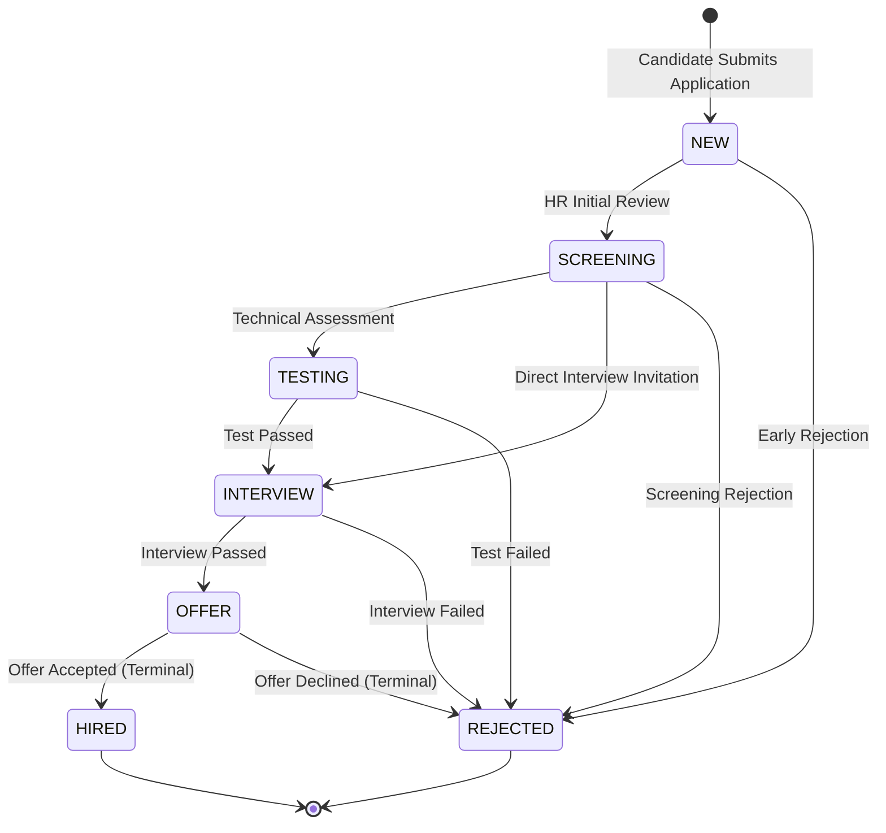

# Application Recruitment Workflow & AI Stub Architecture

> **Author:** Đại Hưng (Backend & Workflow Engineer)  
> **Module:** `com.matchajob.application`  
> **Scope:** Application Boundary, State Machine, Audit History, AI Contract & Deterministic Stub

---

## 1. Recruitment Pipeline State Machine

The recruitment workflow manages application lifecycles from submission to hiring or rejection.



### Transition Invariants
- **Forward-only progression:** Backward transitions (e.g., `INTERVIEW` $\to$ `SCREENING`) are strictly forbidden.
- **Terminal states:** `HIRED` and `REJECTED` are final; no further transitions are allowed.
- **Audit trail:** Every state change records an immutable entry in `application_status_histories`.

---

## 2. API Contract Inventory

| Method | Endpoint | Description | Auth / Role | Status Codes |
|---|---|---|---|---|
| `POST` | `/v1/applications` | Submit application for an active job | Candidate | 201, 400, 404, 409 |
| `PATCH` | `/v1/applications/{id}/stage` | Transition application stage | Employer (HR) | 200, 400, 404 |
| `GET` | `/v1/applications/{id}/history` | Retrieve full transition history | Candidate / Employer | 200, 404 |
| `GET` | `/v1/jobs/{jobId}/applications/ranking` | Ranked candidate list for a job | Employer (HR) | 200, 400 |

### Anti-Duplicate Guarantee
Unique composite index and pre-submission validation prevent candidates from applying multiple times to the same job:
```
(candidate_id, job_id) -> 409 CONFLICT (RFC 7807 Problem Detail)
```

---

## 3. Backend–AI Contract

```
[MatchaJob Backend]                                       [AI Worker]
        │                                                      │
        │  POST /api/v1/cv/extract                             │
        │  Content-Type: multipart/form-data                   │
        │─────────────────────────────────────────────────────>│
        │  200 OK {raw_text, parsed_data, char_count}          │
        │<─────────────────────────────────────────────────────│
        │                                                      │
        │  POST /api/v1/match/score                            │
        │  Body: {job_title, job_requirements, cv_text, ...}   │
        │─────────────────────────────────────────────────────>│
        │  200 OK {overall_score, skills_score, rationale}     │
        │<─────────────────────────────────────────────────────│
```

- **Idempotency Key:** `app_match_{application_id}` in `processing_jobs`.
- **Fault Tolerance:** Non-blocking async queueing with exponential backoff retry.

---

## 4. Deterministic AI Worker Stub

For offline CI/CD and integration testing without external Python FastAPI dependencies:
- **Profile:** `@ActiveProfiles("ai-stub")`
- **Mechanism:** Deterministic Jaccard keyword overlap and SHA-256 seeded vector generation.
- **Output:** Reproducible scores (0–100), structured breakdowns, and rationales.
