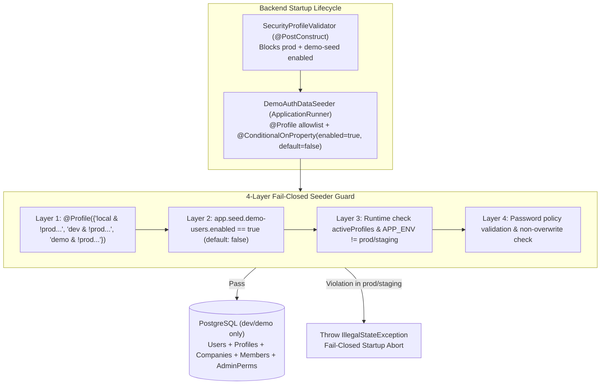

# MatchaJob — Auth/Role Seed, Security Regression & ERD/RBAC Documentation Implementation Plan (v2.0 — Technical Review & Gap Closure)

> **Document Status:** `READY FOR PO REVIEW` (Planning Only — Zero Code/DB/Config Changes Executed)
> **Target Repository Path (Pending PO Approval — see Note Below):** `docs/AUTH_RBAC_SECURITY_IMPLEMENTATION_PLAN.md` *(aligned with root `docs/*.md` convention)* or `docs/plans/AUTH_RBAC_SECURITY_IMPLEMENTATION_PLAN.md` *(requires `.gitignore` allowlist update)*
> **Verified Baseline Commit:** `55322f7a5fbd04d1c7a0f86b8a489fa381312f17` (`main` / `origin/main`)

> [!IMPORTANT]
> **Ghi chú về vị trí lưu file trong Repository (`[VERIFIED]`):**
> Qua kiểm tra thực tế thư mục `docs/` và [`.gitignore`](file:///d:/CongNgheWeb/DoAn/se347_smart_recruitment_platform/.gitignore#L57-L120):
> 1. Thư mục `docs/plans/` **chưa tồn tại** trong repository. Các tài liệu kế hoạch/thiết kế hiện hành đều đặt trực tiếp tại gốc `docs/` theo chuẩn `UPPER_SNAKE_CASE.md` (ví dụ: [`CONTRACT_TEST_PLAN.md`](file:///d:/CongNgheWeb/DoAn/se347_smart_recruitment_platform/docs/CONTRACT_TEST_PLAN.md), [`PHASE3_DESIGN.md`](file:///d:/CongNgheWeb/DoAn/se347_smart_recruitment_platform/docs/PHASE3_DESIGN.md), [`DEPLOYMENT_RUNBOOK.md`](file:///d:/CongNgheWeb/DoAn/se347_smart_recruitment_platform/docs/DEPLOYMENT_RUNBOOK.md)).
> 2. Quan trọng hơn, [`.gitignore:L58`](file:///d:/CongNgheWeb/DoAn/se347_smart_recruitment_platform/.gitignore#L58) đang cấu hình `docs/**` (chặn mặc định toàn bộ file mới trong `docs/`, chỉ mở qua danh sách `!docs/...`), và [`.gitignore:L119`](file:///d:/CongNgheWeb/DoAn/se347_smart_recruitment_platform/.gitignore#L119) đang chặn lại `docs/qa/`.
> 3. Tuân thủ nghiêm ngặt quy tắc *"báo cáo và đề xuất vị trí phù hợp trước khi tạo file"* và không sửa `.gitignore` khi chưa được duyệt, bản kế hoạch hoàn chỉnh này được xuất tại Artifact review và sẽ được ghi vào vị trí PO phê duyệt ở **Mục 19 (PO Decision #1)**.

### Quy ước Phân loại Bằng chứng (Evidence Classification)
- **`[VERIFIED]`**: Đã kiểm chứng trực tiếp từ mã nguồn, migration SQL, `pom.xml`, cấu hình, hoặc lịch sử Git thực tế của repository.
- **`[PROPOSED]`**: Giải pháp kỹ thuật hoặc kiến trúc được đề xuất, chờ Product Owner (PO) phê duyệt trước khi triển khai.
- **`[UNVERIFIED]`**: Chưa thể xác minh chỉ bằng kiểm tra tĩnh/read-only (ví dụ: kết quả thực thi runtime của các test mới chưa viết hoặc trạng thái dữ liệu trên các môi trường triển khai ngoài local repo).

---

## 1. Executive Summary

Kế hoạch kỹ thuật này chuẩn hóa việc triển khai gói công việc **Auth/Role Seed + Security Regression + ERD & RBAC Documentation** cho nền tảng **MatchaJob**, khắc phục triệt để 6 khoảng trống kiến trúc/bảo mật từ bản nháp trước cùng các phát hiện mới qua rà soát mã nguồn:

1. **Demo Auth/Role Seeding an toàn tuyệt đối cho Production (`[PROPOSED]` trên nền `[VERIFIED]`):** Thay thế cơ chế `@Profile("!prod")` lỏng lẻo bằng cơ chế **Fail-Closed 4 lớp** (Allowlist profile tường minh `local`/`dev`/`demo` kết hợp phủ định `!prod & !production & !staging`, cờ opt-in mặc định `false`, kiểm tra chéo `APP_ENV` lúc khởi động trong cả Seeder và `SecurityProfileValidator`, không hardcode mật khẩu trong source/config, không bao giờ ghi đè mật khẩu hoặc trạng thái tài khoản hiện hữu).
2. **Kiến trúc Kiểm thử Hồi quy Phân tách & Tái lập (`[PROPOSED]`):** Tách thành 4 bộ Integration Test độc lập chạy trên PostgreSQL `matchajob_test` thực tế (`DemoAuthDataSeederIT`, `AuthRbacSeedRegressionIT`, `RbacAuthorizationRegressionIT`, `OwnershipSecurityRegressionIT`), kiểm chứng đúng hành vi HTTP status thực tế (`401` / `403` / `404` / `400`) thay vì giả định đồng nhất `403`.
3. **Chiến lược Thực thi Maven Chuẩn xác (`[VERIFIED]` + `[PROPOSED]`):** Khắc phục sai lệch giữa `mvn test` (Surefire loại trừ `**/*IT*`) và `mvn verify` (Failsafe chạy `**/*IT.java` và `**/*IntegrationTest.java`), bắt buộc kiểm chứng số lượng test thực thi qua XML report thay vì chỉ nhìn `BUILD SUCCESS`.
4. **Đồng bộ Tài liệu 100% với Schema V1–V8 & Source (`[VERIFIED]` + `[PROPOSED]`):** Cập nhật ERD phản ánh đủ 31 bảng, 2 views từ Flyway `V1`–`V8` (phân biệt rõ 15 bảng JPA Entity, 4 bảng `JdbcClient`, và 12 bảng schema-only), sơ đồ JWT Flow sát code, và Ma trận RBAC phản ánh cả `Servlet Path` lẫn `External HTTP Path` (bao gồm ngoại lệ `/api/api/v1/recruitment/...`).
5. **Kiểm toán Secret, Git History & Logging Nhạy cảm (`[VERIFIED]` + `[PROPOSED]`):** Xác nhận 0 secret thật trong Git history; phát hiện và lập kế hoạch vá lỗi `GlobalExceptionHandler:132` có khả năng ghi log plaintext `rejected value` của trường `password` khi Bean Validation thất bại.

---

## 2. Verified Repository Baseline

Tất cả thông số dưới đây là **`[VERIFIED]`** tại thời điểm kiểm tra:

| Hạng mục | Giá trị thực tế đã xác minh | Bằng chứng |
| :--- | :--- | :--- |
| **Current Branch** | `feature/jwt-rbac-security-audit-negative-test` | `git branch --show-current` |
| **HEAD Commit** | `55322f7a5fbd04d1c7a0f86b8a489fa381312f17` | Merge PR #47 (`feature/update_6_pnt-...`) |
| **Local `main` / `origin/main`** | `55322f7a5fbd04d1c7a0f86b8a489fa381312f17` | Đồng bộ 100% với `HEAD` (0 commit lệch so với `main`) |
| **Trạng thái nhánh cũ** | `ahead 28` so với `origin/feature/jwt-rbac-security-audit-negative-test` | Nhánh cũ đã được merge vào `main` từ PR #41 (`88bcbe7`), sau đó được fast-forward lên `main` |
| **Modified / Staged Files** | `0` modified, `0` staged | `git status --short` sạch |
| **Untracked Files** | `1` file: `run-security-tests.sh` | Chưa xóa, chưa sửa, chưa stage |
| **Phân tích `run-security-tests.sh`** | Chứa đường dẫn máy cá nhân `JAVA_HOME="/c/Program Files/Eclipse Adoptium/jdk-21.0.13.9-hotspot"` và gọi `./mvnw test -Dtest=...IT` (chỉ chạy 4 file IT qua Surefire override) | Phụ thuộc môi trường cá nhân Windows/Git Bash; **không được đưa vào Git commit** |

### Khuyến nghị Chiến lược Nhánh Git (Git Branch Strategy) — `[PROPOSED]`
- **Không** tiếp tục commit trên `feature/jwt-rbac-security-audit-negative-test` vì PR #41 của nhánh này đã đóng/merge vào `main`, nếu push lên sẽ tạo lịch sử lệch 28 commits hỗn hợp từ `main`.
- **Hành động sau khi PO duyệt kế hoạch:** Tạo nhánh mới trực tiếp từ `main` (`55322f7`):
  ```powershell
  git switch -c feat/auth-role-seed-security-regression-erd main
  ```
- Giữ `run-security-tests.sh` nằm ngoài staging area (hoặc xóa cục bộ nếu chủ máy đồng ý); chỉ dùng `git add <explicit-file-list>` khi commit, tuyệt đối không dùng `git add .` hay `git add -A`.

---

## 3. Existing Architecture & Current State (`[VERIFIED]`)

### 3.1. Xác thực & Phân quyền (Auth, JWT, Filter Chain, Ownership)
- **Password Hashing:** `BCryptPasswordEncoder(10)` khai báo tại [`SecurityConfig.java:L157-L159`](file:///d:/CongNgheWeb/DoAn/se347_smart_recruitment_platform/backend/src/main/java/com/matchajob/security/SecurityConfig.java#L157-L159); giới hạn mật khẩu 8..72 bytes UTF-8 tại [`AuthService.java:L26-L27`](file:///d:/CongNgheWeb/DoAn/se347_smart_recruitment_platform/backend/src/main/java/com/matchajob/auth/service/AuthService.java#L26-L27).
- **JWT Issuance & Validation:** [`JwtTokenProvider.java`](file:///d:/CongNgheWeb/DoAn/se347_smart_recruitment_platform/backend/src/main/java/com/matchajob/security/JwtTokenProvider.java) ký thuật toán `HS256`, **chỉ phát hành đúng 3 claims chuẩn**: `sub` (`userId` UUID), `iat`, `exp` (mặc định `3,600,000 ms` = 1 giờ). Không chứa `email`, `role`, `companyId`; không có Refresh Token hay Redis token blacklist.
- **Per-Request DB Principal Resolution:** [`JwtAuthenticationFilter.java:L55-L109`](file:///d:/CongNgheWeb/DoAn/se347_smart_recruitment_platform/backend/src/main/java/com/matchajob/security/JwtAuthenticationFilter.java#L55-L109) xác thực chữ ký/hạn dùng của token, sau đó truy vấn `userRepository.findById(userId)` **trên mọi request**:
  - Nếu lỗi kết nối DB (`DataAccessException`) → trả thẳng **HTTP 500** `application/problem+json` (không che giấu thành `401`).
  - Chỉ gắn `Authentication` với quyền `ROLE_<UPPER>` (`ROLE_CANDIDATE`, `ROLE_EMPLOYER`, `ROLE_ADMIN`) khi đồng thời thỏa: `user != null`, `deletedAt == null`, `"active".equalsIgnoreCase(status)`, `!(requireEmailVerification && Boolean.FALSE.equals(isVerified))`, và `role` thuộc tập hợp lệ.
  - Hệ quả thiết kế: khi Admin khóa tài khoản (`status = 'suspended'`), mọi JWT đã cấp trước đó bị từ chối `401` ngay lập tức ở request kế tiếp mà không cần stateful blacklist.
- **Multi-Layer Authorization:**
  1. **URL-level:** [`SecurityConfig.java:L55-L104`](file:///d:/CongNgheWeb/DoAn/se347_smart_recruitment_platform/backend/src/main/java/com/matchajob/security/SecurityConfig.java#L55-L104) áp dụng `deny-by-default` (`anyRequest().authenticated()`).
  2. **Method-level:** `@EnableMethodSecurity` + `@PreAuthorize` trên `AdminUserController`, `AdminStatsController`, `CandidateProfileController`, `CompanyController`, `UserController`.
  3. **Resource Ownership-level:** [`ResourceOwnershipService.java`](file:///d:/CongNgheWeb/DoAn/se347_smart_recruitment_platform/backend/src/main/java/com/matchajob/security/ResourceOwnershipService.java) kiểm tra quyền sở hữu trực tiếp bằng SQL qua `JdbcClient` cho `candidate_profiles`, `companies` (`owner_id` hoặc `company_members`), `jobs`, `applications`, `cv_versions` (kèm kiểm tra `application_cv_snapshots`), và `processing_jobs`.
- **Startup Profile Guard:** [`SecurityProfileValidator.java`](file:///d:/CongNgheWeb/DoAn/se347_smart_recruitment_platform/backend/src/main/java/com/matchajob/security/SecurityProfileValidator.java) kiểm tra chéo biến môi trường `APP_ENV` và `spring.profiles.active`, chặn khởi động `prod` nếu thiếu `APP_ENV=production`, tắt `require-email-verification`, hoặc dùng `DEFAULT_DEV_JWT_SECRET`.

### 3.2. Hiện trạng Seed Data & Database Migrations
- Flyway quản lý 8 file migration từ [`V1__init_extensions.sql`](file:///d:/CongNgheWeb/DoAn/se347_smart_recruitment_platform/backend/src/main/resources/db/migration/V1__init_extensions.sql) đến [`V8__seed_demo_data.sql`](file:///d:/CongNgheWeb/DoAn/se347_smart_recruitment_platform/backend/src/main/resources/db/migration/V8__seed_demo_data.sql), chạy trên **mọi profile** (`dev`, `prod`, `test`) với `hibernate.ddl-auto: validate` và `flyway.validate-on-migrate: true`.
- Tồn tại 3 cơ chế seed rời rạc trong repo:
  1. [`V8__seed_demo_data.sql`](file:///d:/CongNgheWeb/DoAn/se347_smart_recruitment_platform/backend/src/main/resources/db/migration/V8__seed_demo_data.sql): Seed 8 categories, 20 skills, 1 employer không thể đăng nhập (`employer-seed@matchajob.vn`), 1 công ty (`MatchaJob Demo Corp`), 14 jobs, 17 `job_skills`, **0 `company_members`**.
  2. [`DataSeeder.java`](file:///d:/CongNgheWeb/DoAn/se347_smart_recruitment_platform/backend/src/main/java/com/matchajob/api/recruitment/config/DataSeeder.java): `@Profile("!prod")`, chỉ chạy khi `categories`/`skills` trống (thực tế trở thành no-op sau khi `V8` chạy).
  3. [`scripts/seed-pipeline-regression.sql`](file:///d:/CongNgheWeb/DoAn/se347_smart_recruitment_platform/scripts/seed-pipeline-regression.sql) & [`scripts/seed-large-demo-jobs.sql`](file:///d:/CongNgheWeb/DoAn/se347_smart_recruitment_platform/scripts/seed-large-demo-jobs.sql): Các script SQL chạy tay; trong đó `seed-pipeline-regression.sql` đang chứa một số tên cột lệch với schema `V2`/`V3`/`V6` (`categories.slug`, `candidate_profiles.title/city`, `cv_versions.sha256Hash/active`).

---

## 4. Confirmed Gaps (`[VERIFIED]`)

| Mã Gap | Hạng mục | Phát hiện Thực tế Đã Xác minh (`[VERIFIED]`) | Mức độ Rủi ro |
| :--- | :--- | :--- | :--- |
| **GAP 1** | Demo Seeder Profile & Prod Safety | `@Profile("!prod")` (đang dùng ở `DataSeeder.java`) cho phép chạy trên `staging`, `uat`, `test` hoặc container cấu hình sai tên profile; `application.yml` mặc định active profile là `dev`, nên nếu seeder bật mặc định trong `dev` mà không có cơ chế opt-in + runtime guard sẽ dễ vô tình seed tài khoản demo trên môi trường public. | **CRITICAL** (nếu thiết kế sai) |
| **GAP 2** | Demo Password Management | Đề xuất cũ đặt mật khẩu mặc định cố định trong cấu hình/code dễ dẫn tới credential dùng chung trên môi trường demo chia sẻ; chưa định nghĩa quy tắc cấm ghi đè mật khẩu/trạng thái khi email đã tồn tại. | **HIGH** |
| **GAP 3** | Regression Test Architecture & Status Codes | Các test hiện tại như [`ApplicationOwnershipSecurityIT`](file:///d:/CongNgheWeb/DoAn/se347_smart_recruitment_platform/backend/src/test/java/com/matchajob/security/ApplicationOwnershipSecurityIT.java) và [`InterviewSecurityIT`](file:///d:/CongNgheWeb/DoAn/se347_smart_recruitment_platform/backend/src/test/java/com/matchajob/security/InterviewSecurityIT.java) dùng `@MockBean` cho tầng service/ownership nên chưa kiểm chứng SQL thực của `ResourceOwnershipService` trên một số nhánh; đồng thời HTTP status khi không tồn tại vs không sở hữu khác nhau theo từng endpoint (`403` vs `404` vs `400`). | **HIGH** |
| **GAP 4** | Maven Surefire vs Failsafe | [`pom.xml:L180-L211`](file:///d:/CongNgheWeb/DoAn/se347_smart_recruitment_platform/backend/pom.xml#L180-L211) loại trừ `**/*IT*` khỏi `mvn test` (Surefire) và chỉ chạy `**/*IT.java` ở `mvn verify` (Failsafe). Ngoài ra [`JobQueryPerformanceAndStatsTest.java`](file:///d:/CongNgheWeb/DoAn/se347_smart_recruitment_platform/backend/src/test/java/com/matchajob/api/recruitment/service/JobQueryPerformanceAndStatsTest.java) dùng `@SpringBootTest` nhưng đặt tên `*Test.java`. | **HIGH** |
| **GAP 5** | ERD, Path, JWT & RBAC Docs Drift | [`ERD_v2.md`](file:///d:/CongNgheWeb/DoAn/se347_smart_recruitment_platform/docs/ERD_v2.md) dừng ở `V1–V3` (5 bảng), thiếu `V4–V8` (tổng 31 bảng, 2 views). [`TaxonomyController`](file:///d:/CongNgheWeb/DoAn/se347_smart_recruitment_platform/backend/src/main/java/com/matchajob/api/recruitment/controller/TaxonomyController.java) và [`StatsController`](file:///d:/CongNgheWeb/DoAn/se347_smart_recruitment_platform/backend/src/main/java/com/matchajob/api/recruitment/controller/StatsController.java) khai báo `/api/v1/...` kết hợp `context-path: /api` tạo ra external URL `/api/api/v1/...`. `application-dev.yml:L43` hardcode `require-email-verification: false` ghi đè env `REQUIRE_EMAIL_VERIFICATION`. | **MEDIUM** |
| **GAP 6** | Secret, `.gitignore` & Logging Audit | Git history sạch secret thật, nhưng [`GlobalExceptionHandler.java:L132`](file:///d:/CongNgheWeb/DoAn/se347_smart_recruitment_platform/backend/src/main/java/com/matchajob/common/exception/GlobalExceptionHandler.java#L132) log `ex.getMessage()` của `MethodArgumentNotValidException` làm lộ plaintext `rejected value` của `RegisterRequest.password` trong log! Ngoài ra `.gitignore` đang chặn `docs/**` và `docs/qa/`. | **MEDIUM / HIGH** |
| **GAP 7** | Legacy `V8` Demo Account | `employer-seed@matchajob.vn` trong `V8` có dummy hash không thể login và thiếu `company_members` (khiến `findActiveCompanySummariesByUserId` trả về `[]`), đang đứng tên sở hữu `MatchaJob Demo Corp` và 14 jobs mẫu. | **MEDIUM** |

---

## 5. Proposed Architecture Overview (`[PROPOSED]`)



---

## 6. Demo Seeder Security Design (Closure of GAP 1)

- **Hiện trạng (`[VERIFIED]`):** [`DataSeeder.java:L16`](file:///d:/CongNgheWeb/DoAn/se347_smart_recruitment_platform/backend/src/main/java/com/matchajob/api/recruitment/config/DataSeeder.java#L16) chỉ dùng `@Profile("!prod")`. [`application.yml:L13`](file:///d:/CongNgheWeb/DoAn/se347_smart_recruitment_platform/backend/src/main/resources/application.yml#L13) đặt mặc định `spring.profiles.active: ${SPRING_PROFILES_ACTIVE:dev}`. [`SecurityProfileValidator.java`](file:///d:/CongNgheWeb/DoAn/se347_smart_recruitment_platform/backend/src/main/java/com/matchajob/security/SecurityProfileValidator.java) mới chỉ chặn `DEFAULT_DEV_JWT_SECRET` và `require-email-verification=false` trên `prod`.
- **Vấn đề:**
  1. `@Profile("!prod")` cho phép bean khởi tạo trong `staging`, `uat`, `test`, hoặc khi người vận hành gõ nhầm `SPRING_PROFILES_ACTIVE=production` thay vì `prod`.
  2. Nếu bật mặc định `app.seed.demo-users.enabled=true` trong `application-dev.yml`, bất kỳ container nào quên truyền `SPRING_PROFILES_ACTIVE` sẽ rơi về `dev` và tự động tạo tài khoản Admin demo.
  3. Nếu seeder chạy trong profile `test`, nó sẽ chèn dữ liệu ngoài ý muốn vào `matchajob_test` trước mọi `@SpringBootTest`.
- **Giải pháp đề xuất (`[PROPOSED]`):**
  1. Tạo `DemoSeedProperties` (`@ConfigurationProperties(prefix = "app.seed.demo-users")`) với mặc định `enabled = false`.
  2. Tạo `DemoAuthDataSeeder` thực thi `ApplicationRunner` với 4 chốt chặn độc lập:
     - **Chốt 1 — Explicit Profile Allowlist kèm Negation:**
       ```java
       @Profile({
           "local & !prod & !production & !staging & !test",
           "dev & !prod & !production & !staging & !test",
           "demo & !prod & !production & !staging & !test"
       })
       ```
       Đảm bảo kể cả khi truyền tổ hợp `SPRING_PROFILES_ACTIVE=dev,prod` hoặc chạy `test`/`staging`, bean vẫn **không bao giờ** được khởi tạo.
     - **Chốt 2 — Explicit Opt-In Property (Default Disabled):**
       ```java
       @ConditionalOnProperty(
           prefix = "app.seed.demo-users",
           name = "enabled",
           havingValue = "true",
           matchIfMissing = false
       )
       ```
       Trong **mọi** file `application.yml`, `application-dev.yml`, `application-prod.yml`, `application-test.yml`, giá trị mặc định trong repo là `false` (`${DEMO_SEED_ENABLED:false}` ở `dev`, và cứng `false` ở `prod`/`test`). Muốn seed phải bật tường minh `DEMO_SEED_ENABLED=true` trong `.env` local hoặc lệnh khởi chạy demo.
     - **Chốt 3 — Runtime Fail-Closed Check trong `DemoAuthDataSeeder.run()`:**
       Kiểm tra trực tiếp `Environment.getActiveProfiles()` và `System.getenv("APP_ENV")`:
       - Nếu không có ít nhất một profile thuộc `{"local", "dev", "demo"}`, HOẶC xuất hiện bất kỳ profile nào ngoài danh sách cho phép (`prod`, `production`, `staging`, `uat`, `preprod`), HOẶC `APP_ENV` mang giá trị `prod`/`production`/`staging` → **ném `IllegalStateException` dừng ứng dụng ngay lập tức**, không thực thi bất kỳ câu lệnh DB nào.
     - **Chốt 4 — Mở rộng `SecurityProfileValidator.validate()`:**
       Bổ sung quy tắc: nếu `isSpringProfileProd` hoặc `isMarkerProd` mà `environment.getProperty("app.seed.demo-users.enabled", Boolean.class, false)` là `true` → **ném `IllegalStateException("FATAL CONFIGURATION: Demo user seeding cannot be enabled in production!")`** ngay cả khi bean `DemoAuthDataSeeder` đã bị chặn bởi `@Profile`.
- **Lý do:** Đảm bảo nguyên tắc Defense-in-Depth & Fail-Closed: dù cấu hình sai 1 biến môi trường, production và staging vẫn không thể tạo tài khoản demo, và suite test `matchajob_test` không bị nhiễu dữ liệu.
- **File/Module liên quan:**
  - Tạo mới: `backend/src/main/java/com/matchajob/security/seed/DemoSeedProperties.java`
  - Tạo mới: `backend/src/main/java/com/matchajob/security/seed/DemoAuthDataSeeder.java`
  - Cập nhật: `backend/src/main/java/com/matchajob/security/SecurityProfileValidator.java`
  - Cập nhật: `backend/src/main/resources/application.yml`, `application-dev.yml`, `application-prod.yml`, `backend/src/test/resources/application-test.yml`
- **Cách xác minh:** Unit test trong `SecurityProfileValidatorTest` (kịch bản `prod` + `app.seed.demo-users.enabled=true` ném `IllegalStateException`) + Integration test `DemoAuthDataSeederIT` xác nhận seeder tắt mặc định ở `test` và chỉ chạy khi bật tường minh.
- **Rủi ro nếu không xử lý:** Lộ tài khoản quyền `ADMIN` biết trước trên môi trường public/staging/production dẫn tới chiếm quyền điều khiển hệ thống hoàn toàn.

---

## 7. Demo Password Management (Closure of GAP 2)

- **Hiện trạng (`[VERIFIED]`):** [`SecurityConfig.java:L158`](file:///d:/CongNgheWeb/DoAn/se347_smart_recruitment_platform/backend/src/main/java/com/matchajob/security/SecurityConfig.java#L158) dùng `BCryptPasswordEncoder(10)`. [`.env.example:L27`](file:///d:/CongNgheWeb/DoAn/se347_smart_recruitment_platform/.env.example#L27) đang dùng mẫu an toàn `POSTGRES_PASSWORD=replace_with_private_demo_password`.
- **Vấn đề:**
  1. Hardcode mật khẩu mặc định dùng được ngay (như `MatchaAdmin@2026!`) trong Java code, `application-dev.yml` hoặc `.env.example` khiến mật khẩu nằm vĩnh viễn trong Git history và Docker image.
  2. Chạy lại ứng dụng nhiều lần nếu dùng `ON CONFLICT DO UPDATE SET password_hash = ...` sẽ ghi đè mật khẩu hoặc khôi phục trái phép tài khoản đã bị Admin khóa.
- **Giải pháp đề xuất (`[PROPOSED]`):**
  1. **Không hardcode bất kỳ mật khẩu dùng được nào trong Java code, `application*.yml` hay `.env.example`:**
     - Các biến cấu hình nhận mật khẩu từ môi trường:
       - `app.seed.demo-users.admin-password: ${DEMO_ADMIN_PASSWORD:}`
       - `app.seed.demo-users.employer-password: ${DEMO_EMPLOYER_PASSWORD:}`
       - `app.seed.demo-users.candidate-password: ${DEMO_CANDIDATE_PASSWORD:}`
     - Trong `.env.example`, chỉ ghi giá trị placeholder không hợp lệ:
       ```dotenv
       DEMO_SEED_ENABLED=false
       DEMO_ADMIN_PASSWORD=replace_with_local_demo_admin_password
       DEMO_EMPLOYER_PASSWORD=replace_with_local_demo_employer_password
       DEMO_CANDIDATE_PASSWORD=replace_with_local_demo_candidate_password
       ```
  2. **Chính sách kiểm tra mật khẩu khi `app.seed.demo-users.enabled=true`:**
     - Mật khẩu bắt buộc phải được cung cấp qua biến môi trường / `.env` cục bộ (không được rỗng, không được bắt đầu bằng `replace_with_`, không trùng danh sách mật khẩu yếu phổ biến `password`, `12345678`, `changeme`, độ dài **12..72 bytes UTF-8**, có chữ hoa, chữ thường, chữ số và ký tự đặc biệt).
     - Nếu `enabled=true` nhưng thiếu mật khẩu hoặc còn giữ nguyên placeholder `replace_with_...`:
       - Trên môi trường chia sẻ (`profile=demo` hoặc `APP_ENV=demo`): **Fail-fast** (`IllegalStateException`) yêu cầu cấu hình secret hợp lệ.
       - Trên môi trường máy cá nhân (`local`/`dev`): **Fail-fast** với thông báo hướng dẫn rõ ràng cấu hình `DEMO_*_PASSWORD` trong `.env` cục bộ *(hoặc theo quyết định PO tại Mục 19)*.
     - Băm mật khẩu động lúc runtime qua bean `PasswordEncoder` (`BCryptPasswordEncoder(10)`).
  3. **Quy tắc Lần chạy đầu vs Các lần chạy tiếp theo (Strict Non-Overwrite Idempotency):**
     - **Lần chạy đầu (Email chưa tồn tại trong `users`):**
       - Khởi tạo trong `@Transactional`: tạo `User` + bảng phụ thuộc tương ứng (`admin_permissions` cho Admin; `Company` + `CompanyMember(role='owner')` cho Employer; `CandidateProfile` cho Candidate).
     - **Các lần chạy tiếp theo (Email đã tồn tại trong `users`):**
       - **TUYỆT ĐỐI KHÔNG** cập nhật `password_hash`, `role`, `status`, `is_verified`, hay `deleted_at` của tài khoản đã tồn tại (đảm bảo nếu Admin đã khóa thử nghiệm một tài khoản demo hoặc người dùng đã đổi thông tin, việc restart backend không mở khóa lại hoặc reset mật khẩu!).
       - Kiểm tra tính nhất quán: nếu bản ghi hiện hữu có `role` khác với role kỳ vọng của tài khoản demo hoặc `deleted_at != null` → **không sửa dữ liệu**, ghi `log.warn` cảnh báo xung đột dữ liệu bằng `userId` + `role` hiện tại và bỏ qua bản ghi đó.
       - Nếu bản ghi hợp lệ (`role` khớp, `deleted_at == null`) nhưng thiếu bản ghi liên kết bắt buộc do lỗi gián đoạn trước đó (ví dụ Candidate chưa có `candidate_profiles`, hoặc công ty demo deterministic chưa có `company_members`), chỉ bổ sung bản ghi liên kết còn thiếu một cách an toàn.
  4. **Chính sách Zero-Credential Logging:**
     - Chỉ log `userId`, `role`, và số lượng tài khoản tạo mới vs bỏ qua (`seeded=X, skippedExisting=Y`). Tuyệt đối không log `rawPassword`, `passwordHash`, độ dài mật khẩu hay token.
- **File/Module liên quan:** `DemoSeedProperties.java`, `DemoAuthDataSeeder.java`, `.env.example`, `compose.yaml`.
- **Cách xác minh:** `DemoAuthDataSeederIT` kiểm tra: (1) thiếu/placeholder password khi `enabled=true` bị từ chối; (2) hash sinh ra là BCrypt `$2a$10$...` khớp `passwordEncoder.matches`; (3) đổi `passwordHash` hoặc `status='suspended'` trong DB rồi chạy lại `DemoAuthDataSeeder.run()` → `passwordHash` và `status` giữ nguyên 100%, không bị ghi đè.
- **Rủi ro nếu không xử lý:** Lộ mật khẩu mặc định qua GitHub public repo hoặc vô tình mở khóa lại tài khoản đã bị Admin đình chỉ sau mỗi lần redeploy.

---

## 8. Regression Test Architecture (Closure of GAP 3)

- **Hiện trạng (`[VERIFIED]`):**
  - Đã có sẵn các test đơn lẻ tốt cho một số luồng: [`JwtSecurityNegativeIT`](file:///d:/CongNgheWeb/DoAn/se347_smart_recruitment_platform/backend/src/test/java/com/matchajob/security/JwtSecurityNegativeIT.java), [`AdminUserSecurityIT`](file:///d:/CongNgheWeb/DoAn/se347_smart_recruitment_platform/backend/src/test/java/com/matchajob/security/AdminUserSecurityIT.java), [`AdminAndUserHttpE2EIT`](file:///d:/CongNgheWeb/DoAn/se347_smart_recruitment_platform/backend/src/test/java/com/matchajob/security/AdminAndUserHttpE2EIT.java), [`CompanyOwnershipSecurityIT`](file:///d:/CongNgheWeb/DoAn/se347_smart_recruitment_platform/backend/src/test/java/com/matchajob/security/CompanyOwnershipSecurityIT.java), [`EmployerJobOwnershipIT`](file:///d:/CongNgheWeb/DoAn/se347_smart_recruitment_platform/backend/src/test/java/com/matchajob/security/EmployerJobOwnershipIT.java).
  - Tuy nhiên, [`ApplicationOwnershipSecurityIT`](file:///d:/CongNgheWeb/DoAn/se347_smart_recruitment_platform/backend/src/test/java/com/matchajob/security/ApplicationOwnershipSecurityIT.java) và [`InterviewSecurityIT`](file:///d:/CongNgheWeb/DoAn/se347_smart_recruitment_platform/backend/src/test/java/com/matchajob/security/InterviewSecurityIT.java) đang dùng `@MockBean` cho `ResourceOwnershipService` / `ApplicationService` / `InterviewService`, nên chưa kiểm thử truy vấn SQL thật của `ResourceOwnershipService` cho Application, Match, ProcessingJob, Interview và CV Snapshot trên DB thật.
  - Ngoài ra, hành vi HTTP status thực tế trong mã nguồn **không đồng nhất là `403` cho mọi trường hợp**:
    - `PUT/PATCH /v1/companies/{id}`: kiểm tra `canEmployerManageCompany` **trước** khi kiểm tra tồn tại → trả **`403 Forbidden`** cho cả công ty của người khác lẫn UUID không tồn tại (chống dò quét UUID).
    - `GET /v1/companies/{id}` (Public): công ty không tồn tại hoặc đã soft-delete ném `IllegalArgumentException` → `GlobalExceptionHandler` trả **`400 Bad Request`** (`invalid-request`).
    - `PUT/PATCH/DELETE /v1/employer/jobs/{id}`: `checkEmployerJobOwnership` kiểm tra tồn tại trước → trả **`404 Not Found`** nếu job không tồn tại/đã xóa mềm, và **`403 Forbidden`** nếu job thuộc công ty khác.
    - `GET/PATCH /v1/applications/{id}/...` & `GET/POST /v1/applications/{id}/match`: `checkApplicationAccess` trả **`404 Not Found`** (`NoSuchElementException`) nếu đơn không tồn tại, và **`403 Forbidden`** nếu đơn của người khác.
    - `GET /v1/candidates/{candidateId}/cv/{cvVersionId}` & `/download`: kiểm tra quyền trên `candidateId`/`cvVersionId` **trước** khi đọc file → nếu `candidateId` là của ứng viên khác (hoặc Employer không nhận đơn kèm snapshot đó), trả **`403 Forbidden`** ngay lập tức kể cả khi `cvVersionId` không tồn tại (chống dò quét CV); chỉ khi chính chủ `candidateId` (hoặc `ADMIN`) truy vấn `cvVersionId` không tồn tại mới trả **`404 Not Found`**.
    - `InterviewController`: `GET /v1/interviews/{id}` bắt `IllegalArgumentException` chuyển thành **`404 Not Found`** khi không tìm thấy, trong khi `PUT/PATCH/DELETE /v1/interviews/{id}` chuyển `IllegalArgumentException` thành **`400 Bad Request`**, và trả **`403 Forbidden`** khi lịch phỏng vấn thuộc job của công ty khác.
- **Vấn đề:** Gom toàn bộ test vào một class khổng lồ sẽ khó bảo trì, trộn lẫn context có/không có seeder, và nếu viết assertion cứng `403` mà không theo đúng hành vi thực tế sẽ gây false-failure hoặc buộc sửa API ngoài phạm vi.
- **Giải pháp đề xuất (`[PROPOSED]`): Thiết kế 4 class `*IT.java` tách biệt theo đúng ranh giới trách nhiệm, chạy trên `matchajob_test` thực tế (KHÔNG dùng `@MockBean` cho tầng Security/Ownership/Repository):**

  | Test Class (`backend/src/test/java/com/matchajob/security/`) | Phạm vi Kiểm thử Chính (Không trùng lặp dư thừa với unit test cũ) | Cơ chế Cô lập Dữ liệu (Test Isolation) |
  | :--- | :--- | :--- |
  | **1. `DemoAuthDataSeederIT`** | • Khởi chạy `DemoAuthDataSeeder` với test secret hợp lệ.<br/>• Xác minh đủ 6 tài khoản demo (`admin`, `employer1`, `employer2`, `candidate1`, `candidate2`, `suspended`), đúng `role`, `status`, `is_verified`, `admin_permissions`, `companies` + `company_members(owner)`, `candidate_profiles`.<br/>• Idempotency: gọi `run()` lần 2 không sinh duplicate, số lượng row giữ nguyên.<br/>• Non-overwrite: đổi hash/status của tài khoản đã seed rồi chạy lại `run()` → dữ liệu cũ được bảo toàn.<br/>• Conflict safety: tạo sẵn user trùng email nhưng khác role → seeder bỏ qua an toàn, không sửa role.<br/>• Reject weak/placeholder password khi `enabled=true`. | `@SpringBootTest` + `@ActiveProfiles("test")` + `@Transactional` (rollback sạch sau mỗi `@Test`, kèm `flush()`). |
  | **2. `AuthRbacSeedRegressionIT`** | • Luồng E2E HTTP qua `MockMvc` sử dụng dữ liệu từ `DemoAuthDataSeeder`:<br/>  - `POST /v1/auth/login` thành công cho `admin`, `employer1`, `candidate1`; sai password → `401 INVALID_CREDENTIALS`; tài khoản `suspended` → `401 ACCOUNT_SUSPENDED`.<br/>  - `GET /v1/users/me`: `employer1` nhận mảng `companies` chứa công ty sở hữu (`membership_role="owner"`), `candidate1` nhận `companies: []`.<br/>  - Token hết hạn, sai chữ ký, `alg:none`, user đã `deleted_at != null` → `401` ProblemDetail.<br/>  - Khóa tài khoản tức thì: Admin khóa `candidate1` → JWT cũ của `candidate1` bị chặn `401` ngay lập tức + đăng nhập lại trả `401 ACCOUNT_SUSPENDED` → Admin mở khóa → truy cập lại `200`.<br/>  - Bảo vệ Admin cuối cùng: thử khóa Admin đang hoạt động duy nhất → **`400 LAST_ADMIN_PROTECTED`** (bổ sung gap chưa có trong `AdminUserSecurityIT`). | `@SpringBootTest` + `@AutoConfigureMockMvc` + `@ActiveProfiles("test")` + `@Transactional` (mọi thay đổi rollback sau từng test method, không phụ thuộc thứ tự chạy). |
  | **3. `RbacAuthorizationRegressionIT`** | • Ma trận sai Role (Wrong-Role Matrix) trên context thật:<br/>  - `CANDIDATE` gọi các route Employer (`/v1/companies`, `/v1/companies/me`, `/v1/employer/jobs`, `/v1/interviews`, `PATCH /v1/applications/{id}/stage`) & Admin (`/v1/admin/users`, `/v1/admin/stats/jobs`, `POST/DELETE /api/v1/recruitment/taxonomies/categories`) → `403 FORBIDDEN`.<br/>  - `EMPLOYER` gọi các route Candidate (`/v1/candidates/profile`, `POST /v1/applications`, `GET /v1/applications`, `POST/GET/PUT /v1/candidates/{id}/cv...`) & Admin → `403 FORBIDDEN`.<br/>  - `ADMIN` gọi các route nghiệp vụ riêng của Candidate (`/v1/candidates/profile`, `POST /v1/applications`, `GET /v1/applications`) và Employer (`/v1/companies/me`, `/v1/employer/jobs`, `/v1/interviews`) → `403 FORBIDDEN`.<br/>• Chống leo thang đặc quyền (Privilege Escalation):<br/>  - `POST /v1/auth/register` với `role="ADMIN"` → `400 INVALID_REGISTRATION_ROLE`.<br/>  - `PATCH /v1/users/me` gửi kèm JSON `role: "admin"`, `status: "active"`, `isVerified: true`, `email: "hack@..."` → các trường nhạy cảm bị bỏ qua, DB giữ nguyên.<br/>  - `POST /v1/companies` gửi kèm `ownerId` giả mạo và `isVerified: true` → DB lưu `owner_id = principal` và `is_verified = false`. | Chia sẻ cùng cấu hình `@SpringBootTest` + `@AutoConfigureMockMvc` + `@ActiveProfiles("test")` + `@Transactional` để Spring tái sử dụng ApplicationContext cache, chạy nhanh và độc lập 100%. |
  | **4. `OwnershipSecurityRegressionIT`** | • Kiểm thử IDOR / Truy cập chéo trên **DB PostgreSQL thật + `ResourceOwnershipService` thật** (bù đắp hoàn toàn chỗ `ApplicationOwnershipSecurityIT` & `InterviewSecurityIT` đang mock):<br/>  - **Cross-Employer:** `Employer 2` đọc/sửa/xóa công ty, job, danh sách ứng viên, bảng xếp hạng (`ranking`), chuyển stage đơn ứng tuyển, xem/tạo/sửa/hủy lịch phỏng vấn của `Employer 1` → `403 FORBIDDEN`; xác minh cả mã `404`/`400` đúng thực tế khi resource không tồn tại.<br/>  - **Cross-Candidate & CV Snapshot Access:** `Candidate 2` xem/upload/kích hoạt/tải CV hoặc xem đơn/lịch sử/match/processing-job của `Candidate 1` → `403 FORBIDDEN` (kể cả truyền `cvVersionId` ngẫu nhiên vẫn nhận `403`, không lộ `404`).<br/>  - **Scoped Employer CV Read:** `Employer 1` đọc được `cvVersion1` đã nộp trong `application_cv_snapshots` (`200`), nhưng bị chặn `403` khi cố đọc `cvVersion2` mới của cùng `Candidate 1` chưa nộp cho job của mình; `Employer 2` bị chặn `403` trên cả hai.<br/>  - **Audited Admin CV Read:** `ADMIN` đọc metadata CV của `Candidate 1` nhận `200` và ghi đúng bản ghi `VIEW_CV_METADATA` vào bảng `audit_logs`, nhưng bị chặn `403` nếu cố `PUT .../active` hoặc `POST .../cv`. | `@SpringBootTest` + `@AutoConfigureMockMvc` + `@ActiveProfiles("test")` + `@Transactional` + thư mục CV tạm `@TempDir` (hoặc cleanup file tạm trong `@AfterEach`) để không để lại file rác trên ổ đĩa. |

- **Cách xác minh:** Kiểm tra `target/failsafe-reports/failsafe-summary.xml` đảm bảo cả 4 class được Failsafe phát hiện và thực thi 100% test cases với `0 failures, 0 errors, 0 skipped`.
- **Rủi ro nếu không xử lý:** Lỗ hổng SQL trong `ResourceOwnershipService` bị che khuất bởi `@MockBean`, hoặc test flakey do tranh chấp dữ liệu giữa các lần chạy.

---

## 9. Maven Test Execution Strategy (Closure of GAP 4)

- **Hiện trạng (`[VERIFIED]` từ [`backend/pom.xml:L180-L211`](file:///d:/CongNgheWeb/DoAn/se347_smart_recruitment_platform/backend/pom.xml#L180-L211) & [`.github/workflows/demo-checks.yml:L62`](file:///d:/CongNgheWeb/DoAn/se347_smart_recruitment_platform/.github/workflows/demo-checks.yml#L62)):**
  1. **`*Test.java` chạy ở phase `test`** bởi `maven-surefire-plugin`, với cấu hình loại trừ:
     ```xml
     <excludes>
         <exclude>**/*IT*</exclude>
         <exclude>**/*IntegrationTest*</exclude>
     </excludes>
     ```
  2. **`**/*IT.java` và `**/*IntegrationTest.java` chạy ở phase `integration-test` và kiểm tra kết quả ở phase `verify`** bởi `maven-failsafe-plugin`.
  3. **Trả lời xác minh trực tiếp:**
     - *Lệnh `mvn test` có chạy Integration Tests không?* → **KHÔNG.** Chạy `./mvnw test` bỏ qua toàn bộ 19 class `*IT.java` và `*IntegrationTest.java`.
     - *Lệnh `mvn verify` có thực thi đúng các Integration Tests không?* → **CÓ**, miễn là PostgreSQL `matchajob_test` đang sẵn sàng (đúng như CI `demo-checks.yml` đang chạy `mvn -B verify` với container `pgvector/pgvector:pg16` port `5432`, trong khi `application-test.yml` mặc định kết nối `localhost:5433/matchajob_test` nếu không truyền `SPRING_TEST_DATASOURCE_URL`).
     - *Phát hiện phụ quan trọng (`[VERIFIED]`):*
       - Class [`JobQueryPerformanceAndStatsTest.java`](file:///d:/CongNgheWeb/DoAn/se347_smart_recruitment_platform/backend/src/test/java/com/matchajob/api/recruitment/service/JobQueryPerformanceAndStatsTest.java) dùng `@SpringBootTest` (cần PostgreSQL `matchajob_test`) nhưng lại đặt hậu tố `*Test.java`, khiến lệnh `./mvnw test` toàn cục cũng đòi kết nối DB.
       - Mẫu loại trừ `<exclude>**/*IT*</exclude>` của Surefire khớp theo chuỗi con `IT`, trong khi Failsafe chỉ nhận hậu tố `*IT.java` / `*IntegrationTest.java` → **quy tắc bắt buộc khi đặt tên class mới:** Unit test tuyệt đối không chứa cụm chữ hoa `IT` ở giữa tên; Integration test bắt buộc kết thúc bằng `IT.java`.
- **Giải pháp thực thi không cần sửa `pom.xml` (`[PROPOSED]`):**
  1. **Lệnh 1 — Chạy riêng Unit & WebMvc Slice Tests (không cần DB, chạy qua Surefire):**
     ```powershell
     cd backend
     .\mvnw.cmd test -Dtest="AuthControllerTest,AuthServiceTest,JwtTokenProviderTest,JwtAuthenticationFilterTest,SecurityProfileValidatorTest,ResourceOwnershipServiceTest,SecurityFilterChainMockMvcTest,SwaggerDevProfileAccessTest,SwaggerProdProfileAccessTest,CvSecurityHttpTest"
     ```
  2. **Lệnh 2 — Chạy toàn bộ Security & Auth/RBAC Integration Tests (chạy qua Failsafe `verify` trên DB cô lập `matchajob_test`):**
     ```powershell
     cd backend
     .\mvnw.cmd verify -Dtest=none -Dsurefire.failIfNoSpecifiedTests=false -Dit.test="DemoAuthDataSeederIT,AuthRbacSeedRegressionIT,RbacAuthorizationRegressionIT,OwnershipSecurityRegressionIT,JwtSecurityNegativeIT,AdminUserSecurityIT,AdminAndUserHttpE2EIT,CompanyOwnershipSecurityIT,EmployerJobOwnershipIT,ApplicationOwnershipSecurityIT,InterviewSecurityIT,TaxonomySecurityIT,RecruitmentRouteSecurityIT,PayloadValidationSecurityIT,SecurityRouteIntegrationTest"
     ```
  3. **Lệnh 3 — Full CI Parity Gate (trước khi nghiệm thu hoàn tất):**
     ```powershell
     cd backend
     .\mvnw.cmd -B verify
     ```
  4. **Quy tắc Chống Dương tính Giả (Anti-False-Positive Verification):**
     - Không bao giờ kết luận PASS chỉ dựa trên dòng `BUILD SUCCESS`.
     - Bắt buộc trích xuất số liệu thực tế từ `backend/target/surefire-reports/TEST-*.xml` và `backend/target/failsafe-reports/failsafe-summary.xml` (cùng từng file `TEST-*IT.xml`), xác nhận `completed > 0`, `errors == 0`, `failures == 0`, `skipped == 0` và ghi bảng tổng hợp số lượng test theo từng class vào báo cáo QA.

---

## 10. ERD Documentation Scope (Closure of GAP 5 — Part 1)

- **Hiện trạng (`[VERIFIED]`):** [`docs/ERD_v2.md`](file:///d:/CongNgheWeb/DoAn/se347_smart_recruitment_platform/docs/ERD_v2.md) chỉ phản ánh `V1–V3` với 5 bảng (`users`, `candidate_profiles`, `companies`, `company_members`, `admin_permissions`). Trong khi thực tế Flyway `V1–V8` tạo **31 bảng**, **2 views**, **1 trigger function** (`fn_set_updated_at`) và **3 extensions** (`vector`, `pgcrypto`, `pg_trgm`).
- **Giải pháp cập nhật [`docs/ERD_v2.md`](file:///d:/CongNgheWeb/DoAn/se347_smart_recruitment_platform/docs/ERD_v2.md) (`[PROPOSED]`):**
  1. **Bảng Lịch sử Migration `V1`–`V8`:** Đối chiếu chính xác từng file SQL (`V1` vector extension, `V2` 22 bảng baseline + 2 views + trigger, `V3` 5 bảng AI/CV/Queue/Vector, `V4` bảng `skills` + `job_skills` + CHECK `jobs.status`/`level`, `V5` bảng `application_status_histories` + stage `'hired'`, `V6` cột `cv_versions.is_active` + partial unique index `uq_cv_versions_active_candidate`, `V7` performance indexes, `V8` demo seed).
  2. **Phân loại rõ 3 nhóm đối tượng CSDL (khớp 100% thực tế mã nguồn `[VERIFIED]`):**
     - **Nhóm A — Flyway Tables có JPA `@Entity` trực tiếp (15 bảng):**
       `users`, `companies`, `company_members`, `candidate_profiles`, `categories`, `skills`, `jobs`, `job_skills`, `applications`, `application_status_histories`, `interviews`, `cv_versions` (lưu ý `CvVersion.active` map vào cột `is_active`), `application_cv_snapshots`, `processing_jobs`, `match_results`.
     - **Nhóm B — Flyway Tables truy cập qua `JdbcClient` / Native SQL, KHÔNG có JPA `@Entity` (4 bảng):**
       `admin_permissions`, `company_perks` (`CompanyService`), `audit_logs` (`AdminAuditService`, `CvAccessAuditService`), `embeddings` (`EmbeddingRepository`, cột `vector(1536)` + HNSW index).
     - **Nhóm C — Flyway Schema-Only Tables & Views trong `V2` chưa có mapping Backend MVP (12 bảng + 2 views):**
       `candidate_skills`, `candidate_work_history`, `job_tags`, `saved_jobs`, `moderation_reviews`, `reports`, `system_settings`, `notifications`, `billing_plans`, `company_subscriptions`, `guides`, `password_reset_tokens`, cùng 2 views `vw_employer_dashboard` và `vw_moderation_queue`.
  3. **Đặc tả đầy đủ PK, FK (`ON DELETE RESTRICT` / `CASCADE` / `SET NULL`), Unique Constraints, Nullable/CHECK Constraints, Partial/GIN/HNSW/BRIN Indexes, và Polymorphic Logical References** (`processing_jobs(entity_type, entity_id)` và `embeddings(entity_type, entity_id)` không có FK vật lý do đa hình).
  4. **Sơ đồ Ownership Chain:** Minh họa chuỗi sở hữu thực tế dùng bởi `ResourceOwnershipService`:
     - Nhánh Employer: `users (id)` $\rightarrow$ `companies (owner_id)` / `company_members (user_id, company_id)` $\rightarrow$ `jobs (company_id, created_by)` $\rightarrow$ `applications (job_id)` $\rightarrow$ `interviews` / `match_results` / `application_cv_snapshots`.
     - Nhánh Candidate: `users (id)` $\rightarrow$ `candidate_profiles (user_id)` $\rightarrow$ `cv_versions (candidate_id)` & `applications (candidate_id)`.

---

## 11. JWT Flow & Configuration Matrix Scope (Closure of GAP 5 — Part 2)

- **Giải pháp tài liệu hóa (`[PROPOSED]` trên dữ liệu `[VERIFIED]`):** Cập nhật [`docs/Auth_API_Contract_v2.md`](file:///d:/CongNgheWeb/DoAn/se347_smart_recruitment_platform/docs/Auth_API_Contract_v2.md) và tạo tài liệu chuyên biệt `docs/SECURITY_RBAC_AND_JWT_FLOW.md` (sau khi PO duyệt cập nhật `.gitignore`):
  1. **Sơ đồ Sequence Diagram chuẩn xác khớp từng nhánh rẽ trong code:**
     - `POST /api/v1/auth/login` → `AuthService.login()` (`normalizeEmail` → `findByEmail` → kiểm tra `deletedAt == null` & `BCrypt.matches` → kiểm tra `status != suspended` → kiểm tra `requireEmailVerification` & `isVerified` → cập nhật `last_login_at` → `JwtTokenProvider.generateToken(userId)` chỉ sinh `sub, iat, exp`).
     - Request có bảo vệ → `JwtAuthenticationFilter.doFilterInternal()`:
       - Không có header `Bearer ` hoặc `validateToken(token) == false` → không set `SecurityContext` → đi tiếp xuống `SecurityFilterChain` (`permitAll` cho route công khai, `401` cho route bảo vệ).
       - Token hợp lệ nhưng `userRepository.findById(userId)` ném `DataAccessException` → trả ngay **`500 Internal Server Error`** (`application/problem+json`), dừng filter chain.
       - User tồn tại, `deletedAt == null`, `status == "active"`, đạt điều kiện `isVerified`, `role` thuộc `{CANDIDATE, EMPLOYER, ADMIN}` → gắn `UsernamePasswordAuthenticationToken(user, null, [ROLE_<UPPER>])`.
       - Sau khi qua URL filter & `@PreAuthorize` → Controller lấy `SecurityUtils.extractUserId(authentication)` (bỏ qua hoàn toàn header legacy `X-User-Id` / `X-Candidate-Id`) → gọi `ResourceOwnershipService`.
  2. **Bảng Đối chiếu Cấu hình Bảo mật Thực tế theo Profile (`[VERIFIED]`):**

     | Cấu hình / Property | `application.yml` (Base) | `dev` (`application-dev.yml`) | `prod` (`application-prod.yml`) | `test` (`application-test.yml`) | Docker Compose (`compose.yaml`) |
     | :--- | :--- | :--- | :--- | :--- | :--- |
     | `server.servlet.context-path` | `/api` | Kế thừa `/api` | `/api` | `/api` | Kế thừa `/api` |
     | `security.jwt.secret` | *(không đặt)* | `${JWT_SECRET:<DEFAULT_DEV_SECRET>}` | `${JWT_SECRET}` *(bắt buộc, cấm dùng default dev secret)* | `${JWT_SECRET:<DEFAULT_DEV_SECRET>}` | `${JWT_SECRET:?Set JWT_SECRET in .env}` |
     | `security.jwt.expiration-ms` | `${JWT_EXPIRATION_MS:3600000}` | Kế thừa (`3600000`) | Kế thừa (`3600000`) | Kế thừa (`3600000`) | `${JWT_EXPIRATION_MS:-3600000}` |
     | `app.auth.require-email-verification` | `${REQUIRE_EMAIL_VERIFICATION:true}` | **`false` (hardcoded — xem lưu ý!)** | `${REQUIRE_EMAIL_VERIFICATION:true}` *(bắt buộc `true`)* | **`false` (hardcoded)** | `${REQUIRE_EMAIL_VERIFICATION:-false}` |
     | `SecurityProfileValidator` | Chạy `@PostConstruct` | Chặn nếu `APP_ENV=prod` | Bắt buộc `APP_ENV=production`, `require-email-verification=true`, custom `JWT_SECRET`, và *(đề xuất)* `demo-seed=false` | Không kích hoạt luật `prod` (trừ khi `APP_ENV=prod`) | `ai-worker` có `APP_ENV`, `backend` chưa truyền `APP_ENV` trong `compose.yaml` |
     | `springdoc` (`/v3/api-docs`, Swagger) | Mặc định tắt trong `SecurityConfig` nếu thiếu | `enabled: true` (`permitAll`) | `enabled: false` (`401` bởi deny-by-default) | `enabled: true` (`permitAll`) | Theo profile active (`dev` -> bật) |
     | `app.cors.allowed-origins` | `localhost:5173, 127.0.0.1:5173, :5174, :3000` | Kế thừa | Kế thừa qua `${APP_CORS_ALLOWED_ORIGINS:...}` | Kế thừa | `${APP_CORS_ALLOWED_ORIGINS:-...}` |
     | `app.seed.demo-users.enabled` *(Đề xuất)* | `false` | `${DEMO_SEED_ENABLED:false}` | `false` *(cứng + fail-closed)* | `false` | `${DEMO_SEED_ENABLED:-false}` |

     > **Phát hiện cấu hình đã xác minh (`[VERIFIED]`):** Trong [`application-dev.yml:L43`](file:///d:/CongNgheWeb/DoAn/se347_smart_recruitment_platform/backend/src/main/resources/application-dev.yml#L43), `require-email-verification: false` đang được ghi cứng không qua placeholder `${REQUIRE_EMAIL_VERIFICATION:false}`, nên biến `REQUIRE_EMAIL_VERIFICATION` truyền vào container `backend` tại [`compose.yaml:L77`](file:///d:/CongNgheWeb/DoAn/se347_smart_recruitment_platform/compose.yaml#L77) hiện bị profile `dev` ghi đè thành `false`. Tài liệu sẽ ghi nhận trung thực hành vi này (và có thể đổi thành `${REQUIRE_EMAIL_VERIFICATION:false}` nếu PO phê duyệt).

---

## 12. RBAC Matrix Documentation Scope (Closure of GAP 5 — Part 3)

### 12.1. Làm rõ Canonical API Path (`/v1/...` vs `/api/v1/...` vs `/api/api/v1/...`) — `[VERIFIED]`
1. Toàn bộ ứng dụng Spring Boot cấu hình `server.servlet.context-path: /api`.
2. `SecurityConfig.requestMatchers(...)` và `MockMvc` làm việc trên **Servlet Path** (không bao gồm `context-path` `/api`).
3. **14/16 Controllers** khai báo `@RequestMapping("/v1/...")` $\Rightarrow$ Servlet Path là `/v1/...` và **Canonical External HTTP Path là `/api/v1/...`**.
4. **Ngoại lệ đã xác minh trên 2 Controllers:**
   - [`TaxonomyController.java:L14`](file:///d:/CongNgheWeb/DoAn/se347_smart_recruitment_platform/backend/src/main/java/com/matchajob/api/recruitment/controller/TaxonomyController.java#L14): `@RequestMapping("/api/v1/recruitment/taxonomies")`
   - [`StatsController.java:L14`](file:///d:/CongNgheWeb/DoAn/se347_smart_recruitment_platform/backend/src/main/java/com/matchajob/api/recruitment/controller/StatsController.java#L14): `@RequestMapping("/api/v1/recruitment/stats")`
   Do cộng dồn với `context-path: /api`, đường dẫn HTTP thực tế từ bên ngoài (và đang được [`frontend/src/services/api/apiAdminService.js:L72,L96,L101`](file:///d:/CongNgheWeb/DoAn/se347_smart_recruitment_platform/frontend/src/services/api/apiAdminService.js#L72-L101) gọi trực tiếp) là **`/api/api/v1/recruitment/taxonomies/...`** và **`/api/api/v1/recruitment/stats/...`**.
   - **Quy tắc trong Kế hoạch này:** **Không tự ý sửa URL** của 2 controller này (vì sẽ làm gãy `apiAdminService.js` trên Frontend và các test `TaxonomySecurityIT` hiện có); thay vào đó tài liệu RBAC Matrix sẽ hiển thị song song cả 2 cột **Servlet Path** và **External HTTP URL** để minh bạch tuyệt đối.

### 12.2. Ma trận Phân quyền RBAC & Ownership Thực tế Toàn Hệ thống (`[VERIFIED]`)

| Module / Controller | Method | Servlet Path (`SecurityConfig` / `MockMvc`) | External HTTP Path (`context-path=/api`) | Public | CANDIDATE | EMPLOYER | ADMIN | Kiểm soát Ownership / Ghi chú Nghiệp vụ | Mã lỗi khi vi phạm (No Auth / Sai Role / Sai Owner / Không tồn tại) |
| :--- | :--- | :--- | :--- | :---: | :---: | :---: | :---: | :--- | :--- |
| **Actuator** | `GET` | `/actuator/health`, `/actuator/health/**` | `/api/actuator/health/**` | ✅ | ✅ | ✅ | ✅ | Container liveness/readiness probes | N/A |
| **OpenAPI (`dev`/`test`)** | `GET` | `/v3/api-docs/**`, `/swagger-ui/**` | `/api/v3/api-docs/**`, `/api/swagger-ui/**` | ✅ *(dev/test)* | ✅ *(dev/test)* | ✅ *(dev/test)* | ✅ *(dev/test)* | Tắt hoàn toàn ở `prod` (`springdoc.api-docs.enabled=false`) | `prod`: `401` (nếu chưa auth) / `404` |
| **AuthController** | `POST` | `/v1/auth/register` | `/api/v1/auth/register` | ✅ | ✅ | ✅ | ✅ | Chỉ cho phép đăng ký `CANDIDATE` hoặc `EMPLOYER` | Role `ADMIN` $\rightarrow$ `400 INVALID_REGISTRATION_ROLE`; trùng email $\rightarrow$ `409` |
| **AuthController** | `POST` | `/v1/auth/login` | `/api/v1/auth/login` | ✅ | ✅ | ✅ | ✅ | Chặn `deleted_at != null`, `suspended`, chưa verify (nếu bật) | `401 INVALID_CREDENTIALS` / `ACCOUNT_SUSPENDED` / `ACCOUNT_NOT_ACTIVATED` |
| **UserController** | `GET` | `/v1/users/me` | `/api/v1/users/me` | ❌ | ✅ | ✅ | ✅ | Principal từ JWT; Employer kèm `companies[]` từ `company_members` | `401` / N/A / N/A |
| **UserController** | `PATCH` | `/v1/users/me` | `/api/v1/users/me` | ❌ | ✅ | ✅ | ✅ | `@PreAuthorize("isAuthenticated()")`; allowlist `fullName, phone, avatarUrl, timezone` | `401` / N/A / N/A (`400` nếu payload sai) |
| **CandidateProfileController** | `GET`, `PATCH` | `/v1/candidates/profile` | `/api/v1/candidates/profile` | ❌ | ✅ | ❌ | ❌ | URL + `@PreAuthorize("hasRole('CANDIDATE')")`; tra cứu theo `principal.id` | `401` / `403` / N/A / `404 CANDIDATE_PROFILE_NOT_FOUND` |
| **CompanyController** | `GET` | `/v1/companies/{id}` | `/api/v1/companies/{id}` | ✅ | ✅ | ✅ | ✅ | Public nếu `{id}` khớp regex hex/dash; lọc `deleted_at IS NULL` | Không tồn tại hoặc đã xóa mềm $\rightarrow$ **`400`** (`IllegalArgumentException`) |
| **CompanyController** | `GET` | `/v1/companies` | `/api/v1/companies` | ❌ | ❌ | ✅ | ❌ | `@PreAuthorize("hasRole('EMPLOYER')")` + lọc theo `company_members` | `401` / `403` / Trả danh sách thuộc sở hữu |
| **CompanyController** | `GET` | `/v1/companies/me` | `/api/v1/companies/me` | ❌ | ❌ | ✅ | ❌ | URL + `@PreAuthorize("hasRole('EMPLOYER')")`; lấy công ty đầu tiên của user | `401` / `403` / Chưa có công ty $\rightarrow$ **`400`** |
| **CompanyController** | `POST` | `/v1/companies` | `/api/v1/companies` | ❌ | ❌ | ✅ | ❌ | URL + `@PreAuthorize`; tạo atomic `Company` + `CompanyMember(owner)`, `is_verified=false` | `401` / `403` / Trùng MST $\rightarrow$ `409` |
| **CompanyController** | `PUT`, `PATCH` | `/v1/companies/{id}` | `/api/v1/companies/{id}` | ❌ | ❌ | ✅ *(Owner/Member)* | ❌ | `checkEmployerCompanyOwnership` chạy trước khi tìm entity | `401` / `403` / **`403`** (cả khi không sở hữu lẫn không tồn tại) |
| **JobController** | `GET` | `/v1/jobs` | `/api/v1/jobs` | ✅ | ✅ | ✅ | ✅ | Public tìm kiếm tin tuyển dụng | N/A |
| **JobController** | `GET` | `/v1/jobs/{id}` | `/api/v1/jobs/{id}` | ❌ | ✅ | ✅ | ✅ | Yêu cầu đăng nhập (`anyRequest().authenticated()`, PR #51) | `401` / N/A / N/A / `404` |
| **Category / SkillController** | `GET` | `/v1/categories`, `/v1/skills` | `/api/v1/categories`, `/api/v1/skills` | ✅ | ✅ | ✅ | ✅ | Public danh mục & kỹ năng | N/A |
| **TaxonomyController** | `GET` | `/api/v1/recruitment/taxonomies/**` | `/api/api/v1/recruitment/taxonomies/**` | ✅ | ✅ | ✅ | ✅ | Public đọc `categories`, `work-types`, `levels`, `skills` | N/A |
| **TaxonomyController** | `POST`, `DELETE` | `/api/v1/recruitment/taxonomies/categories/**` | `/api/api/v1/recruitment/taxonomies/categories/**` | ❌ | ❌ | ❌ | ✅ | `SecurityConfig`: `hasRole("ADMIN")` | `401` / `403` / N/A |
| **StatsController** | `GET` | `/api/v1/recruitment/stats/**` | `/api/api/v1/recruitment/stats/**` | ✅ | ✅ | ✅ | ✅ | Public đọc `/jobs`, `/overview` (`SecurityConfig:L75`) | N/A |
| **EmployerJobController** | `GET`, `POST`, `PUT`, `PATCH`, `DELETE` | `/v1/employer/jobs`, `/v1/employer/jobs/{id}`, `.../status` | `/api/v1/employer/jobs/**` | ❌ | ❌ | ✅ *(Owner/Member)* | ❌ | `SecurityConfig` `hasRole("EMPLOYER")` + `checkEmployerCompanyOwnership` / `checkEmployerJobOwnership` | `401` / `403` / **`403`** / Job không tồn tại $\rightarrow$ **`404`** |
| **ApplicationController** | `POST` | `/v1/applications` | `/api/v1/applications` | ❌ | ✅ | ❌ | ❌ | `hasRole("CANDIDATE")` + `getRequiredCandidateProfileId(principal)` | `401` / `403` / Không có profile $\rightarrow$ `403` / Trùng đơn $\rightarrow$ `409` |
| **ApplicationController** | `GET` | `/v1/applications` | `/api/v1/applications` | ❌ | ✅ | ❌ *(403 ở service)* | ❌ *(403 ở service)* | `authenticated()` + `getRequiredCandidateProfileId(principal)` chặn user không có `candidate_profiles` | `401` / **`403`** (`AccessDeniedException`) |
| **ApplicationController** | `GET` | `/v1/applications/{id}`, `.../history` | `/api/v1/applications/{id}`, `.../history` | ❌ | ✅ *(Chủ đơn)* | ✅ *(Chủ job)* | ❌ *(403)* | `checkApplicationAccess(userId, applicationId)` | `401` / `403` / **`403`** / Không tồn tại $\rightarrow$ **`404`** |
| **ApplicationController** | `PATCH` | `/v1/applications/{id}/stage` | `/api/v1/applications/{id}/stage` | ❌ | ❌ | ✅ *(Chủ job)* | ❌ | `hasRole("EMPLOYER")` + `checkEmployerApplicationOwnership` | `401` / `403` / **`403`** / Không tồn tại $\rightarrow$ **`404`** |
| **ApplicationController** | `GET` | `/v1/jobs/{jobId}/applications`, `.../ranking` | `/api/v1/jobs/{jobId}/applications/**` | ❌ | ❌ | ✅ *(Chủ job)* | ❌ | `hasRole("EMPLOYER")` + `checkEmployerJobOwnership` | `401` / `403` / **`403`** / Job không tồn tại $\rightarrow$ **`404`** |
| **ApplicationController** | `GET` | `/v1/employer/applications`, `.../{id}` | `/api/v1/employer/applications/**` | ❌ | ❌ | ✅ *(Owner/Member)* | ❌ | `hasRole("EMPLOYER")` + `checkEmployerCompanyOwnership` / `checkEmployerApplicationOwnership` | `401` / `403` / **`403`** / Không tồn tại $\rightarrow$ **`404`** |
| **InterviewController** | `GET`, `POST`, `PUT`, `PATCH`, `DELETE` | `/v1/interviews/**`, `/v1/employer/interviews/**` | `/api/v1/interviews/**`, `/api/v1/employer/interviews/**` | ❌ | ❌ | ✅ *(Owner/Member)* | ❌ | `hasRole("EMPLOYER")` + ownership check trên company/application | `401` / `403` / **`403`** / Không tồn tại: `GET /{id}` $\rightarrow$ **`404`**, `PUT/PATCH/DELETE /{id}` $\rightarrow$ **`400`** |
| **CvController** | `POST`, `GET`, `PUT` | `/v1/candidates/{cid}/cv`, `.../cv/active`, `.../cv/{vid}/active` | `/api/v1/candidates/{cid}/cv...` | ❌ | ✅ *(Chính chủ)* | ❌ | ❌ | `hasRole("CANDIDATE")` + `checkCandidateProfileOwnership` | `401` / `403` / **`403`** / Không tồn tại (chính chủ) $\rightarrow$ **`404`** |
| **CvController** | `GET` | `/v1/candidates/{cid}/cv/{vid}`, `.../download` | `/api/v1/candidates/{cid}/cv/{vid}...` | ❌ | ✅ *(Chính chủ)* | ✅ *(Qua snapshot)* | ✅ *(Ghi audit)* | `checkReadAccess`: Candidate chính chủ, Employer có `application_cv_snapshots` khớp `vid`, hoặc `ADMIN` (ghi `audit_logs`) | `401` / N/A / **`403`** (chạy trước khi tìm CV!) / Chính chủ tìm sai `vid` $\rightarrow$ **`404`** |
| **MatchController** | `POST`, `GET` | `/v1/applications/{id}/match` | `/api/v1/applications/{id}/match` | ❌ | ✅ *(Chủ đơn)* | ✅ *(Chủ job)* | ❌ *(403)* | `checkApplicationAccess(userId, applicationId)` | `401` / `403` / **`403`** / Không tồn tại $\rightarrow$ **`404`** |
| **ProcessingJobController** | `GET` | `/v1/processing-jobs/{id}` | `/api/v1/processing-jobs/{id}` | ❌ | ✅ *(Chủ CV/đơn)* | ✅ *(Theo CV/đơn)* | ❌ *(403)* | `getJob(id)` $\rightarrow$ `checkProcessingJobAccess` | `401` / `403` / **`403`** / Không tồn tại $\rightarrow$ **`404`** |
| **AdminUserController** | `GET`, `PATCH`, `PUT` | `/v1/admin/users`, `/v1/admin/users/{id}/status` | `/api/v1/admin/users/**` | ❌ | ❌ | ❌ | ✅ | `hasRole("ADMIN")` + chặn tự khóa (`400`) & khóa admin cuối (`400`) + ghi `audit_logs` | `401` / `403` / `400` (`SELF_SUSPEND` / `LAST_ADMIN`) / `404` |
| **AdminStatsController** | `GET` | `/v1/admin/stats/jobs` | `/api/v1/admin/stats/jobs` | ❌ | ❌ | ❌ | ✅ | `hasRole("ADMIN")` | `401` / `403` |

---

## 13. Secret & Sensitive Logging Audit (Closure of GAP 6)

Toàn bộ kết quả kiểm toán dưới đây đã được thực hiện Read-Only trên working tree và toàn bộ Git history (`[VERIFIED]`):

### 13.1. Bảng Kết quả Kiểm toán Bảo mật (Audit Findings Register)

| Mã Finding | Phân loại | Mức độ | Trạng thái | Vị trí & Bằng chứng Thực tế (`[VERIFIED]`) | Đánh giá Ảnh hưởng & Đề xuất Xử lý (`[PROPOSED]`) |
| :--- | :--- | :---: | :---: | :--- | :--- |
| **SEC-LOG-01** | Sensitive Logging (Plaintext Password Leak on Validation Failure) | **HIGH** *(hoặc MEDIUM-HIGH)* | `OPEN` | [`GlobalExceptionHandler.java:L132`](file:///d:/CongNgheWeb/DoAn/se347_smart_recruitment_platform/backend/src/main/java/com/matchajob/common/exception/GlobalExceptionHandler.java#L132): `log.warn("Validation error on request: {}", ex.getMessage());` kết hợp [`RegisterRequest.java:L22-L24`](file:///d:/CongNgheWeb/DoAn/se347_smart_recruitment_platform/backend/src/main/java/com/matchajob/auth/dto/RegisterRequest.java#L22-L24) (`@Size(min = 8) private String password;`). Ngoài ra `RegisterRequest` và `LoginRequest` dùng `@Data` chưa có `@ToString.Exclude` trên `password`. | **Ảnh hưởng:** Khi người dùng gửi mật khẩu < 8 ký tự lên `/api/v1/auth/register`, `MethodArgumentNotValidException.getMessage()` in ra `rejected value [<plaintext_password>]` vào log `WARN`.<br/>**Đề xuất vá:** (1) Tại `GlobalExceptionHandler:L132`, chỉ log danh sách `fieldError.getField() + ": " + fieldError.getDefaultMessage()`, tuyệt đối không log `ex.getMessage()` hoặc `getRejectedValue()`. (2) Thêm `@ToString.Exclude` cho `password` trong `RegisterRequest` và `LoginRequest`. (3) Viết unit test xác minh log không chứa mật khẩu bị từ chối. |
| **SEC-LOG-02** | Sensitive Logging (Malformed Body / Constraint PII in Warn Logs) | **LOW** | `OPEN` | [`GlobalExceptionHandler.java:L60`](file:///d:/CongNgheWeb/DoAn/se347_smart_recruitment_platform/backend/src/main/java/com/matchajob/common/exception/GlobalExceptionHandler.java#L60) (`DataIntegrityViolationException` có thể log email/tax_code trong thông điệp lỗi PostgreSQL) và [`GlobalExceptionHandler.java:L159`](file:///d:/CongNgheWeb/DoAn/se347_smart_recruitment_platform/backend/src/main/java/com/matchajob/common/exception/GlobalExceptionHandler.java#L159) (`HttpMessageNotReadableException` có thể kèm đoạn JSON lỗi khi gửi sai cú pháp tới `/login`). | **Đề xuất vá:** Chỉ log tên constraint (`extractConstraintName(ex)`) ở mức `WARN` và tên lớp ngoại lệ gốc (`ex.getMostSpecificCause().getClass().getSimpleName()`) đối với JSON lỗi cú pháp, không in nguyên văn `ex.getMessage()` chứa payload đầu vào. |
| **SEC-CFG-01** | Gitignore Blocks Security/QA Docs | **MEDIUM** | `OPEN` | [`.gitignore:L58`](file:///d:/CongNgheWeb/DoAn/se347_smart_recruitment_platform/.gitignore#L58) (`docs/**`) và [`.gitignore:L119`](file:///d:/CongNgheWeb/DoAn/se347_smart_recruitment_platform/.gitignore#L119) (`docs/qa/`). | **Ảnh hưởng:** Mọi tài liệu bảo mật/báo cáo test tạo mới ngoài danh sách allowlist sẽ không thể track vào Git.<br/>**Đề xuất xử lý:** Sau khi PO duyệt vị trí file, bổ sung dòng `!docs/...` tương ứng vào `.gitignore`. |
| **SEC-CFG-02** | Known Public Dev JWT Secret Shared Across Dev/Test Configs | **LOW** | `OPEN` *(Mitigated in Prod)* | `DEFAULT_DEV_JWT_SECRET` xuất hiện tại `.env.example:L53`, `application-dev.yml:L47`, `application-test.yml:L49`, `compose.matching-test.yaml:L26`, `SecurityProfileValidator.java:L18`. | **Đánh giá:** Không phải secret thật của production; `SecurityProfileValidator` đã chặn cứng chuỗi này khi chạy `prod` (`[VERIFIED]`). Giữ nguyên cho local dev/test nhưng ghi rõ cảnh báo trong tài liệu vận hành và yêu cầu sinh key ngẫu nhiên ≥ 256-bit cho mọi môi trường chia sẻ (`demo`/`staging`/`prod`). |
| **SEC-CFG-03** | `application-dev.yml` Hardcodes `require-email-verification: false` & `compose.yaml` Backend Lacks `APP_ENV` | **LOW** | `OPEN` | [`application-dev.yml:L43`](file:///d:/CongNgheWeb/DoAn/se347_smart_recruitment_platform/backend/src/main/resources/application-dev.yml#L43) ghi cứng `false` (bỏ qua env `REQUIRE_EMAIL_VERIFICATION`); [`compose.yaml:L63-L79`](file:///d:/CongNgheWeb/DoAn/se347_smart_recruitment_platform/compose.yaml#L63-L79) chưa truyền `APP_ENV` vào container `backend` (chỉ truyền vào `ai-worker`). | **Đề xuất xử lý (nếu PO duyệt):** Đổi `application-dev.yml:L43` thành `${REQUIRE_EMAIL_VERIFICATION:false}` và truyền `- APP_ENV=${APP_ENV:-development}` vào service `backend` trong `compose.yaml` để `SecurityProfileValidator` luôn nhận được marker môi trường. |
| **SEC-HIST-01** | Git History Secret Scan (`.env`, Keys, API Tokens) | **INFORMATIONAL** | `OPEN` *(Clean Observation)* | Quét `git ls-files` và `git log --all --full-history` cho `.env`, `*.pem`, `*.key`, `*.p12`, `sk-*`, `AKIA*`, `ghp_*`, `AIza*`, `PRIVATE KEY`: **0 kết quả phát hiện**. File `.env` trên máy hiện tại nằm trong `.gitignore`, không bị track. | Không có lộ lọt secret trong lịch sử Git; **không cần** rotate key hay rewrite Git history. *(Lưu ý: trạng thái giữ là `OPEN` / Observation trong kế hoạch và chỉ chuyển sang `VERIFIED` kèm log đầu ra trong báo cáo QA chính thức).* |
| **SEC-LOG-03** | Core Auth/JWT/Admin Logging Review | **INFORMATIONAL** | `OPEN` *(Clean Observation)* | Rà soát toàn bộ `AuthService`, `JwtTokenProvider`, `JwtAuthenticationFilter`, `AdminUserService`, `AdminAuditService`, `UserService`, `CompanyService`, `ResourceOwnershipService`: không log JWT token, `Authorization` header, `jwtSecret`, password hay passwordHash. | Chỉ có 1 câu `System.out.println` trong file test `JobQueryPerformanceAndStatsTest.java:L46` (`0` trong `src/main/java`). |

---

## 14. Legacy V8 Seed Data Strategy (Closure of Section 5 Gap)

### 14.1. Kết quả Xác minh Thực tế `V8__seed_demo_data.sql` (`[VERIFIED]`)
1. **Cấu trúc dữ liệu được seed:**
   - 8 `categories` (`a0000000-0000-0000-0000-000000000001..0008`), 20 `skills` (`b0000000-0000-0000-0000-000000000001..0020`).
   - 1 `users`: `id = c0000000-0000-0000-0000-000000000001`, `email = 'employer-seed@matchajob.vn'`, `role = 'employer'`, `status = 'active'`, `is_verified = true`, `password_hash = '$2a$10$dummyHashForSeedDataOnly000000000000000000000000000000'`.
   - 1 `companies`: `id = d0000000-0000-0000-0000-000000000001`, `owner_id = c0000000-0000-0000-0000-000000000001`, `name = 'MatchaJob Demo Corp'`, `is_verified = true`.
   - 14 `jobs` (`e0000000-0000-0000-0000-000000000001..0014`) đủ 5 trạng thái (`active`, `draft`, `pending`, `paused`, `closed`) và 17 `job_skills`.
2. **Khả năng đăng nhập:** **KHÔNG THỂ ĐĂNG NHẬP.** Chuỗi dummy hash không tương ứng với bất kỳ mật khẩu thực nào (`BCryptPasswordEncoder.matches` luôn trả `false`), nhờ vậy vô tình giúp `V8` không mở cửa hậu đăng nhập trên môi trường đã chạy migration.
3. **Bản ghi `company_members`:** **KHÔNG CÓ.** `V8` không chèn vào `company_members`, dẫn tới truy vấn [`CompanyMemberRepository.findActiveCompanySummariesByUserId`](file:///d:/CongNgheWeb/DoAn/se347_smart_recruitment_platform/backend/src/main/java/com/matchajob/user/repository/CompanyMemberRepository.java#L26-L30) trả về danh sách rỗng `[]` cho user này.
4. **Phụ thuộc trong toàn repo:** Quét toàn bộ `backend/src`, `frontend/src`, `scripts`, `docs` cho `employer-seed@matchajob.vn`, `c0000000-...-0001`, `d0000000-...-0001` cho thấy **không có bất kỳ dòng code Java/JS hay bài test nào tham chiếu cứng tới UUID/email này**; chỉ có ràng buộc khóa ngoại SQL từ bảng `companies` và 14 dòng `jobs` ngay trong `V8`, cùng các API tìm kiếm/thống kê việc làm đọc chung dữ liệu bảng `jobs`.
5. **Tương tác với cơ chế mới:**
   - **Tuyệt đối không sửa `V8__seed_demo_data.sql`** vì sẽ làm hỏng Flyway checksum (`validate-on-migrate: true`) trên mọi CSDL đã khởi tạo.
   - **Không tạo migration `V9` để gắn mật khẩu thật** cho `employer-seed@matchajob.vn`, vì `V9` cũng sẽ chạy trên `prod`.

### 14.2. Phương án Xử lý Đề xuất (`[PROPOSED]`)
- **Giữ nguyên `V8` làm dữ liệu nền danh mục & tin tuyển dụng công khai không tương tác (Non-Interactive Catalog Seed):** Tài khoản `employer-seed@matchajob.vn` tiếp tục đóng vai trò system placeholder sở hữu 14 tin mẫu của `V8` và **không được dùng làm tài khoản đăng nhập demo**.
- **`DemoAuthDataSeeder` quản lý bộ tài khoản đăng nhập demo tách biệt hoàn toàn (Clean Namespace):**
  - Sử dụng tiền tố email và UUID deterministic riêng biệt để không bao giờ va chạm với `V8` hay dữ liệu người dùng thật:
    1. `demo.admin@matchajob.vn` (`role=admin`, quyền `MANAGE_USERS`, `MANAGE_TAXONOMIES`, `VIEW_STATS`)
    2. `demo.employer1@matchajob.vn` (`role=employer`, sở hữu công ty `MatchaJob Enterprise Demo` + `company_members(role='owner')`)
    3. `demo.employer2@matchajob.vn` (`role=employer`, sở hữu công ty `MatchaJob Partner Studio` + `company_members(role='owner')` — phục vụ kiểm thử cross-employer IDOR)
    4. `demo.candidate1@matchajob.vn` (`role=candidate`, có `candidate_profiles` đầy đủ)
    5. `demo.candidate2@matchajob.vn` (`role=candidate`, có `candidate_profiles` độc lập — phục vụ kiểm thử cross-candidate IDOR)
    6. `demo.suspended@matchajob.vn` (`role=candidate`, `status='suspended'`, `is_verified=true` — phục vụ demo kịch bản tài khoản bị khóa)
  - *Tùy chọn mở rộng cho UI Demo (trình PO quyết định tại Mục 19):* Có thể cho `DemoAuthDataSeeder` (chỉ trong `local`/`dev`/`demo`) chèn thêm 1 dòng `company_members(company_id='d0000000-...-0001', user_id=demo.employer1.id, role='admin')` nếu PO muốn `demo.employer1` thấy sẵn 14 jobs của `MatchaJob Demo Corp` ngay sau khi đăng nhập, hoặc giữ tách biệt 100% 1 công ty/employer. **Khuyến nghị kỹ thuật:** Giữ tách biệt 100% (1 công ty riêng kèm 2–3 tin tuyển dụng demo riêng cho `demo.employer1`) để không pha trộn dữ liệu với `V8`.

---

## 15. Implementation Phases (`[PROPOSED]` — Chỉ thực hiện sau khi PO phê duyệt)

1. **Phase 0 — Khởi tạo Nhánh Sạch & Chuẩn bị `.gitignore` (nếu được PO duyệt):**
   - Tạo nhánh `feat/auth-role-seed-security-regression-erd` từ `main` (`55322f7`).
   - Cập nhật allowlist `.gitignore` cho đúng các đường dẫn tài liệu được PO chốt (không đụng tới `run-security-tests.sh`).
2. **Phase 1 — Hardening Bảo mật Logging & Startup Validator:**
   - Khắc phục `SEC-LOG-01` & `SEC-LOG-02` tại `GlobalExceptionHandler.java`, `RegisterRequest.java`, `LoginRequest.java`.
   - Bổ sung kiểm tra `app.seed.demo-users.enabled` trong `SecurityProfileValidator.java` + unit tests tương ứng.
3. **Phase 2 — Triển khai `DemoSeedProperties` & `DemoAuthDataSeeder` (Fail-Closed 4 Lớp):**
   - Triển khai `DemoSeedProperties` và `DemoAuthDataSeeder` theo đúng thiết kế Mục 6, 7, 14.
   - Cập nhật `application.yml`, `application-dev.yml`, `application-prod.yml`, `application-test.yml` và `.env.example` (mặc định `false`, chỉ placeholder trong `.env.example`).
4. **Phase 3 — Triển khai 4 Bộ Kiểm thử Hồi quy (`*IT.java`) & Thực thi Maven Gate:**
   - Viết `DemoAuthDataSeederIT`, `AuthRbacSeedRegressionIT`, `RbacAuthorizationRegressionIT`, `OwnershipSecurityRegressionIT` + unit test cho `SEC-LOG-01`.
   - Chạy đầy đủ Lệnh 1 (`Surefire`), Lệnh 2 (`Failsafe`), và Lệnh 3 (`mvn -B verify`), thu thập XML report thực tế.
5. **Phase 4 — Cập nhật Tài liệu ERD, JWT Flow, RBAC Matrix & Xuất Báo cáo QA Bảo mật:**
   - Cập nhật `docs/ERD_v2.md` (V1–V8, 31 bảng + 2 views, phân nhóm JPA / `JdbcClient` / Schema-only).
   - Cập nhật `docs/Auth_API_Contract_v2.md` & tài liệu `SECURITY_RBAC_AND_JWT_FLOW.md`.
   - Xuất báo cáo kiểm thử & kiểm toán bảo mật kèm bằng chứng thực thi thực tế.

---

## 16. Definition of Done (DoD) — Phân tách Rõ Trạng thái Vòng đời

Để tránh đánh đồng giữa *"viết xong code"* và *"hoàn thành nghiệm thu"*, tiến độ của từng hạng mục phải được theo dõi qua **6 trạng thái độc lập, tuần tự**:

1. **`Implementation Complete`**: Code, cấu hình hoặc tài liệu đã được viết xong đúng phạm vi được phê duyệt, biên dịch sạch (`mvn test-compile` không lỗi/warning bảo mật).
2. **`Tests Executed`**: Các lệnh Maven Surefire (`test`) và Failsafe (`verify`) đã thực sự chạy trên môi trường mục tiêu và sinh ra file báo cáo XML với `completed > 0` (không bị skip ngầm).
3. **`Tests Passed`**: 100% test cases trong phạm vi (cả unit tests và integration tests mới + cũ) đạt `failures = 0`, `errors = 0`, `skipped = 0`.
4. **`Security Findings Resolved`**: Các phát hiện bảo mật mức `CRITICAL` / `HIGH` (và các mục `MEDIUM` trong phạm vi như `SEC-LOG-01`) đã được khắc phục và có bài test tự động chứng minh không còn tái diễn (chuyển trạng thái sang `VERIFIED`).
5. **`Documentation Verified`**: Từng bảng trong ERD, từng bước trong JWT Flow, từng dòng trong RBAC Matrix và Configuration Matrix đã được đối chiếu chéo 1-1 với source code và migration `V1`–`V8` tại commit cuối.
6. **`PO Accepted`**: Product Owner đã xem xét toàn bộ bằng chứng, báo cáo kiểm thử và chính thức xác nhận nghiệm thu.

---

## 17. Acceptance Criteria Matrix

| Hạng mục | Điều kiện Nghiệm thu Cụ thể & Đo lường được | Bằng chứng Xác minh Bắt buộc |
| :--- | :--- | :--- |
| **Demo Seeder** | Khi bật opt-in trong `local`/`dev`/`demo` với mật khẩu hợp lệ, seed đúng 6 tài khoản (`admin`, `employer1`, `employer2`, `candidate1`, `candidate2`, `suspended`) cùng đầy đủ `admin_permissions`, `companies` + `company_members(owner)`, `candidate_profiles`. | `DemoAuthDataSeederIT` PASS + truy vấn kiểm tra số lượng bản ghi. |
| **Idempotency** | Chạy `DemoAuthDataSeeder.run()` ≥ 2 lần liên tiếp không ném lỗi constraint và không tạo thêm bất kỳ bản ghi trùng nào. | `DemoAuthDataSeederIT#runTwice_isIdempotent` PASS. |
| **Data Integrity** | Không ghi đè `password_hash`, `role`, `status` của tài khoản đã tồn tại; nếu gặp email trùng nhưng sai `role` hoặc đã soft-delete thì bỏ qua an toàn và ghi cảnh báo. | `DemoAuthDataSeederIT#existingAccount_isNeverOverwritten` PASS. |
| **Password Policy** | Mật khẩu băm bằng `BCryptPasswordEncoder(10)`; từ chối mật khẩu yếu/rỗng/placeholder `replace_with_...`; không hardcode mật khẩu dùng được trong code/config/`.env.example`; không log plaintext hay hash. | Code inspection + `DemoAuthDataSeederIT` + `git grep` kiểm chứng. |
| **Production Safety** | Mặc định `app.seed.demo-users.enabled=false`; bean bị chặn trên `prod`, `production`, `staging`, `test`; `SecurityProfileValidator` ném `IllegalStateException` fail-fast nếu `prod` bật cờ này. | `SecurityProfileValidatorTest` + `DemoAuthDataSeederIT` PASS. |
| **JWT Negative** | Từ chối `401` (`application/problem+json`) đối với request thiếu token, sai định dạng, hết hạn, ký bằng khóa lạ, `alg:none`, user không tồn tại hoặc đã soft-delete. | `JwtSecurityNegativeIT` + `AuthRbacSeedRegressionIT` PASS. |
| **Account Suspension** | Tài khoản `suspended` login nhận `401 ACCOUNT_SUSPENDED`; khi Admin khóa user đang active, JWT cũ còn hạn bị chặn `401` ngay ở request kế tiếp; mở khóa khôi phục truy cập; chặn tự khóa (`400 SELF_SUSPEND_NOT_ALLOWED`) và chặn khóa admin cuối cùng (`400 LAST_ADMIN_PROTECTED`). | `AdminUserSecurityIT` + `AuthRbacSeedRegressionIT` PASS. |
| **RBAC Matrix** | Mọi cặp (Role $\times$ Endpoint trái phép) cho `CANDIDATE`, `EMPLOYER`, `ADMIN`, `Anonymous` trả đúng mã `401`/`403` như Bảng 12.2. | `RbacAuthorizationRegressionIT` + các `*SecurityIT` hiện có PASS. |
| **Ownership / IDOR** | Không thể đọc/ghi/xóa chéo `Company`, `Job`, `Application`, `Interview`, `CV`, `MatchResult`, `ProcessingJob` giữa 2 Employer hoặc 2 Candidate trên DB thật; giữ nguyên đúng hành vi `403` vs `404` vs `400` hiện hữu. | `OwnershipSecurityRegressionIT` PASS (không dùng `@MockBean` cho tầng ownership). |
| **Privilege Escalation** | Không thể tự đăng ký `ADMIN` (`400`); không thể nâng `role`/`status`/`is_verified` qua `PATCH /v1/users/me` hoặc giả mạo `owner_id`/`is_verified` qua `POST /v1/companies` hay `createdBy` qua `POST /v1/employer/jobs`. | `RbacAuthorizationRegressionIT` + `EmployerJobOwnershipIT` PASS. |
| **ERD Documentation** | `docs/ERD_v2.md` bao phủ đủ `V1`–`V8` (31 bảng, 2 views), phân biệt rõ JPA Entity (15), `JdbcClient` (4) và Schema-only (12 bảng + 2 views), đúng PK/FK/Unique/Index/Ownership. | Checklist đối chiếu từng bảng với `V1`–`V8` SQL. |
| **JWT Documentation** | Sơ đồ và mô tả khớp 100% `JwtTokenProvider` (3 claims `sub, iat, exp`), `JwtAuthenticationFilter` (kể cả nhánh `500` khi DB lỗi) và `SecurityConfig`. | Đối chiếu dòng lệnh tương ứng trong 3 class nguồn. |
| **RBAC Documentation** | Bao phủ đủ 16 controllers, ghi rõ cả `Servlet Path` và `External HTTP Path` (kể cả `/api/api/v1/recruitment/...`), khớp `SecurityConfig` + `@PreAuthorize` + `ResourceOwnershipService`. | Đối chiếu toàn bộ `@RequestMapping` trên 16 controllers. |
| **Secret & Log Audit** | `0` Critical/High findings còn `OPEN`; `SEC-LOG-01` (lộ password trong validation log) được vá và có unit test kiểm chứng; Git history và `.env` được xác minh an toàn. | Unit test cho `GlobalExceptionHandler` + bảng Audit Findings cập nhật trạng thái `VERIFIED`. |
| **Regression Execution** | Cả Surefire và Failsafe (`mvn -B verify`) thực thi đầy đủ và PASS 100%, xác nhận qua `failsafe-summary.xml` (`completed > 0, failures = 0, errors = 0`). | Trích xuất XML summary đính kèm trong báo cáo. |
| **QA Security Report** | Báo cáo chứa đầy đủ lệnh thực thi, số lượng test theo từng class, kết quả kiểm tra 6 nhóm kịch bản, bảng findings bảo mật và bằng chứng xác minh. | File báo cáo hoàn chỉnh trong `docs/` theo vị trí PO duyệt. |

---

## 18. Risk Register

| Mã Rủi ro | Mô tả Rủi ro | Khả năng | Tác động | Biện pháp Giảm thiểu (Mitigation) |
| :--- | :--- | :---: | :---: | :--- |
| **RSK-01** | Vô tình kích hoạt `DemoAuthDataSeeder` trên môi trường public/staging/prod do cấu hình nhầm biến môi trường. | Thấp | **Rất Cao** | Áp dụng đồng thời 4 chốt chặn Fail-Closed (Profile allowlist + negation, default `false`, runtime `APP_ENV` check, `SecurityProfileValidator` startup abort). |
| **RSK-02** | Lệnh `mvn test` trả `BUILD SUCCESS` nhưng bỏ qua toàn bộ `*IT.java`, tạo cảm giác an toàn giả. | Cao *(nếu không kiểm soát)* | **Cao** | Bắt buộc dùng `mvn verify` (Failsafe) và kiểm tra `completed > 0` trong `failsafe-summary.xml` như một điều kiện nghiệm thu cứng. |
| **RSK-03** | File tài liệu/báo cáo mới trong `docs/` bị `.gitignore` (`docs/**` và `docs/qa/`) chặn ngầm, không xuất hiện trong PR. | **Chắc chắn xảy ra** *(nếu không sửa `.gitignore`)* | **Trung bình** | Báo cáo rõ cho PO và cập nhật quy tắc phủ định `!docs/...` chính xác trong `.gitignore`, kiểm tra bằng `git check-ignore -v` và `git status`. |
| **RSK-04** | Chạy Integration Tests làm ảnh hưởng dữ liệu dev local (`matchajob_db`). | Trung bình | **Trung bình** | Profile `test` trong `application-test.yml` trỏ riêng sang `matchajob_test` (khởi tạo bởi `01-init-test-db.sh`); mọi test mới dùng `@Transactional` rollback sạch. |
| **RSK-05** | Lộ mật khẩu người dùng qua log `MethodArgumentNotValidException` (`SEC-LOG-01`). | Trung bình | **Cao** | Vá `GlobalExceptionHandler#handleMethodArgumentNotValid` và thêm `@ToString.Exclude` trên DTO xác thực kèm unit test hồi quy. |
| **RSK-06** | Va chạm dữ liệu giữa tài khoản demo mới và dữ liệu `V8__seed_demo_data.sql`. | Thấp | **Trung bình** | Giữ nguyên `V8` không chỉnh sửa; dùng namespace email & UUID riêng cho `DemoAuthDataSeeder` và không bao giờ ghi đè tài khoản hiện hữu. |

---

## 19. Required PO Decisions (Cần Product Owner Phê duyệt Trước Khi Triển khai)

Vui lòng xác nhận các quyết định dưới đây trước khi đội ngũ kỹ thuật chuyển sang bước viết code:

1. **Vị trí lưu tài liệu Kế hoạch & Báo cáo QA + Cập nhật `.gitignore`:**
   - **Phương án 1A (Khuyến nghị — Đồng nhất quy ước hiện tại của repo):** Đặt kế hoạch tại `docs/AUTH_RBAC_SECURITY_IMPLEMENTATION_PLAN.md`, tài liệu JWT/RBAC tại `docs/SECURITY_RBAC_AND_JWT_FLOW.md`, báo cáo QA tại `docs/qa/security-regression/auth-rbac-security-report.md`, và mở allowlist tương ứng trong `.gitignore` (gỡ dòng chặn dư `docs/qa/` ở cuối `.gitignore`).
   - **Phương án 1B:** Tạo thư mục mới `docs/plans/AUTH_RBAC_SECURITY_IMPLEMENTATION_PLAN.md` và bổ sung `!docs/plans/`, `!docs/plans/**` vào `.gitignore`.
2. **Chính sách Bật/Tắt & Mật khẩu của `DemoAuthDataSeeder` trên môi trường `dev` local:**
   - **Phương án 2A (Khuyến nghị — Security by Design):** Mặc định `DEMO_SEED_ENABLED=false` ngay cả trong `application-dev.yml`; khi bật `DEMO_SEED_ENABLED=true`, bắt buộc khai báo `DEMO_ADMIN_PASSWORD`, `DEMO_EMPLOYER_PASSWORD`, `DEMO_CANDIDATE_PASSWORD` trong file `.env` cục bộ (không commit mật khẩu dùng được vào repo).
   - **Phương án 2B (Ưu tiên tiện lợi khi dev local):** Vẫn mặc định `DEMO_SEED_ENABLED=false` ở code, nhưng cho phép truyền mật khẩu qua `.env` cục bộ hoặc hướng dẫn lệnh tạo `.env` nhanh trong `development-environment.md`.
3. **Quan hệ giữa `demo.employer1@matchajob.vn` và Công ty Legacy trong `V8` (`MatchaJob Demo Corp`):**
   - **Phương án 3A (Khuyến nghị — Cô lập sạch):** `demo.employer1@matchajob.vn` sở hữu công ty demo riêng biệt (`MatchaJob Enterprise Demo` + 2 jobs mẫu riêng), giữ nguyên `MatchaJob Demo Corp` của `V8` độc lập 100%.
   - **Phương án 3B:** Vừa tạo công ty riêng cho `demo.employer1`, vừa thêm `demo.employer1` làm `company_members(role='admin')` của `MatchaJob Demo Corp` (`d0000000-...-0001`) để tài khoản này quản lý được luôn 14 jobs mẫu của `V8` trên giao diện Recruiter.
4. **Phạm vi Vá lỗi Bảo mật Phát hiện trong lúc Audit (`SEC-LOG-01`, `SEC-LOG-02`, `SEC-CFG-03`):**
   - Phê duyệt sửa [`GlobalExceptionHandler.java`](file:///d:/CongNgheWeb/DoAn/se347_smart_recruitment_platform/backend/src/main/java/com/matchajob/common/exception/GlobalExceptionHandler.java) + `@ToString.Exclude` trên [`RegisterRequest.java`](file:///d:/CongNgheWeb/DoAn/se347_smart_recruitment_platform/backend/src/main/java/com/matchajob/auth/dto/RegisterRequest.java) / [`LoginRequest.java`](file:///d:/CongNgheWeb/DoAn/se347_smart_recruitment_platform/backend/src/main/java/com/matchajob/auth/dto/LoginRequest.java) để chặn lộ plaintext password trong validation log?
   - Có đồng thời đổi `application-dev.yml:L43` thành `${REQUIRE_EMAIL_VERIFICATION:false}` và truyền `APP_ENV` vào service `backend` trong `compose.yaml` không, hay giữ nguyên cấu hình `compose.yaml` hiện tại?
5. **Xử lý Hành vi Path `/api/api/v1/recruitment/...` và HTTP Status `400` vs `404` hiện hữu:**
   - **Khuyến nghị:** **Bảo toàn nguyên trạng API hiện tại** (chỉ ghi nhận chính xác vào tài liệu RBAC Matrix và Regression Tests), **không** đổi `@RequestMapping` của `TaxonomyController`/`StatsController` và **không** đổi mã `400` của `GET /v1/companies/{id}` / `PUT /v1/interviews/{id}` trong task này để tránh breaking change cho Frontend. Bạn đồng ý giữ nguyên trạng API chứ?
6. **Chiến lược Nhánh Git & File `run-security-tests.sh`:**
   - Xác nhận tạo nhánh mới `feat/auth-role-seed-security-regression-erd` từ `main` (`55322f7`), và giữ nguyên (không commit, không xóa) file cục bộ `run-security-tests.sh`?

---

## 20. Explicit Out-of-Scope Items

Các hạng mục dưới đây được xác định rõ là **NGOÀI PHẠM VI** của gói công việc này để tránh mở rộng phạm vi (scope creep) hoặc gây gãy tương thích ngược:

1. **Không sửa đổi bất kỳ file Flyway migration đã tồn tại nào (`V1`–`V8`)**, bao gồm `V8__seed_demo_data.sql`.
2. **Không thay đổi mô hình lưu trữ Role trong CSDL** (giữ nguyên cột `users.role` + bảng `admin_permissions`, không tách bảng `roles` mới).
3. **Không bổ sung Refresh Token, OAuth2/SSO, OTP Email Verification flow thực tế, hay Stateful Redis Token Blacklist** (cơ chế kiểm tra DB mỗi request của `JwtAuthenticationFilter` hiện tại đã đáp ứng thu hồi quyền tức thì khi khóa tài khoản).
4. **Không thay đổi đường dẫn API của `TaxonomyController` và `StatsController`** (tránh làm hỏng `apiAdminService.js` trên Frontend).
5. **Không triển khai Backend JPA Entities/APIs mới cho 12 bảng baseline `V2` chưa dùng** (`moderation_reviews`, `reports`, `billing_plans`, `notifications`, `password_reset_tokens`, v.v.).
6. **Không sửa `pom.xml`** hay đổi tên các test class ngoài phạm vi (như `JobQueryPerformanceAndStatsTest.java`) trừ khi PO yêu cầu riêng.
7. **Không rewrite Git history** (đã kiểm chứng lịch sử Git không chứa secret thật).
