# MatchaJob – Entity Relationship Design Specification (ERD v2 — Synced V1–V8)

> **Document Status:** Authoritative Schema Specification (Synced with Flyway Migrations V1–V8 & Source Code)
> **Database:** PostgreSQL 16+ (`pgvector`, `pgcrypto`, `pg_trgm`)
> **Migrations Covered:** `V1__init_extensions.sql` through `V8__seed_demo_data.sql`
> **Related Security & API Docs:** [`SECURITY_RBAC_AND_JWT_FLOW.md`](./SECURITY_RBAC_AND_JWT_FLOW.md) | [`Auth_API_Contract_v2.md`](./Auth_API_Contract_v2.md)

---

## 1. Migration Inventory (`V1`–`V8`) `[VERIFIED]`

| Migration File | Phạm vi Thay đổi Chính | Đối tượng SQL Tạo / Sửa đổi |
| :--- | :--- | :--- |
| `V1__init_extensions.sql` | Bật extension vector cho AI matching | `CREATE EXTENSION vector` |
| `V2__baseline_schema.sql` | Khởi tạo toàn bộ schema nền tảng | Extensions `pgcrypto`, `pg_trgm`; **22 bảng** (`users`, `admin_permissions`, `companies`, `company_perks`, `company_members`, `candidate_profiles`, `candidate_skills`, `candidate_work_history`, `categories`, `jobs`, `job_tags`, `saved_jobs`, `applications`, `interviews`, `moderation_reviews`, `reports`, `system_settings`, `audit_logs`, `notifications`, `billing_plans`, `company_subscriptions`, `guides`, `password_reset_tokens`); **2 views** (`vw_employer_dashboard`, `vw_moderation_queue`); trigger function `fn_set_updated_at()` |
| `V3__ai_vector_foundation.sql` | Nền tảng lưu CV, hàng đợi xử lý bất đồng bộ, embeddings & chấm điểm | **5 bảng**: `cv_versions`, `application_cv_snapshots`, `processing_jobs`, `embeddings` (`vector(1536)` + HNSW index), `match_results` |
| `V4__job_category_skill_level.sql` | Chuẩn hóa Job status/level & danh mục kỹ năng | Mở rộng `jobs.status` thêm `'draft'`, thêm `chk_jobs_level` (7 cấp bậc); tạo **2 bảng** `skills`, `job_skills`; thêm composite/trigram indexes |
| `V5__application_status_history.sql` | Lịch sử chuyển trạng thái đơn ứng tuyển | Mở rộng `applications.stage` thêm `'hired'`; tạo **1 bảng** `application_status_histories` |
| `V6__cv_active_version.sql` | Chọn phiên bản CV active cho ứng viên | Thêm cột `cv_versions.is_active BOOLEAN NOT NULL DEFAULT FALSE` + partial unique index `uq_cv_versions_active_candidate (candidate_id) WHERE is_active` |
| `V7__job_performance_and_stats_indexes.sql` | Tối ưu hiệu năng truy vấn & thống kê tin tuyển dụng | Indexes trên `jobs(category_id, created_at, deleted_at, status)` và `job_skills(job_id, skill_id)` |
| `V8__seed_demo_data.sql` | Dữ liệu nền danh mục, kỹ năng và 14 jobs mẫu (legacy non-loginable owner) | Seed 8 `categories`, 20 `skills`, 1 user `employer-seed@matchajob.vn` (dummy hash), 1 company `MatchaJob Demo Corp`, 14 `jobs`, 17 `job_skills` |

---

## 2. Phân loại Đối tượng CSDL theo Mức độ Mapping Backend (`[VERIFIED]`)

Tổng cộng schema PostgreSQL từ `V1`–`V8` có **31 bảng** và **2 views**:

| Nhóm Mapping | Số lượng | Danh sách Đối tượng SQL | Cách truy cập trong Backend |
| :--- | :---: | :--- | :--- |
| **A. Flyway Tables có JPA `@Entity`** | **15 bảng** | `users` (`User`), `companies` (`Company`), `company_members` (`CompanyMember`), `candidate_profiles` (`CandidateProfile`), `categories` (`Category`), `skills` (`Skill`), `jobs` (`Job`), `job_skills` (`JobSkill`), `applications` (`ApplicationEntity`), `application_status_histories` (`ApplicationStatusHistory`), `interviews` (`InterviewEntity`), `cv_versions` (`CvVersion` — field `active` map vào cột `is_active`), `application_cv_snapshots` (`ApplicationCvSnapshot`), `processing_jobs` (`ProcessingJob`), `match_results` (`MatchResult`) | Spring Data JPA Repositories (`hibernate.ddl-auto: validate`) |
| **B. Flyway Tables truy cập qua `JdbcClient` (Không có `@Entity`)** | **4 bảng** | `admin_permissions`, `company_perks`, `audit_logs`, `embeddings` (`vector(1536)`) | Native SQL qua `JdbcClient` trong `DemoAuthDataSeeder`, `CompanyService`, `AdminAuditService`, `CvAccessAuditService`, `EmbeddingRepository` |
| **C. Flyway Schema-Only (`V2` Baseline, chưa map ở Backend MVP)** | **12 bảng + 2 views** | `candidate_skills`, `candidate_work_history`, `job_tags`, `saved_jobs`, `moderation_reviews`, `reports`, `system_settings`, `notifications`, `billing_plans`, `company_subscriptions`, `guides`, `password_reset_tokens`; views `vw_employer_dashboard`, `vw_moderation_queue` | Đã tạo sẵn trong PostgreSQL từ `V2`, chưa có JPA Entity/Controller active trong MVP |

---

## 3. Core Entity Relationship Diagram (Identity, Recruitment & AI Pipeline — V1–V8)

```mermaid
erDiagram
    users ||--o{ admin_permissions : "granted (role=admin)"
    users ||--o| candidate_profiles : "owns (1:0..1, role=candidate)"
    users ||--o{ companies : "legal owner (owner_id, RESTRICT)"
    users ||--o{ company_members : "member of"
    companies ||--o{ company_members : "has members"
    companies ||--o{ company_perks : "has perks"
    users ||--o{ audit_logs : "actor_id (SET NULL)"

    companies ||--o{ jobs : "publishes (RESTRICT)"
    users ||--o{ jobs : "created_by (RESTRICT)"
    categories ||--o{ jobs : "categorizes (SET NULL)"
    categories ||--o{ skills : "groups (SET NULL)"
    jobs ||--o{ job_skills : "requires"
    skills ||--o{ job_skills : "assigned to"

    candidate_profiles ||--o{ cv_versions : "uploads (CASCADE)"
    candidate_profiles ||--o{ applications : "submits (RESTRICT)"
    jobs ||--o{ applications : "receives (RESTRICT)"
    applications ||--o| application_cv_snapshots : "freezes CV (CASCADE)"
    cv_versions ||--o{ application_cv_snapshots : "referenced by (RESTRICT)"
    applications ||--o{ application_status_histories : "audit trail (CASCADE)"
    users ||--o{ application_status_histories : "changed_by"
    applications ||--o{ interviews : "schedules (CASCADE)"
    applications ||--o| match_results : "scored by (CASCADE)"
    jobs ||--o{ match_results : "job_id (CASCADE)"
    cv_versions ||--o{ match_results : "cv_version_id (CASCADE)"

    users {
        uuid id PK
        varchar email UK "trimmed lowercase, max 255"
        varchar password_hash "BCrypt cost 10"
        varchar full_name "max 150"
        varchar role "CHECK: candidate|employer|admin"
        varchar status "CHECK: active|pending_verification|suspended"
        boolean is_verified "DEFAULT false"
        timestamptz last_login_at
        timestamptz deleted_at "soft-delete"
    }

    admin_permissions {
        uuid user_id PK,FK "users(id) CASCADE"
        varchar permission PK "max 50"
        timestamptz granted_at
    }

    companies {
        uuid id PK
        uuid owner_id FK "users(id) RESTRICT"
        varchar name "NOT NULL"
        varchar tax_code UK "nullable"
        varchar size "CHECK: 1-49|50-150|150-500|500-1000|1000+"
        boolean is_verified "DEFAULT false"
        timestamptz deleted_at "soft-delete"
    }

    company_members {
        uuid company_id PK,FK "companies(id) CASCADE"
        uuid user_id PK,FK "users(id) CASCADE"
        varchar role "CHECK: owner|admin|member"
        timestamptz joined_at
    }

    candidate_profiles {
        uuid id PK
        uuid user_id FK,UK "users(id) CASCADE"
        varchar headline
        smallint experience_years
        varchar cv_url "read-only via profile API"
        smallint ai_cv_score "0..100"
        timestamptz deleted_at
    }

    jobs {
        uuid id PK
        uuid company_id FK "companies(id) RESTRICT"
        uuid category_id FK "categories(id) SET NULL"
        uuid created_by FK "users(id) RESTRICT"
        varchar title
        varchar slug UK
        varchar level "V4 CHECK: 7 levels"
        varchar work_type "full_time|part_time|hybrid|remote|contract"
        varchar status "V4 CHECK: draft|pending|active|paused|closed"
        date deadline
        timestamptz deleted_at
    }

    cv_versions {
        uuid id PK
        uuid candidate_id FK "candidate_profiles(id) CASCADE"
        varchar file_path "private object key"
        varchar sha256_hash "64 hex"
        varchar status "uploaded|extracted|failed"
        boolean is_active "V6: partial UK per candidate"
    }

    applications {
        uuid id PK
        uuid candidate_id FK "candidate_profiles(id) RESTRICT"
        uuid job_id FK "jobs(id) RESTRICT"
        varchar stage "V5 CHECK: new|screening|testing|interview|offer|hired|rejected"
        smallint match_score "0..100"
    }

    application_cv_snapshots {
        uuid id PK
        uuid application_id FK,UK "applications(id) CASCADE"
        uuid cv_version_id FK "cv_versions(id) RESTRICT"
    }

    application_status_histories {
        uuid id PK
        uuid application_id FK "applications(id) CASCADE"
        varchar from_stage
        varchar to_stage
        uuid changed_by FK "users(id)"
    }

    interviews {
        uuid id PK
        uuid application_id FK "applications(id) CASCADE"
        varchar interview_mode "online|onsite"
        timestamptz scheduled_at
        varchar status "scheduled|confirmed|pending_confirm|completed|cancelled"
    }

    match_results {
        uuid id PK
        uuid application_id FK,UK "applications(id) CASCADE"
        uuid job_id FK "jobs(id) CASCADE"
        uuid cv_version_id FK "cv_versions(id) CASCADE"
        smallint overall_score "0..100"
        jsonb breakdown
    }

    processing_jobs {
        uuid id PK
        varchar job_type "CV_TEXT_EXTRACTION|CV_EMBEDDING_GENERATION|JOB_EMBEDDING_GENERATION|APPLICATION_MATCHING"
        varchar entity_type "POLYMORPHIC: cv_version|job|application"
        uuid entity_id "logical FK"
        varchar status "PENDING|PROCESSING|COMPLETED|FAILED"
        varchar idempotency_key UK
    }

    embeddings {
        uuid id PK
        varchar entity_type "POLYMORPHIC: cv_version|job"
        uuid entity_id "logical FK"
        int chunk_index "UK(entity_type, entity_id, chunk_index)"
        vector embedding "vector(1536), HNSW cosine"
    }

    audit_logs {
        bigint id PK "IDENTITY"
        uuid actor_id FK "users(id) SET NULL"
        varchar actor_type "user|system|ai"
        varchar action "SUSPEND_USER|ACTIVATE_USER|VIEW_CV_METADATA|..."
        varchar target_type
        varchar target_id
        jsonb metadata
    }
```

> **Lưu ý về Khóa ngoại Đa hình (Polymorphic Logical FKs):** Hai bảng `processing_jobs(entity_type, entity_id)` và `embeddings(entity_type, entity_id)` không dùng ràng buộc FK vật lý trong SQL vì trỏ đa hình tới nhiều bảng (`cv_version`, `job`, `application`). Quyền sở hữu khi đọc `processing_jobs` được kiểm tra tại tầng ứng dụng bởi `ResourceOwnershipService.checkProcessingJobAccess(...)`.

---

## 4. Mô hình Role & Chuỗi Quyền Sở hữu (Ownership Model) `[VERIFIED]`

- **Role lưu trực tiếp trên `users.role`:** Không có bảng `roles` riêng; 3 giá trị cố định `'candidate'`, `'employer'`, `'admin'` (CHECK constraint ở `V2`) được ánh xạ thành `ROLE_CANDIDATE`, `ROLE_EMPLOYER`, `ROLE_ADMIN` trong `JwtAuthenticationFilter`. Quyền chi tiết của Admin lưu tại `admin_permissions(user_id, permission)`.
- **Chuỗi Ownership thực thi bởi `ResourceOwnershipService`:**
  1. **Candidate Ownership:** `principal.id` $\rightarrow$ `candidate_profiles.user_id` (`deleted_at IS NULL`) $\rightarrow$ `cv_versions.candidate_id` & `applications.candidate_id`.
  2. **Employer Ownership:** `principal.id` $\rightarrow$ `companies.owner_id` **OR** `company_members(company_id, user_id)` (`companies.deleted_at IS NULL`) $\rightarrow$ `jobs.company_id` (hoặc `jobs.created_by = principal.id`) $\rightarrow$ `applications.job_id` $\rightarrow$ `interviews.application_id` / `match_results.application_id`.
  3. **Snapshot-Scoped CV Access cho Employer:** Employer chỉ được xem/tải `cv_version_id` nếu tồn tại bản ghi khớp trong `application_cv_snapshots` gắn với một `application` thuộc `job` do Employer đó quản lý (ngăn Employer xem các phiên bản CV mới/riêng tư chưa nộp).
  4. **Audited Admin Read cho CV:** `ADMIN` được phép đọc `GET /v1/candidates/{cid}/cv/{vid}` và `/download`, bắt buộc ghi nhật ký vào `audit_logs` (`VIEW_CV_METADATA`, `PREVIEW_CV`, `DOWNLOAD_CV`), nhưng không có quyền chỉnh sửa trạng thái active CV.

---

## 5. Chiến lược Dữ liệu Seed (`V8` Legacy vs `DemoAuthDataSeeder`) `[VERIFIED]`

- **`V8__seed_demo_data.sql` (Flyway — Không chỉnh sửa):** Đóng vai trò seed dữ liệu danh mục (`categories`, `skills`) và 14 tin tuyển dụng mẫu gắn với tài khoản hệ thống không thể đăng nhập `employer-seed@matchajob.vn` (dummy hash, không có `company_members`).
- **`DemoAuthDataSeeder` (`com.matchajob.security.seed.DemoAuthDataSeeder`):** Cơ chế Java seeder **opt-in & fail-closed 4 lớp**, chỉ hoạt động trên `local`/`dev`/`demo` khi `DEMO_SEED_ENABLED=true` và truyền mật khẩu hợp lệ qua biến môi trường (`DEMO_*_PASSWORD`), tắt cứng trên `prod`/`staging`/`test`. Seed 6 tài khoản đăng nhập demo độc lập (`demo.admin@matchajob.vn`, `demo.employer1@matchajob.vn`, `demo.employer2@matchajob.vn`, `demo.candidate1@matchajob.vn`, `demo.candidate2@matchajob.vn`, `demo.suspended@matchajob.vn`) đầy đủ `admin_permissions`, `companies` + `company_members(owner)` và `candidate_profiles`, không bao giờ ghi đè tài khoản hiện hữu.
