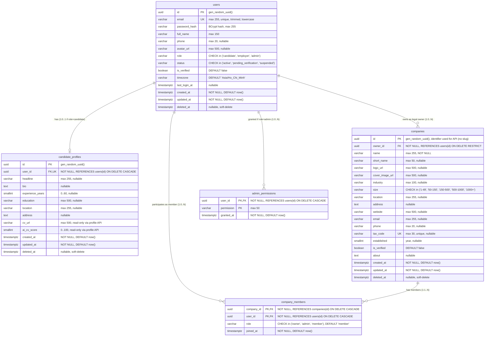

# MatchaJob – Entity Relationship Design Specification v2 (ERD v2)
## User – Role – CandidateProfile – Company – Membership Architecture

> **Document Status:** Authoritative Design Specification (Updated in Batch 2.1 per Approved Decisions)  
> **Target Audience:** Engineering Team, Backend Developers, Reviewers  
> **Source Base:** PostgreSQL 16+ | Flyway Migrations V1–V3 | Spring Boot 3.3.4 JPA Entities  
> **Scope:** Authentication, User Identity, Candidate Profile, Company & Membership  

---

## 1. Executive Summary & Evidence Classification

Tài liệu này xác định mô hình dữ liệu quan hệ chuẩn hóa (ERD v2) cho phân hệ người dùng, hồ sơ ứng viên, doanh nghiệp và thành viên doanh nghiệp của nền tảng **MatchaJob**. Thiết kế này được xây dựng trên cơ sở đối chiếu trực tiếp giữa:
- CSDL thực tế: [`V1__init_extensions.sql`](file:///d:/CongNgheWeb/DoAn/se347_smart_recruitment_platform/backend/src/main/resources/db/migration/V1__init_extensions.sql), [`V2__baseline_schema.sql`](file:///d:/CongNgheWeb/DoAn/se347_smart_recruitment_platform/backend/src/main/resources/db/migration/V2__baseline_schema.sql), [`V3__ai_vector_foundation.sql`](file:///d:/CongNgheWeb/DoAn/se347_smart_recruitment_platform/backend/src/main/resources/db/migration/V3__ai_vector_foundation.sql).
- JPA Entities hiện có: `User.java`, `CandidateProfile.java`, `Company.java`, `CompanyMember.java`, `CompanyMemberId.java`.

### Quy ước phân loại kết luận:
- **`[CONFIRMED]`**: Đã được chứng minh bằng mã nguồn hoặc migration SQL thực tế trong repository.
- **`[APPROVED DECISION]`**: Quyết định thiết kế đã được người dùng chính thức phê duyệt trong Đợt 2.1.
- **`[PROPOSED]`**: Đề xuất thiết kế kỹ thuật, chờ xem xét cho các đợt tiếp theo.
- **`[UNRESOLVED]`**: Vấn đề phụ thuộc vào quyết định nghiệp vụ cấp cao hoặc chưa có đầy đủ bằng chứng/luồng nghiệp vụ.

---

## 2. Mô hình Role: Hiện trạng và Khác biệt [CONFIRMED]

### 2.1. Hiện trạng Schema V2
- **Không có bảng `roles` riêng biệt:** Trong các migration từ V1 đến V3, hoàn toàn không có bảng `roles`.
- Role được lưu trực tiếp dưới dạng cột chuỗi trên bảng `users`:
  ```sql
  -- V2__baseline_schema.sql: L33
  role VARCHAR(20) NOT NULL CHECK (role IN ('candidate', 'employer', 'admin'))
  ```
- Phân quyền chi tiết cho Admin: Tách riêng sang bảng `admin_permissions` (`V2__baseline_schema.sql: L54-L60`) gồm `(user_id, permission)` để tránh nullable columns trên `users`.

### 2.2. Khác biệt với cụm từ "User–Role"
- Cụm từ "User–Role" trong tài liệu yêu cầu được thể hiện chính xác trong ERD v2 là **thuộc tính miền giá trị (Attribute/Domain Constraint)** của thực thể `User`, chứ không phải là một quan hệ Many-to-Many qua bảng liên kết.
- **Quyết định thiết kế [CONFIRMED]:** Không tự ý tạo bảng `roles` mới vì mô hình hiện tại (3 roles cố định `candidate`, `employer`, `admin`) hoàn toàn đáp ứng tốt kiểm tra quyền qua Spring Security (`ROLE_CANDIDATE`, `ROLE_EMPLOYER`, `ROLE_ADMIN`), tránh join bảng không cần thiết khi xác thực.

---

## 3. Entity Relationship Diagram (ERD v2)



---

## 4. Đặc tả chi tiết từng bảng

### 4.1. Bảng `users` [CONFIRMED]
- **Migration nguồn:** `V2__baseline_schema.sql` (dòng 26–48).
- **Primary Key:** `id UUID` (PostgreSQL `gen_random_uuid()`).
- **Unique Constraint:** `uq_users_email UNIQUE (email)`.
- **Check Constraints:**
  - `role IN ('candidate', 'employer', 'admin')`
  - `status IN ('active', 'pending_verification', 'suspended')`
- **Indexes:**
  - `idx_users_role_status ON users (role, status) WHERE deleted_at IS NULL`
- **Soft-delete:** Cột `deleted_at TIMESTAMPTZ`. Khi bị xóa mềm, tài khoản bị chặn đăng nhập và từ chối ở JWT filter.
- **Java Entity tương ứng:** [`User.java`](file:///d:/CongNgheWeb/DoAn/se347_smart_recruitment_platform/backend/src/main/java/com/matchajob/user/model/User.java).

---

### 4.2. Bảng `candidate_profiles` [CONFIRMED]
- **Migration nguồn:** `V2__baseline_schema.sql` (dòng 129–145).
- **Primary Key:** `id UUID` (`gen_random_uuid()`).
- **Foreign Key:** `user_id UUID NOT NULL REFERENCES users(id) ON DELETE CASCADE`.
- **Unique Constraint:** `uq_candidate_user UNIQUE (user_id)` $\rightarrow$ Ràng buộc 1 User chỉ có tối đa 1 CandidateProfile.
- **Check Constraint:** `CHECK (ai_cv_score BETWEEN 0 AND 100)`.
- **Indexes:** Tìm kiếm theo `user_id` tự động được tối ưu nhờ unique index `uq_candidate_user`.
- **Soft-delete:** `deleted_at TIMESTAMPTZ`.
- **Đặc điểm liên kết:** Khi `users` bị xóa vật lý (`ON DELETE CASCADE`), `candidate_profiles` tự động bị xóa theo. Khi `users` bị soft-delete, profile được xử lý như không tồn tại thông qua logic nghiệp vụ.
- **Java Entity tương ứng:** [`CandidateProfile.java`](file:///d:/CongNgheWeb/DoAn/se347_smart_recruitment_platform/backend/src/main/java/com/matchajob/user/model/CandidateProfile.java).

---

### 4.3. Bảng `companies` [CONFIRMED]
- **Migration nguồn:** `V2__baseline_schema.sql` (dòng 65–96).
- **Primary Key:** `id UUID` (`gen_random_uuid()`). Đây là định danh duy nhất của Company trong toàn bộ API v1/v2.
- **Foreign Key:** `owner_id UUID NOT NULL REFERENCES users(id) ON DELETE RESTRICT`.
  - *Ý nghĩa nghiệp vụ [CONFIRMED]:* `ON DELETE RESTRICT` bảo vệ dữ liệu công ty: Không thể xóa tài khoản chủ sở hữu nếu công ty chưa được giải thể hoặc chuyển giao quyền sở hữu.
- **Unique Constraint:** `uq_companies_tax_code UNIQUE (tax_code)`.
- **Check Constraint:** `CHECK (size IN ('1-49', '50-150', '150-500', '500-1000', '1000+'))`.
- **Indexes:**
  - `idx_companies_owner ON companies (owner_id)`
  - `idx_companies_industry ON companies (industry) WHERE deleted_at IS NULL`
  - `idx_companies_name_trgm ON companies USING gin (name gin_trgm_ops)` (tìm kiếm tên mờ / trigram)
- **Soft-delete:** `deleted_at TIMESTAMPTZ`.
- **Java Entity tương ứng:** [`Company.java`](file:///d:/CongNgheWeb/DoAn/se347_smart_recruitment_platform/backend/src/main/java/com/matchajob/user/model/Company.java).
- **Điểm chốt về Schema [CONFIRMED]:**
  1. Cột `slug` **hoàn toàn KHÔNG TỒN TẠI** trong schema `V2` và entity `Company.java`.
  2. `Company.java: L43` khai báo `private String size;` nhưng CSDL có check constraint 5 khoảng giá trị.

---

### 4.4. Bảng `company_members` [CONFIRMED]
- **Migration nguồn:** `V2__baseline_schema.sql` (dòng 114–125).
- **Composite Primary Key:** `(company_id, user_id)`.
- **Foreign Keys:**
  - `company_id UUID NOT NULL REFERENCES companies(id) ON DELETE CASCADE`
  - `user_id UUID NOT NULL REFERENCES users(id) ON DELETE CASCADE`
- **Check Constraint:** `CHECK (role IN ('owner', 'admin', 'member'))`. Giá trị mặc định là `'member'`.
- **Indexes:**
  - PK index trên `(company_id, user_id)`.
  - `idx_company_members_user ON company_members (user_id)` (tối ưu truy vấn: lấy toàn bộ công ty mà 1 user tham gia).
- **Lifecycle & Deletion [CONFIRMED]:** Bảng này **không có** `created_at`, `updated_at`, `deleted_at`. Chỉ có `joined_at TIMESTAMPTZ NOT NULL DEFAULT now()`. Khi thành viên rời công ty hoặc bị xóa quyền, bản ghi bị xóa vật lý (Hard-Delete).
- **Java Entity tương ứng:** [`CompanyMember.java`](file:///d:/CongNgheWeb/DoAn/se347_smart_recruitment_platform/backend/src/main/java/com/matchajob/user/model/CompanyMember.java) sử dụng `@IdClass(CompanyMemberId.class)`.

---

## 5. Quyết định Thiết kế Đã duyệt & Trạng thái [APPROVED DECISIONS]

### 5.1. Quyết định 2.1: Company dùng UUID, chưa thêm `slug` [APPROVED DECISION]
- **Định danh duy nhất:** Sử dụng `companies.id` kiểu `UUID` làm định danh cho mọi thao tác API.
- **Không có `slug`:** Không thêm cột `slug` vào bảng `companies`.
- **Không có Migration V4:** Không tạo file migration V4 trong Đợt 3.
- **Không đưa vào Checklist Đợt 3:** Việc thêm `slug` không nằm trong phạm vi bắt buộc của Đợt 3.
- **Đồng bộ Schema:** ERD phản ánh 100% schema V1–V3 thực tế.

### 5.2. Quyết định 2.2: Tạo Company và Owner Membership cùng Transaction [APPROVED DECISION]
- **Quy tắc tạo đồng thời:**
  Khi tạo Company trong Đợt 3:
  1. Xác định `userId` trực tiếp từ authenticated principal đã được backend xác thực (tuyệt đối không lấy `owner_id` từ request body).
  2. Tạo bản ghi trong `companies` với `owner_id = principal.userId`.
  3. Tạo bản ghi trong `company_members` với cùng `company_id`, `user_id = principal.userId`, và `role = 'owner'`.
  4. Thực hiện cả hai thao tác trong **cùng một Transaction** (`@Transactional`). Nếu một thao tác thất bại, **rollback toàn bộ**.
- **Bảo toàn tính nhất quán:**
  - DTO tạo/cập nhật Company không được phép sửa trực tiếp `owner_id`.
  - Không triển khai API chuyển giao quyền sở hữu (transfer ownership) trong Đợt 3.
  - API quản lý thành viên không bao giờ được tự gán role `owner`.
  - **Lưu ý thiết kế:** Đây là quy tắc nghiệp vụ ở tầng Application Service, **không phải** là foreign key hay constraint có sẵn trong CSDL. Không tự ý sửa schema/migration để bổ sung constraint chưa tồn tại.

### 5.3. Quyết định 2.3: Mô hình Thành viên & Không có Invitation Workflow [APPROVED DECISION]
- **Chỉ thêm user đã tồn tại:** Nếu người dùng duyệt các API membership tùy chọn, hệ thống chỉ hỗ trợ thêm trực tiếp user đã có tài khoản trong hệ thống.
- **Không có Invitation Workflow:** Không xây dựng invitation token, gửi email mời, trạng thái lời mời (`pending`, `accepted`) hay bảng invitation trong Đợt 3.
- **Quyền thao tác:** Chỉ `owner` hoặc `admin` của công ty mới được thêm/xóa thành viên.
- **Giới hạn Role:** Chỉ được gán role `'admin'` hoặc `'member'`. Cấm gán role `'owner'`.
- **Cấm xóa Owner:** API xóa thành viên cấm xóa bản ghi có role `owner`.
- **Trạng thái [UNRESOLVED]:** Điều kiện về role/status của user được thêm (ví dụ: bắt buộc user có role `employer`, trạng thái `active`, chưa soft-delete) được ghi nhận là `[UNRESOLVED]` kèm đề xuất; không tự coi là quy tắc đã chốt.

### 5.4. Quyết định 2.4: Company Verification ngoài phạm vi [APPROVED DECISION]
- **Quyền quản lý của Owner:** Owner được quản lý Company trong phạm vi quyền hạn đã duyệt bất kể trạng thái `is_verified`.
- **Cấm can thiệp `is_verified`:** DTO tạo và cập nhật Company không cho phép sửa trường `is_verified`.
- **Giữ Default Schema:** Khi tạo Company, giữ nguyên giá trị mặc định của CSDL (`is_verified = false`). Không tự gán `true`.
- **Không có Admin Verification Workflow:** Không triển khai quy trình Admin duyệt/xác minh công ty trong Đợt 3.
- **Không suy diễn cấm đoán:** Không tự ý suy diễn rằng Company chưa xác minh bị cấm dùng tính năng nào nếu chưa có quy định nghiệp vụ cụ thể.
- **Trạng thái [UNRESOLVED]:** Workflow xác minh công ty và các hạn chế theo verification status được ghi nhận là `[UNRESOLVED]`.

### 5.5. Số lượng Company mà một User có thể tham gia [CONFIRMED]
- Schema V2 hỗ trợ mô hình 1 User có thể là Owner của nhiều công ty (`idx_companies_owner` không phải unique) và là thành viên của nhiều công ty (`company_members` có composite PK `company_id, user_id`).
- Để phản ánh điều này, API `GET /v1/users/me` sẽ trả về danh sách: `companies: [...]`. Nếu không có công ty nào, trả về mảng rỗng `[]` (không trả `null`).

### 5.6. Ảnh hưởng của Soft-delete Company đối với Membership [CONFIRMED & APPROVED]
- Khi Company bị soft-delete (`companies.deleted_at != null`):
  - Dữ liệu trong `company_members` được giữ nguyên (không xóa vật lý).
  - Mọi API đọc Company (kể cả `/v1/users/me`) **phải lọc bỏ** các Company có `deleted_at IS NOT NULL`.

---

## 6. Ranh giới Trách nhiệm Package / Module (Module Ownership Matrix) [CONFIRMED]

| Module Package | Ownership & Trách nhiệm Nghiệp vụ | Phụ thuộc Cho phép | Trạng thái Đợt 3 |
| :--- | :--- | :--- | :--- |
| `com.matchajob.auth` | Xác thực đăng ký (`Register`), đăng nhập (`Login`), chuẩn hóa email, mã hóa mật khẩu BCrypt. | `user.repository.UserRepository`, `security.JwtTokenProvider`, `user.model.User` | Trong phạm vi Đợt 3 |
| `com.matchajob.security` | Phát hành và xác thực JWT token (`JwtTokenProvider`), filter bảo mật (`JwtAuthenticationFilter`), SecurityFilterChain theo profile. | `user.repository.UserRepository` (lấy principal từ DB) | Trong phạm vi Đợt 3 |
| `com.matchajob.user` | Quản lý tài khoản (`/v1/users/me`), hồ sơ ứng viên (`/v1/candidates/profile`), doanh nghiệp & thành viên (`/v1/companies`, `Company`, `CompanyMember`). | Tự chủ trong package `user`; dùng `common.exception` | Trong phạm vi Đợt 3 |
| `com.matchajob.common` | Xử lý ngoại lệ toàn cục (`GlobalExceptionHandler`), chuẩn hóa lỗi RFC 7807 Problem Detail. | Các domain exception từ `auth`, `user` | Trong phạm vi Đợt 3 |
| `com.matchajob.config` | Cấu hình OpenAPI documentation (`OpenApiConfig`). | Thư viện SpringDoc OpenAPI | Trong phạm vi Đợt 3 |
| `com.matchajob.api.recruitment` | Tuyển dụng, bài đăng việc làm, quy trình ứng tuyển. | N/A | **Ngoài phạm vi Đợt 3 (Bảo toàn nguyên trạng)** |
| `com.matchajob.cv` | Quản lý và xử lý file CV, trích xuất dữ liệu ứng viên. | N/A | **Ngoài phạm vi Đợt 3 (Bảo toàn nguyên trạng)** |
| `com.matchajob.matching` | Khớp nối ứng viên - công việc bằng AI/Vector. | N/A | **Ngoài phạm vi Đợt 3 (Bảo toàn nguyên trạng)** |

---
