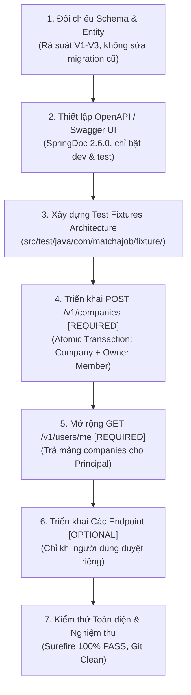

# MatchaJob – Implementation Checklist & Readiness Plan (Batch 3)
## Company/Membership API, OpenAPI, Test Fixtures & Regression Testing

> **Document Status:** Planning & Implementation Readiness Specification (Updated in Batch 2.1)  
> **Target Phase:** Batch 3 Execution  
> **Prerequisites:** Batch 2 & 2.1 Design Approval (`docs/ERD_v2.md` & `docs/Auth_API_Contract_v2.md`)  
> **Scope Notice:** Đợt 2.1 chỉ cập nhật tài liệu thiết kế. Không triển khai code, không sửa migration, không sửa config. Dừng chờ người dùng duyệt trước khi bắt đầu Đợt 3.

---

## 1. Mục tiêu Đợt 3

Triển khai các tính năng cốt lõi bắt buộc của phân hệ Doanh nghiệp (`Company`), mở rộng API `/v1/users/me` với thông tin `companies`, tích hợp tài liệu hóa API tương tác (`OpenAPI / Swagger UI`) chỉ dành cho môi trường phát triển và kiểm thử, thiết lập kiến trúc dữ liệu mẫu (`Test Fixtures`) phục vụ kiểm thử tự động, và bảo đảm 100% test suite vượt qua kiểm thử hồi quy.

---

## 2. Thứ tự Triển khai Chi tiết (Implementation Order)



---

## 3. Danh mục Triển khai Đợt 3 (Implementation Checklist)

### 3.1. [REQUIRED] — Các Hạng mục Bắt buộc trong Đợt 3

1. **[REQUIRED] Đối chiếu schema và entity; không sửa V1–V3:**
   - [ ] Đối chiếu các entity `Company` (`companies`), `CompanyMember` (`company_members`), `User` (`users`) với Flyway schema V1–V3.
   - [ ] Xác nhận không có cột `slug` trong database và trong entity. Nhận diện Company bằng UUID `id`.
   - [ ] Không tạo migration V4 trong Đợt 3.
   - [ ] **Quy tắc mismatch:** Nếu phát hiện bất kỳ entity/schema mismatch nào cần thay đổi schema, lập tức dừng lại, ghi nhận bằng chứng, phương án và tác động chi tiết để báo cáo người dùng duyệt riêng trước khi tạo bất kỳ migration nào.

2. **[REQUIRED] `POST /v1/companies` — Tạo Company và Owner Membership cùng Transaction:**
   - [ ] **DTO Request (`CreateCompanyRequest`):**
     - Allowlist: `name`, `tax_code`, `website`, `description`, `industry`, `size`, `logo_url`, `banner_url`, `location`, `address`.
     - Tuyệt đối không cho phép client truyền `owner_id` hoặc `is_verified` qua request body (bị bỏ qua hoặc không tồn tại trong DTO).
     - Validation: `@NotBlank` cho `name`, `@Pattern`/`@Size` cho `tax_code`, kiểm tra định dạng hợp lệ cho `size` enum (`1-49`, `50-150`, `150-500`, `500-1000`, `1000+`).
   - [ ] **Transactional Atomicity (`@Transactional`):**
     - Bước 1: Trích xuất `currentUserId` từ Spring Security authenticated principal (đã được xác thực qua JWT filter, truy vấn user từ DB).
     - Bước 2: Tạo bản ghi `companies` với `owner_id = currentUserId`, `is_verified = false` (default DB).
     - Bước 3: Tạo bản ghi `company_members` với `company_id = company.id`, `user_id = currentUserId`, `role = 'owner'`.
     - Bước 4: Toàn bộ quá trình thực hiện trong cùng một database transaction. Nếu bất kỳ bước nào thất bại, rollback toàn bộ để bảo đảm tính nhất quán (không có Company mồ côi hoặc thiếu Owner member).
   - [ ] **Xử lý trùng mã số thuế (`tax_code`):**
     - Thực hiện pre-check trong service và bắt exception vi phạm ràng buộc CSDL (`DataIntegrityViolationException` do `UNIQUE (tax_code)`) để phòng tránh race condition.
     - Trả về HTTP `409 Conflict` kèm thông điệp lỗi rõ ràng theo contract chuẩn.
   - [ ] **Response (`CompanyResponse`):**
     - Trả về HTTP `201 Created` kèm payload chi tiết Company vừa tạo (bao gồm `id`, `name`, `owner_id`, `created_at`, ...).

3. **[REQUIRED] Mở rộng `/v1/users/me` với `companies`:**
   - [ ] Cập nhật DTO `UserResponse` bổ sung trường `companies: List<CompanySummaryResponse>`.
   - [ ] Quy tắc giá trị:
     - Luôn luôn trả về mảng JSON (`[]`), tuyệt đối không trả `null`.
     - Mỗi phần tử trong mảng tối thiểu có các trường định dạng `snake_case`: `id`, `name`, `membership_role`.
   - [ ] Lọc dữ liệu:
     - Chỉ trả về các Company mà user hiện tại có quan hệ sở hữu hoặc thành viên và **chưa bị xóa mềm** (`deleted_at IS NULL`).
     - Với Candidate hoặc Employer chưa tạo/tham gia Company nào, trả về `companies: []`.
   - [ ] Principal Isolation: Xác định người dùng hoàn toàn từ authenticated principal trong `SecurityContext`, client không được phép chỉ định `userId`.
   - [ ] Token Isolation: Không đưa `companyId` vào JWT claims.

4. **[REQUIRED] OpenAPI / Swagger UI — Chỉ bật ở Profile `dev` và `test`:**
   - [ ] Bổ sung dependency tương thích Spring Boot 3.3.4 (Spring Framework 6.1):
     ```xml
     <dependency>
         <groupId>org.springdoc</groupId>
         <artifactId>springdoc-openapi-starter-webmvc-ui</artifactId>
         <version>2.6.0</version> <!-- hoặc 2.5.0 tương thích Spring Boot 3.3.4 -->
     </dependency>
     ```
   - [ ] Cấu hình `OpenApiConfig.java` trong package `com.matchajob.config`:
     - Khai báo OpenAPI metadata (Title, Version `v1.0.0`, Description).
     - Cấu hình JWT Bearer Security Scheme (`type = HTTP`, `scheme = bearer`, `bearerFormat = JWT`).
   - [ ] **Chính sách Profile nghiêm ngặt:**
     - Trong `application-dev.yml` và `application-test.yml`:
       ```yaml
       springdoc:
         swagger-ui:
           enabled: true
           path: /swagger-ui.html
         api-docs:
           enabled: true
           path: /v3/api-docs
       ```
     - Trong `application-prod.yml` (Production):
       ```yaml
       springdoc:
         swagger-ui:
           enabled: false
         api-docs:
           enabled: false
       ```
       *Lưu ý bảo mật:* Mặc định tắt hoàn toàn Swagger UI và `/v3/api-docs` ở môi trường Production. Nếu sau này có yêu cầu kích hoạt ở Production, phải có văn bản quyết định bảo mật riêng kèm cơ chế xác thực/phân quyền truy cập đặc biệt.
   - [ ] Phân quyền trong `SecurityConfig.java`:
     - Cho phép truy cập công khai đến `/v3/api-docs/**`, `/swagger-ui/**`, `/swagger-ui.html` (khi Swagger UI được bật theo profile).

5. **[REQUIRED] Kiến trúc Test Fixtures — Chỉ phục vụ Test:**
   - [ ] Định vị an toàn: Toàn bộ code fixtures phải nằm trong thư mục test:
     `backend/src/test/java/com/matchajob/fixture/`
   - [ ] Tuyệt đối không chèn seed data vào môi trường Production hoặc qua Flyway migration.
   - [ ] Xây dựng các helper fixtures:
     - `UserFixture`: Tạo Candidate user, Employer user, Admin user kèm password BCrypt đã mã hóa, kích hoạt và gán role.
     - `CompanyFixture`: Tạo Company mẫu hợp lệ kèm Owner member trong `company_members`.
     - `CandidateProfileFixture`: Tạo hồ sơ ứng viên mẫu.
   - [ ] Dọn dẹp dữ liệu test: Sử dụng `@Transactional` trên các test class hoặc phương thức teardown để bảo đảm isolation và không làm bẩn CSDL kiểm thử.

6. **[REQUIRED] API Tests & Regression Tests — Toàn bộ Backend Suite:**
   - [ ] **Unit & MockMvc Tests cho Company (`CompanyControllerTest.java`, `CompanyServiceTest.java`):**
     - Tạo company thành công bởi Employer $\rightarrow$ 201 Created (kèm kiểm tra tạo owner membership).
     - Candidate gọi tạo company $\rightarrow$ 403 Forbidden.
     - Anonymous gọi tạo company $\rightarrow$ 401 Unauthorized.
     - Payload không hợp lệ (thiếu tên, sai mã số thuế) $\rightarrow$ 400 Bad Request.
     - Trùng mã số thuế (`tax_code`) $\rightarrow$ 409 Conflict.
     - Thử can thiệp `owner_id`, `is_verified` trong request $\rightarrow$ giá trị bị bỏ qua, hệ thống lấy ID từ principal và `is_verified = false`.
   - [ ] **Tests mở rộng `/v1/users/me` (`UserControllerTest.java`):**
     - Employer có công ty $\rightarrow$ `companies` chứa danh sách đúng định dạng snake_case.
     - Employer chưa có công ty $\rightarrow$ `companies: []`.
     - Candidate $\rightarrow$ `companies: []`.
     - Công ty đã bị xóa mềm (`deleted_at IS NOT NULL`) $\rightarrow$ không xuất hiện trong mảng `companies`.
   - [ ] **Regression Tests:**
     - Chạy toàn bộ test suite hiện có của backend qua Maven Wrapper (`mvnw test`).
     - Đảm bảo 100% test cases (Auth, User, CandidateProfile, Security, Recruitment) vượt qua thành công (**0 failures, 0 errors, 0 skipped**).

7. **[REQUIRED] Kiểm tra Schema Validation, Git Diff và Phạm vi Thay đổi:**
   - [ ] Kiểm tra tính toàn vẹn của database schema qua Hibernate DDL validation (`validate`).
   - [ ] Rà soát `git status --short` và `git diff` trước khi hoàn tất Đợt 3:
     - Không có file ngoài phạm vi bị sửa.
     - Bảo toàn các staged deletions và các file Recruitment upstream.
     - Không sửa migration V1–V3.

---

### 3.2. [OPTIONAL] — Các Hạng mục Chỉ thực hiện khi Người dùng Duyệt riêng

> [!IMPORTANT]
> Các hạng mục dưới đây thuộc diện **[OPTIONAL]** và **KHÔNG** nằm trong phạm vi bắt buộc của Đợt 3. Chỉ được phép triển khai khi có văn bản phê duyệt riêng từ người dùng.

1. **[OPTIONAL] `GET /v1/companies` — Danh sách công ty:**
   - [ ] Trả về danh sách công ty mà user hiện tại đang tham gia (Owner/Admin/Member).
   - [ ] Bắt buộc lọc bỏ các công ty đã bị soft-delete (`deleted_at IS NOT NULL`).
   - [ ] Hỗ trợ phân trang và tìm kiếm cơ bản nếu có yêu cầu.

2. **[OPTIONAL] `GET /v1/companies/{id}` — Chi tiết công ty:**
   - [ ] Kiểm tra quyền truy cập: Chỉ trả về thông tin cho thành viên nội bộ công ty (hoặc công khai theo business rule được duyệt).
   - [ ] Trả về 404 Not Found nếu công ty không tồn tại hoặc đã bị soft-delete (`deleted_at IS NOT NULL`).

3. **[OPTIONAL] `PATCH /v1/companies/{id}` — Cập nhật thông tin công ty:**
   - [ ] **Kiểm tra quyền:** Chỉ `owner` hoặc `admin` của công ty mới có quyền cập nhật.
   - [ ] **Allowlist:** Chỉ nhận `name`, `tax_code`, `website`, `description`, `industry`, `size`, `logo_url`, `banner_url`, `location`, `address`.
   - [ ] **Cấm sửa:** Tuyệt đối không cho phép cập nhật `id`, `owner_id`, `is_verified`, `created_at`, `deleted_at`.
   - [ ] Áp dụng ngữ nghĩa PATCH: Trường omitted/null giữ nguyên; chuỗi rỗng trim lưu `NULL`; chuỗi có ký tự trim lưu giá trị mới.
   - [ ] Trùng `tax_code` với công ty khác $\rightarrow$ 409 Conflict.

4. **[OPTIONAL] Thêm thành viên công ty (`POST /v1/companies/{id}/members`):**
   - [ ] **Phạm vi cho phép:** Chỉ hỗ trợ thêm user **đã tồn tại sẵn** trong hệ thống (tìm theo `email`).
   - [ ] **Không hỗ trợ:** Tuyệt đối không xây dựng invitation workflow, không token mời, không email mời, không luồng accept/reject, không trạng thái lời mời.
   - [ ] **Kiểm tra quyền:** Chỉ `owner` hoặc `admin` của công ty mới có quyền thêm thành viên.
   - [ ] **Giới hạn Role:** Chỉ cho phép gán role `admin` hoặc `member`. Tuyệt đối cấm gán role `owner` qua API này.
   - [ ] **[UNRESOLVED] Điều kiện user được thêm:** Xem xét và chốt điều kiện (Đề xuất: `role = 'employer'`, `status = 'active'`, `is_verified = true`, `deleted_at IS NULL`).

5. **[OPTIONAL] Xóa thành viên công ty (`DELETE /v1/companies/{id}/members/{userId}`):**
   - [ ] **Kiểm tra quyền:** `owner` hoặc `admin` có thể xóa thành viên khác; thành viên tự rời công ty.
   - [ ] **Cấm xóa Owner:** Tuyệt đối cấm xóa bản ghi của `owner` qua API này (trả về 400 Bad Request hoặc 403 Forbidden).
   - [ ] Không hỗ trợ chuyển quyền sở hữu (`owner-transfer`) trong đợt này.

---

## 4. Các Giới hạn Tuyệt đối Bị loại bỏ khỏi Đợt 3 (Out of Scope)

| Hạng mục | Trạng thái | Lý do / Quyết định Đã Duyệt |
| :--- | :--- | :--- |
| **`slug` cho Company** | **LOẠI BỎ** | Quyết định 2.1: Giữ định danh bằng UUID `id`. Không thêm cột `slug`, không tạo migration V4. |
| **Invitation Workflow** | **LOẠI BỎ** | Quyết định 2.3: Chỉ hỗ trợ thêm trực tiếp user đã tồn tại (nếu làm Optional). Không làm token/email mời. |
| **Owner-Transfer API** | **LOẠI BỎ** | Quyết định 2.2: Không triển khai chuyển giao quyền sở hữu trong Đợt 3 để giữ an toàn dữ liệu. |
| **Admin Verification Workflow** | **LOẠI BỎ** | Quyết định 2.4: Admin review/verification cho Company là ngoài phạm vi. Giữ `is_verified = false` mặc định. |
| **Flyway Migration V4** | **LOẠI BỎ** | Giữ nguyên schema V1–V3. Không tự ý tạo migration mới nếu chưa có yêu cầu duyệt riêng. |

---

## 5. Ghi nhận Nợ Kỹ thuật & Rủi ro (Technical Debt & Risk Register)

| Thành phần | Vấn đề / Rủi ro Phát hiện | Mức độ | Hướng Xử lý Khuyến nghị |
| :--- | :--- | :--- | :--- |
| **`CvController`** | Nhận `candidateId` trực tiếp từ URL path mà không xác thực đối chiếu với authenticated principal $\rightarrow$ **Nguy cơ IDOR Vulnerability**. | Cao | Ghi nhận Technical Debt. Sẽ refactor ở Phase CV/AI: Trích xuất `userId` từ JWT principal để truy vấn hồ sơ candidate tương ứng. |
| **Upstream Recruitment Entities** | Các entity `Job`, `Application`, `JobStage` được cách ly trong package riêng để tránh xung đột với công việc của nhóm khác. | Trung bình | Giữ nguyên nguyên tắc cách ly (Domain Package Isolation) đã thiết lập trong `MatchaJobApplication.java`. |
| **Ràng buộc Enum `size`** | CSDL có check constraint 5 khoảng giá trị (`1-49`, `50-150`, `150-500`, `500-1000`, `1000+`), nhưng entity Java hiện dùng `String`. | Thấp | Khai báo enum Java và annotation validation tương ứng ở DTO tầng Application ở Đợt 3. |

---

## 6. Tiêu chí Nghiệm thu Hoàn thành Đợt 3 (Acceptance Criteria)

1. **Chức năng Bắt buộc [REQUIRED]:**
   - API `POST /v1/companies` hoạt động chính xác theo cơ chế atomic transaction (tạo company và owner membership đồng thời).
   - API `GET /v1/users/me` trả về danh sách `companies` đầy đủ cho Employer và `[]` cho Candidate.
   - Xử lý race condition trùng mã số thuế trả về HTTP `409 Conflict`.
2. **OpenAPI / Swagger UI:**
   - Swagger UI và `/v3/api-docs` hoạt động hoàn hảo ở profile `dev` và `test`.
   - Swagger UI và `/v3/api-docs` bị **tắt hoàn toàn** ở profile `prod`.
3. **Chất lượng Kiểm thử (Test Quality):**
   - Test fixtures đặt đúng trong `src/test/java/com/matchajob/fixture/`.
   - Bộ API tests bao phủ đầy đủ các trường hợp: tạo thành công, validation thất bại, trùng `tax_code`, RBAC 403 Forbidden, 401 Unauthorized, và bỏ qua parameter tampering (`owner_id`, `is_verified`).
4. **Hồi quy (Regression):**
   - Chạy lệnh `mvnw test` đạt **100% BUILD SUCCESS** (0 failures, 0 errors, 0 skipped).
5. **Bảo toàn Kho lưu trữ (Repository Integrity):**
   - Không có file ngoài phạm vi bị sửa; bảo toàn các staged deletions và các thay đổi Recruitment.
