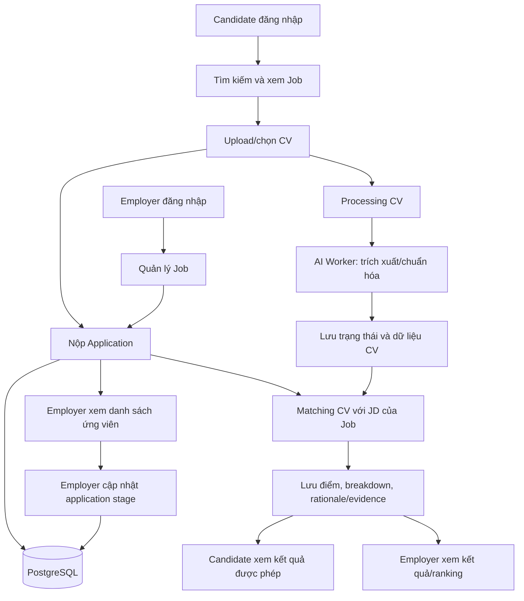

# MVP Scope — MatchaJob (SE347.R11, Nhóm 7)

- **Phiên bản:** Draft 0.1 — đề xuất để nhóm review, chưa phải phạm vi đã được freeze
- **Ngày soạn:** 2026-10-12
- **Người tổng hợp:** Việt Khang — MVP Scope + API Convention + Integration Contract
- **Tài liệu liên quan:** `docs/API_INVENTORY.md`, `docs/PHASE3_DESIGN.md`, `docs/BACKEND.md`, `docs/AI_WORKER.md`, workbook nhóm (đặc biệt `Tasks tuần`, `Phân Công`, `P1_01_TamNhin`, `Nội Dung Dự Án`)
- **Cách đọc trạng thái:** “Có trong source” chỉ xác nhận đã tìm thấy code/mapping; không có nghĩa đã chạy được hoặc đã tích hợp end-to-end. Inventory hiện là static source audit; runtime smoke test chưa được xác nhận.

> **Lý do có trạng thái Draft:** Trong workbook, sheet `Nội Dung Dự Án` ghi rõ danh sách chức năng hiện tại mới là bản AI-generated để tham khảo và cần sàng lọc. Vì vậy tài liệu này lấy ba luồng MVP được nêu cụ thể trong task tuần làm phạm vi đề xuất chính; không coi toàn bộ tính năng trong danh sách dài là bắt buộc cho MVP.

## 1. Mục tiêu MVP

Xây dựng một vertical slice full-stack có thể demo và kiểm chứng bằng dữ liệu được lưu trong PostgreSQL, gồm ba luồng:

1. **Ứng viên tìm việc và ứng tuyển.**
2. **Nhà tuyển dụng quản lý tin tuyển dụng và xử lý ứng viên.**
3. **Đối sánh CV/JD, xem giải thích kết quả và xếp hạng ứng viên.**

MVP cần chứng minh được Frontend gọi Backend thật, Backend làm việc với database và Backend tích hợp AI Worker cho phần phân tích. Giao diện dùng `mockStore`, `localStorage` hoặc dữ liệu định nghĩa sẵn có thể tiếp tục phục vụ phát triển UI, nhưng không được tính là hoàn tất luồng nghiệp vụ MVP.

### Mục tiêu không phải

- Không xây đủ mọi màn hình đang có trong prototype.
- Không hoàn thành mọi chức năng được liệt kê trong bản ý tưởng sinh tự động.
- Không đưa mọi endpoint hiện tại vào contract chỉ vì route đã tồn tại trong source.
- Không đánh dấu matching thành công nếu chỉ trả điểm giả, dùng giá trị mặc định không phản ánh Job/CV thật hoặc chưa lưu được kết quả cần thiết.

## 2. Người dùng và ranh giới vai trò

| Vai trò | Mục tiêu trong MVP | Ranh giới quyền cần có |
|---|---|---|
| Candidate / Ứng viên | Đăng nhập; tìm và xem tin; quản lý/upload CV ở mức cần thiết; ứng tuyển; xem lịch sử/trạng thái; xem kết quả phù hợp CV/JD được phép hiển thị | Chỉ thao tác dữ liệu/hồ sơ và application của chính mình; chỉ ứng tuyển vào tin đủ điều kiện nhận hồ sơ |
| Employer / Nhà tuyển dụng | Đăng nhập; quản lý thông tin doanh nghiệp tối thiểu; tạo và quản lý tin của doanh nghiệp mình; xem đơn ứng tuyển của các tin mình quản lý; xem CV/kết quả matching và cập nhật trạng thái tuyển dụng | Chỉ sửa tin và truy cập hồ sơ ứng viên thuộc các đơn/tin nằm trong phạm vi doanh nghiệp được phép quản lý |
| Admin / Moderator | **Không thuộc ba luồng demo cốt lõi**; chỉ bổ sung nếu yêu cầu môn học hoặc giảng viên bắt buộc | Nếu được đưa vào MVP thì nhóm phải chốt riêng use case, role, API và acceptance criteria; không suy diễn từ việc có màn hình prototype |

## 3. Ba luồng demo MVP

### MVP-F01 — Ứng viên tìm việc và ứng tuyển

**Mục tiêu:** Một ứng viên có thể dùng hệ thống để tìm được một tin tuyển dụng, chọn CV và nộp đơn; dữ liệu ứng tuyển được lưu để theo dõi tiếp.

**Luồng chính đề xuất:**

1. Ứng viên đăng ký/đăng nhập.
2. Ứng viên xem danh sách việc làm công khai, tìm kiếm/lọc và mở chi tiết tin.
3. Ứng viên tải lên hoặc chọn một phiên bản CV đã có.
4. Ứng viên gửi application cho một tin còn nhận hồ sơ.
5. Backend kiểm tra danh tính/quyền, tin có hợp lệ và chưa đóng, và không có application trùng theo quy tắc đã được nhóm chốt.
6. Backend lưu application và tham chiếu/snapshot tới phiên bản CV đã chọn.
7. Ứng viên xem danh sách/lịch sử application cùng trạng thái hiện tại.

**Phạm vi tối thiểu:**

- Đăng ký/đăng nhập Candidate và lấy danh tính hiện tại để Frontend biết người dùng đang thao tác.
- Tìm kiếm, lọc cơ bản, xem chi tiết Job.
- Upload CV PDF/DOCX theo giới hạn file hiện có trong source (10 MB) hoặc giới hạn được nhóm thống nhất lại; xem danh sách/phiên bản CV cần dùng để ứng tuyển.
- Chọn CV khi nộp đơn.
- Tạo application, chống nộp trùng, kiểm tra trạng thái tin trước khi nhận đơn.
- Xem trạng thái và lịch sử application tối thiểu.
- Xử lý rõ các trạng thái loading, empty, validation error và server error trên UI.

**Không bắt buộc trong luồng này ở MVP:** CV builder đầy đủ, xuất CV PDF từ editor, Quick Apply nâng cao, lưu việc làm yêu thích, kết nối GitHub, quản lý nhiều mẫu CV với editor phong phú. Chỉ bổ sung nếu nhóm chốt ưu tiên sau khi ba luồng cốt lõi hoạt động.

**Điều kiện hoàn thành / acceptance criteria:**

- [ ] Candidate chưa đăng nhập không thể tạo application.
- [ ] Candidate có thể tìm kiếm và mở chi tiết một Job hợp lệ qua API thật.
- [ ] File không được hỗ trợ hoặc vượt giới hạn bị từ chối với lỗi rõ ràng; không lưu thành CV hợp lệ.
- [ ] Application được tạo từ Job đang nhận hồ sơ và một CV/version hợp lệ; dữ liệu tồn tại sau khi tải lại trang/đăng nhập lại.
- [ ] Gửi application trùng theo cùng quy tắc nghiệp vụ bị từ chối có response nhất quán; không tạo bản ghi trùng.
- [ ] Job đã đóng/không còn nhận hồ sơ không thể nhận application mới.
- [ ] Candidate chỉ xem application của chính mình và thấy trạng thái do Backend trả về.
- [ ] Luồng chính được chạy ít nhất một lần từ UI qua Backend đến PostgreSQL, không dựa vào `mockStore`/localStorage làm nguồn dữ liệu nghiệp vụ.

### MVP-F02 — Nhà tuyển dụng quản lý tin và ứng viên

**Mục tiêu:** Một nhà tuyển dụng quản lý được tin của doanh nghiệp mình và xử lý những application gửi vào các tin đó.

**Luồng chính đề xuất:**

1. Nhà tuyển dụng đăng ký/đăng nhập.
2. Nhà tuyển dụng có thông tin doanh nghiệp tối thiểu gắn với tài khoản.
3. Tạo tin tuyển dụng với thông tin cốt lõi và yêu cầu cần thiết cho matching.
4. Chỉnh sửa tin, mở/publish, tạm dừng hoặc đóng tin theo state machine được chốt.
5. Xem danh sách application theo từng Job.
6. Mở thông tin ứng viên/CV gắn với application đó.
7. Cập nhật trạng thái application hợp lệ; ứng viên nhìn thấy trạng thái mới qua API.

**Phạm vi tối thiểu:**

- Employer authentication và liên kết tài khoản với Company.
- Tạo/sửa/xem danh sách/chi tiết và cập nhật trạng thái Job.
- Các trường Job tối thiểu phải đủ để hiển thị tin và làm đầu vào matching: tiêu đề, mô tả, yêu cầu/kỹ năng; các trường bắt buộc khác do owner Job và nhóm xác nhận theo DTO/schema hiện hành.
- Xem application thuộc các Job mà employer có quyền quản lý.
- Xem CV và kết quả matching chỉ khi có quyền hợp lệ.
- Chuyển trạng thái application theo state machine đã thống nhất; lưu trạng thái hiện tại và lịch sử thay đổi tối thiểu.
- Lọc/sắp xếp danh sách ứng viên ở mức cơ bản nếu cần cho demo; ranking được bao phủ cụ thể ở MVP-F03.

**Không bắt buộc trong luồng này ở MVP:** thanh toán/gói dịch vụ, lịch phỏng vấn có nhắc lịch, dashboard analytics nâng cao, báo cáo phễu tuyển dụng chi tiết, quản trị nội dung/hướng dẫn.

**Điều kiện hoàn thành / acceptance criteria:**

- [ ] Employer đăng nhập có thể tạo một Job hợp lệ và đọc lại Job đã tạo từ API thật.
- [ ] Employer có thể sửa hoặc đổi trạng thái Job theo các transition được phép.
- [ ] Employer A không thể sửa tin của Company B hoặc truy cập application/CV ngoài quyền của mình.
- [ ] Danh sách application theo Job lấy dữ liệu thật từ Backend.
- [ ] Employer có thể cập nhật application sang trạng thái hợp lệ; trạng thái được lưu và được Candidate nhìn thấy.
- [ ] Tin đã đóng không nhận thêm application; thao tác publish/pause/close được phản ánh thống nhất trên phần tìm kiếm công khai.
- [ ] Lỗi quyền truy cập, resource không tồn tại và transition không hợp lệ được phân biệt; không chỉ ẩn nút trên UI thay cho kiểm tra phía Backend.

### MVP-F03 — Đối sánh CV/JD, giải thích và xếp hạng

**Mục tiêu:** Dùng CV và Job Description thật để tạo kết quả matching có thể giải thích, lưu được và dùng để hỗ trợ nhà tuyển dụng xem/xếp hạng ứng viên.

**Luồng chính đề xuất:**

1. CV được upload và ghi nhận trong Backend.
2. Backend tạo hoặc theo dõi trạng thái xử lý CV; gọi AI Worker để trích xuất/chuẩn hóa nội dung.
3. Khi đã có CV/JD đầu vào hợp lệ, hệ thống tính điểm matching cho application/CV với Job tương ứng.
4. Backend lưu kết quả đã xác minh: điểm tổng thể, các tiêu chí/thành phần nếu baseline hỗ trợ, rationale/evidence và thời điểm tạo kết quả.
5. Frontend đọc và hiển thị trạng thái xử lý; khi hoàn tất thì hiển thị điểm, giải thích và các kỹ năng đạt/thiếu nếu dữ liệu đầu ra cung cấp.
6. Nhà tuyển dụng xem danh sách ứng viên xếp hạng theo matching cho Job, chỉ trong phạm vi được phép.
7. Khi xử lý thất bại, hệ thống hiển thị trạng thái lỗi có thể hiểu được; không biến lỗi thành điểm số hợp lệ.

**Phạm vi tối thiểu:**

- Backend–AI Worker contract dùng cấu hình môi trường, không để AI key ở Frontend.
- Parsing/normalization cho CV PDF/DOCX mà stack hiện tại hỗ trợ.
- Có schema đầu vào CV/JD và fixture kiểm thử được AI Worker owner xác nhận.
- Scoring baseline có tiêu chí, trọng số/quy tắc và cách giải thích được ghi lại; **không tự ấn định trọng số trong tài liệu MVP này**.
- Lưu kết quả matching và trạng thái processing để truy vấn lại.
- API lấy status/kết quả/giải thích và API ranking cho Employer; URL cụ thể sẽ chốt ở `API_CONTRACT.md` sau khi owner xác nhận.
- UI chi tiết kết quả matching do Việt Khang phụ trách theo sheet `Phân Công`, phối hợp với Backend/Application và AI Worker.
- Với dữ liệu thiếu/sai hoặc AI Worker lỗi, trả trạng thái tương ứng và không tạo kết quả giả.

**Không bắt buộc trong luồng này ở MVP:** đánh giá GitHub, truy cập GitHub private repository, mô hình AI tự huấn luyện quy mô lớn, semantic ranking nâng cao chưa có baseline đánh giá, realtime streaming, hay cam kết độ chính xác số học chưa được kiểm chứng.

**Điều kiện hoàn thành / acceptance criteria:**

- [ ] AI Worker health/readiness có thể kiểm tra độc lập và Backend gọi được bằng địa chỉ phù hợp với cách chạy (Docker network hoặc host).
- [ ] Một CV hợp lệ được lưu và đi qua trạng thái xử lý được định nghĩa; lỗi parse được ghi nhận, không báo `COMPLETED` giả.
- [ ] Job/JD và CV đầu vào phải đến từ resource hợp lệ; không tạo UUID ngẫu nhiên thay cho Job bị thiếu.
- [ ] Matching result có điểm trong khoảng mà contract scoring chốt (schema thiết kế hiện tại quy định overall score 0–100; owner cần xác nhận contract cuối), liên kết đúng application/job/CV version.
- [ ] Response kết quả có schema rõ ràng cho overall score, breakdown và rationale/evidence ở mức baseline thực sự hỗ trợ; không hứa trả trường mà AI Worker chưa thể cung cấp.
- [ ] Trạng thái HTTP nhất quán với cách xử lý: nếu trả `202 Accepted`, hệ thống phải tạo/truy xuất được processing job và có endpoint/status để polling; nếu tính xong trong request thì nhóm cần thống nhất response đồng bộ khác.
- [ ] Kết quả matching được lưu và có thể đọc lại; ranking sắp xếp theo quy tắc đã thống nhất.
- [ ] Người không có quyền không thể đọc CV/result/ranking của employer khác hoặc application không thuộc phạm vi của mình.
- [ ] Có test ít nhất cho input hợp lệ, thiếu dữ liệu, AI Worker lỗi/timeout và kết quả đã tồn tại; không dùng mock score làm minh chứng cho matching thật.

## 4. Danh sách chức năng: In Scope / Out of Scope / Cần quyết định

| ID | Hạng mục | Đề xuất MVP | Căn cứ / trạng thái source | Quyết định cần chốt |
|---|---|---|---|---|
| S-01 | Candidate registration/login | In scope | Workbook `Phân Công` và `P1_01_TamNhin` yêu cầu; inventory chưa tìm thấy Auth API trong Backend source | Phúc Khang chốt endpoint, JWT, role và validation |
| S-02 | Employer registration/login | In scope | Workbook phân công Backend tài khoản và recruiter workflow | Phúc Khang chốt cùng luồng Candidate; xác định setup Company |
| S-03 | Public job list/search/detail | In scope | Job API đã có route trong source; path conflict P0 trong inventory | Vua Thanh Hóa chốt filters/sort/page và job visibility |
| S-04 | Job CRUD/status | In scope | Một phần route Employer Job đã có; cần sửa base path, auth/ownership chưa xác minh | Vua Thanh Hóa chốt required fields và state machine |
| S-05 | CV upload/version/status | In scope | CV Controller/storage/processing có một phần; cần kiểm tra quyền và contract response | Đại Hưng + Tiểu pro chốt file validation, download, storage/version |
| S-06 | Application create/history/stage | In scope | Có entity/schema nhưng chưa tìm thấy workflow API đầy đủ trong inventory | Đại Hưng chốt duplicate rule, valid Job, stage transitions/history |
| S-07 | CV/JD parse and matching | In scope, baseline only | AI Worker extraction/match endpoints và Backend matching integration đã có một phần; contract còn gap | Khải Vạn chốt schema, score logic, evidence, evaluation fixtures |
| S-08 | Match result details UI/API | In scope | Thuộc vai trò Việt Khang theo sheet `Phân Công`; phải dùng output thật | Việt Khang + Đại Hưng + Khải Vạn thống nhất field/result lifecycle |
| S-09 | Candidate ranking | In scope, basic | Được nêu trong vai trò HR và task matching; chưa tìm thấy ranking API trong inventory | Đại Hưng chốt query/sort/tie-break và quyền truy cập |
| S-10 | Admin account management/moderation | Out of core demo; pending stakeholder/lecturer confirmation | Có trong prototype/ý tưởng dự án nhưng không phải một trong ba luồng demo của task tuần | Nhóm xác nhận có phải yêu cầu chấm điểm bắt buộc không |
| S-11 | GitHub Assessment/Evidence | Out of core demo | Được liệt kê trong sheet ý tưởng, nhưng scope được ghi là bản AI-generated cần sàng lọc; chưa thấy route matching trong inventory | Để phase sau trừ khi nhóm/giảng viên yêu cầu |
| S-12 | Billing/payment/subscriptions | Out of scope | Không thuộc ba luồng; vision ghi payment thật ngoài phạm vi | Không triển khai trong MVP |
| S-13 | Interview scheduling/reminders | Out of core demo | Có UI/model prototype nhưng không cần để chứng minh ba luồng MVP | Hoãn; không block demo MVP |
| S-14 | Advanced analytics/reports/admin dashboards | Out of core demo | Prototype có view/chart; chưa phải luồng backend-first đã chốt | Hoãn sau core data flow |
| S-15 | CV builder/export PDF/multiple layouts | Out of core demo | Có trong ý tưởng chức năng, nhưng upload CV PDF/DOCX là đường tối thiểu phù hợp source hiện tại | Hoãn nếu không đủ thời gian |
| S-16 | Private GitHub access, native mobile, enterprise ATS, e-signature, large custom AI, multi-region production | Out of scope | Nêu rõ trong `P1_01_TamNhin` | Không làm trong MVP |

## 5. Luồng tổng thể và phụ thuộc

**Thứ tự phụ thuộc nên theo:**

1. Auth/role và company/candidate identity.
2. Job schema, Job API, status/visibility và các field JD cần cho matching.
3. CV upload/storage/version và trạng thái processing.
4. Application create/history/stage và liên kết snapshot/version CV.
5. AI schema/scoring + Backend–AI contract + matching result persistence.
6. Candidate/recruiter UI gọi API thật, rồi kiểm thử end-to-end ba luồng.

Có thể làm song song bằng contract/fixtures sau khi các field và status cần thiết được owner xác nhận; không để mỗi module tự định nghĩa tên field/trạng thái độc lập.

## 6. Business rules tối thiểu cần được nhóm xác nhận

Những quy tắc này là đề xuất nhằm biến MVP thành hành vi có thể kiểm thử. Chúng **chưa được coi là quyết định đã duyệt** cho đến khi owner của module xác nhận.

| ID | Quy tắc đề xuất | Owner cần xác nhận |
|---|---|---|
| BR-01 | Chỉ user đã xác thực và có role Candidate mới tạo application; danh tính lấy từ principal/JWT chứ không tin `candidateId` tùy ý do client gửi | Phúc Khang + Đại Hưng |
| BR-02 | Application chỉ được tạo với Job đang nhận hồ sơ; nhóm chốt ý nghĩa của `active/published`, deadline và các trạng thái khác | Vua Thanh Hóa + Đại Hưng |
| BR-03 | Một Candidate không thể tạo application trùng với cùng Job theo khóa nghiệp vụ nhóm thống nhất | Đại Hưng |
| BR-04 | Application lưu chính xác CV version đã gửi; nếu schema hiện tại dùng snapshot thì xác định nơi tạo snapshot và quy tắc giữ nguyên | Đại Hưng + Tiểu pro |
| BR-05 | Employer chỉ xem/cập nhật Job/Application/CV trong phạm vi Company được quyền quản lý | Phúc Khang + Vua Thanh Hóa + Đại Hưng |
| BR-06 | Application stage có state machine; chỉ những transition đã duyệt mới được chấp nhận và thay đổi phải được lưu | Đại Hưng + Frontend Recruiter |
| BR-07 | Matching không bắt đầu nếu không xác định được đúng Job/JD và CV/version; không dùng default text hoặc UUID ngẫu nhiên làm dữ liệu thực | Đại Hưng + Khải Vạn |
| BR-08 | Kết quả matching có trạng thái processing và thời điểm cập nhật; lỗi AI không chuyển thành điểm 0 hoặc kết quả thành công giả | Đại Hưng + Khải Vạn |
| BR-09 | Ranking chỉ dùng kết quả hợp lệ của các ứng viên trong Job hiện tại; nhóm chốt tie-break khi bằng điểm và chính sách ẩn kết quả chưa hoàn thành | Đại Hưng + Khải Vạn |
| BR-10 | Candidate được xem kết quả matching của chính họ ở mức nhóm cho phép; Employer được xem kết quả ứng viên thuộc Job mình quản lý | Phúc Khang + Đại Hưng + Việt Khang |

## 7. Quality requirements / giới hạn nghiệm thu

- **Dữ liệu thật:** luồng demo chính phải ghi/đọc PostgreSQL; mock được phép ở UI development hoặc test fixture, không phải nguồn dữ liệu runtime của demo end-to-end.
- **Authorization:** kiểm tra quyền ở Backend; ẩn nút ở Frontend không thay thế authorization.
- **Validation:** lỗi request, quyền, resource không tồn tại, file sai định dạng/quá lớn, trùng application và AI processing failure cần có response nhất quán.
- **Traceability:** mỗi chức năng trong phạm vi có endpoint/contract, owner, acceptance criteria và ít nhất test phù hợp.
- **Service boundaries:** Frontend chỉ gọi Backend; Backend gọi AI Worker theo URL từ environment; AI Worker không được yêu cầu Browser cung cấp secret AI Provider.
- **Observability/demo:** có log/error đủ để phân biệt lỗi upload, parsing, matching và persistence; không log secret hoặc toàn bộ dữ liệu CV nhạy cảm ngoài nhu cầu cần thiết.
- **Test result:** vision workbook nêu mục tiêu ít nhất 95% test case chức năng cốt lõi PASS. Dùng mục tiêu này khi nhóm thống nhất bộ test và mẫu số; không được công bố đạt nếu chưa có kết quả chạy test thật.
- **Performance:** chưa có con số latency được thống nhất trong nguồn tham chiếu; nhóm cần đo và ghi số thực tế thay vì tự đặt SLA không có căn cứ.

## 8. Definition of Demo (DoD) cho ba luồng MVP

MVP chỉ được xem là sẵn sàng demo khi tất cả điều kiện sau được xác minh:

- [ ] Ba luồng F01, F02, F03 có thể chạy tuần tự qua UI, Backend và PostgreSQL; F03 gọi AI Worker thật trong demo matching chính.
- [ ] Cấu hình API base path thống nhất; vấn đề `/api` lặp trong Job/Employer Job/Category/Skill đã được xử lý và kiểm tra.
- [ ] Auth/JWT và quyền truy cập đã được test, không chỉ mô phỏng bằng state phía Frontend.
- [ ] Application không bị tạo trùng theo rule đã duyệt; tin đóng không nhận đơn mới.
- [ ] CV upload, parsing/matching có trạng thái processing rõ; lỗi được hiển thị hợp lý, không tạo dữ liệu thành công giả.
- [ ] Matching result có thể đọc lại, có giải thích/breakdown đúng schema thực tế; ranking lấy dữ liệu từ các kết quả đã lưu.
- [ ] Có test case hợp lệ và negative cases cho ba luồng; kết quả chạy test được lưu hoặc tham chiếu từ CI/log thật.
- [ ] `.env.example`/documentation đủ để thành viên khác khởi chạy theo cấu hình thống nhất; không commit secret.
- [ ] Contract freeze có reviewer/approval; các thay đổi phá vỡ contract sau freeze phải được thông báo và review.

## 9. Mapping owner và reviewer đề xuất

| Workstream | Owner theo workbook | Phối hợp/reviewer đề xuất | Deliverable liên quan |
|---|---|---|---|
| MVP scope, convention và integration contract | Việt Khang | Tất cả module owners; đặc biệt Phúc Khang, Vua Thanh Hóa, Đại Hưng, Khải Vạn | `MVP_SCOPE.md`, `API_INVENTORY.md`, sau đó `API_CONTRACT.md` |
| Auth, JWT, role, Candidate/Profile/Company | Phúc Khang | Việt Khang + Frontend Candidate | Auth/profile contract, permission matrix |
| Recruitment/Job/Category/Skill | Vua Thanh Hóa - Aka HGK | Việt Khang + Frontend Recruiter/Candidate | Job/search/status contract và DTO fixtures |
| CV upload/storage/download/version | Tiểu pro (theo sheet `Phân Công`); phối hợp Đại Hưng ở Backend workflow | Việt Khang + Frontend Candidate | CV/storage contract, file validation và ownership rules |
| Application/workflow/matching persistence/ranking API | Đại Hưng | Việt Khang + Phúc Khang + Khải Vạn | Application state machine, processing/matching API contract |
| AI Worker/schema/scoring/evaluation | Khải Vạn | Đại Hưng + Việt Khang | CV/JD schemas, fixture, scoring baseline và evaluation tests |
| Candidate UI | PN Thông | Việt Khang + Phúc Khang + Tiểu pro | Candidate screens/service adapters, test evidence |
| Recruiter UI | Khanh | Việt Khang + Vua Thanh Hóa + Đại Hưng | Recruiter screens/service adapters, ranking/stage actions |

> Tên owner ở bảng trên lấy từ sheet phân công của workbook. Với các phần phối hợp/reviewer do tài liệu này đề xuất, cần được nhóm chấp thuận; đây không phải khẳng định rằng reviewer đã được chỉ định chính thức.

## 10. Quyết định cần chốt tại buổi review scope

Không nên freeze MVP cho đến khi nhóm trả lời và ghi quyết định cho các điểm sau:

1. **Roles:** MVP bắt buộc Candidate + Employer; Admin/Moderator có phải yêu cầu đánh giá bắt buộc không?
2. **Job lifecycle:** Các trạng thái chính xác và transition được phép là gì? `active`, `paused`, `closed` có đủ không; `draft/published` có cần không?
3. **Application uniqueness:** một Candidate chỉ được nộp một lần cho một Job hay có thể nộp lại sau khi rút đơn?
4. **Application stages:** bộ trạng thái tối thiểu và transition hợp lệ.
5. **CV readiness:** application có được tạo khi CV đang `uploaded/processing`, hay bắt buộc chờ extracted? Matching chạy ngay hay sau khi CV/JD đã xử lý xong?
6. **Matching lifecycle:** đồng bộ hay bất đồng bộ; nếu bất đồng bộ, processing status endpoint và polling interval sẽ theo contract nào?
7. **Scoring baseline:** tiêu chí, trọng số, semantics của overall score/breakdown/rationale, tie-break ranking và bộ fixture đánh giá.
8. **Candidate visibility:** ứng viên có xem đầy đủ điểm/rationale hay chỉ một phần; recruiter có thể xem dữ liệu nào trong CV/result?
9. **File policy:** giữ giới hạn 10 MB và PDF/DOCX theo source hiện tại hay cần thay đổi? Quy tắc download và lưu trữ CV.
10. **Admin, GitHub, interviews, billing, analytics:** xác nhận hoãn khỏi core MVP hay có yêu cầu giảng viên bắt buộc phải giữ.

Mỗi quyết định nên được ghi vào Decision Log có ngày, người xác nhận và tác động đến API/schema/UI.

## 11. Kế hoạch review và freeze

1. Việt Khang gửi tài liệu này và `API_INVENTORY.md` đến các owner.
2. Từng owner đánh dấu các dòng thuộc module mình: **Agree / Change requested / Not in MVP**, kèm lý do và tác động.
3. Chốt các business rules ở mục 6 và các quyết định ở mục 10; không thay đổi route/field state machine theo trao đổi miệng mà thiếu ghi nhận.
4. Cập nhật `API_CONTRACT.md` và fixtures theo phạm vi được thông qua.
5. Review cross-module theo ba luồng, kiểm tra các acceptance criteria và ghi rõ phần nào chưa làm.
6. Khi owner liên quan xác nhận và reviewer đồng ý, đổi trạng thái tài liệu từ **Draft** sang **Approved**, ghi ngày/commit/tag của contract freeze.

## 12. Change log

| Phiên bản | Ngày | Thay đổi | Trạng thái |
|---|---|---|---|
| 0.1 | 2026-10-12 | Draft phạm vi MVP theo ba luồng demo từ task tuần; phân biệt scope đề xuất, hiện trạng source và quyết định còn chờ nhóm xác nhận | Chờ review — chưa freeze |
