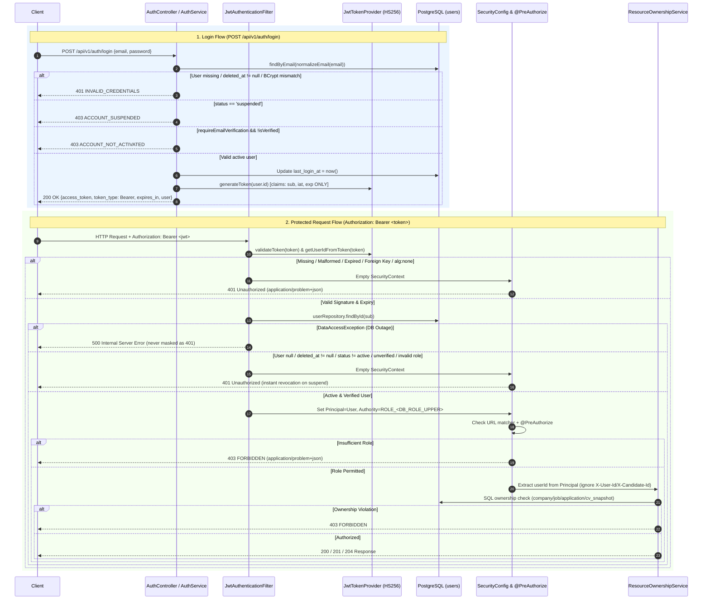

# MatchaJob – Security, JWT Flow, RBAC Matrix & Configuration Reference

> **Document Status:** Authoritative Security Reference (Synced 1-to-1 with Source Code & Spring Profiles)
> **Related Docs:** [`ERD_v2.md`](./ERD_v2.md) | [`Auth_API_Contract_v2.md`](./Auth_API_Contract_v2.md) | [`auth-rbac-security-report.md`](./qa/security-regression/auth-rbac-security-report.md)

---

## 1. JWT Authentication & Authorization Flow (`[VERIFIED]`)

Cơ chế xác thực của MatchaJob là **Stateless Bearer JWT (HS256)** kết hợp **Per-Request Database Principal Verification** (không tin cậy claim `role`/`email` từ token, không lưu `companyId` trong token, không dùng Refresh Token hay Redis blacklist):

---

## 2. Canonical API Paths & Complete RBAC + Ownership Matrix (`[VERIFIED]`)

- **Context Path:** `server.servlet.context-path: /api` (cấu hình tại `application.yml`).
- **14/16 Controllers** khai báo `@RequestMapping("/v1/...")` $\Rightarrow$ **Servlet Path** là `/v1/...`, **External HTTP URL** là `/api/v1/...`.
- **2 Controllers đặc biệt** (`TaxonomyController`, `StatsController`) khai báo `@RequestMapping("/api/v1/recruitment/...")` $\Rightarrow$ **Servlet Path** là `/api/v1/recruitment/...`, **External HTTP URL** thực tế trên Tomcat (đang được Frontend `apiAdminService.js` gọi) là **`/api/api/v1/recruitment/...`**.

| Controller | Method | Servlet Path (`SecurityConfig`) | External HTTP Path | Public | CANDIDATE | EMPLOYER | ADMIN | Cơ chế Kiểm soát Ownership & Mã lỗi thực tế |
| :--- | :--- | :--- | :--- | :---: | :---: | :---: | :---: | :--- |
| **Actuator** | `GET` | `/actuator/health/**` | `/api/actuator/health/**` | ✅ | ✅ | ✅ | ✅ | Health probes (`show-details: never` ở `prod`) |
| **SpringDoc** | `GET` | `/v3/api-docs/**`, `/swagger-ui/**` | `/api/v3/api-docs/**`, `/api/swagger-ui/**` | ✅ *(dev)* | ✅ *(dev)* | ✅ *(dev)* | ✅ *(dev)* | Tắt ở `prod` (`401` bởi deny-by-default) |
| **AuthController** | `POST` | `/v1/auth/register` | `/api/v1/auth/register` | ✅ | ✅ | ✅ | ✅ | Chỉ cho phép `CANDIDATE`/`EMPLOYER`; `ADMIN` $\rightarrow$ `400 INVALID_REGISTRATION_ROLE`; trùng email $\rightarrow$ `409` |
| **AuthController** | `POST` | `/v1/auth/login` | `/api/v1/auth/login` | ✅ | ✅ | ✅ | ✅ | Sai mật khẩu/soft-delete $\rightarrow$ `401 INVALID_CREDENTIALS`; bị khóa $\rightarrow$ **`403 ACCOUNT_SUSPENDED`**; chưa verify $\rightarrow$ **`403 ACCOUNT_NOT_ACTIVATED`** |
| **UserController** | `GET` | `/v1/users/me` | `/api/v1/users/me` | ❌ | ✅ | ✅ | ✅ | `authenticated()`; Employer kèm `companies[]` từ `company_members`; `401` nếu chưa auth/bị khóa |
| **UserController** | `PATCH` | `/v1/users/me` | `/api/v1/users/me` | ❌ | ✅ | ✅ | ✅ | `@PreAuthorize("isAuthenticated()")`; allowlist `fullName, phone, avatarUrl, timezone` (bỏ qua `role/status/email`) |
| **CandidateProfileController** | `GET`, `PATCH` | `/v1/candidates/profile` | `/api/v1/candidates/profile` | ❌ | ✅ | ❌ | ❌ | URL + `@PreAuthorize("hasRole('CANDIDATE')")`; tra cứu theo `principal.id`; `401`/`403`/`404` |
| **CompanyController** | `GET` | `/v1/companies/{id}` | `/api/v1/companies/{id}` | ✅ | ✅ | ✅ | ✅ | Public với UUID hex/dash; không tồn tại hoặc đã xóa mềm $\rightarrow$ **`400`** |
| **CompanyController** | `GET` | `/v1/companies`, `/v1/companies/me` | `/api/v1/companies`, `/api/v1/companies/me` | ❌ | ❌ | ✅ | ❌ | `@PreAuthorize("hasRole('EMPLOYER')")`; chỉ trả về công ty user sở hữu/tham gia |
| **CompanyController** | `POST` | `/v1/companies` | `/api/v1/companies` | ❌ | ❌ | ✅ | ❌ | Tạo atomic `Company` + `CompanyMember(owner)`; luôn gán `owner_id = principal`, `is_verified = false`; trùng MST $\rightarrow$ `409` |
| **CompanyController** | `PUT`, `PATCH` | `/v1/companies/{id}` | `/api/v1/companies/{id}` | ❌ | ❌ | ✅ *(Owner/Member)* | ❌ | `checkEmployerCompanyOwnership` chạy trước $\rightarrow$ **`403`** cho cả công ty người khác lẫn UUID không tồn tại |
| **JobController** | `GET` | `/v1/jobs` | `/api/v1/jobs` | ✅ | ✅ | ✅ | ✅ | Public tìm kiếm việc làm |
| **JobController** | `GET` | `/v1/jobs/{id}` | `/api/v1/jobs/{id}` | ❌ | ✅ | ✅ | ✅ | Yêu cầu JWT (`anyRequest().authenticated()`); `401` / `404` |
| **Category/SkillController** | `GET` | `/v1/categories`, `/v1/skills` | `/api/v1/categories`, `/api/v1/skills` | ✅ | ✅ | ✅ | ✅ | Public danh mục và kỹ năng |
| **TaxonomyController** | `GET` | `/api/v1/recruitment/taxonomies/**` | `/api/api/v1/recruitment/taxonomies/**` | ✅ | ✅ | ✅ | ✅ | Public đọc danh mục/kỹ năng/work-types/levels |
| **TaxonomyController** | `POST`, `DELETE` | `/api/v1/recruitment/taxonomies/**` | `/api/api/v1/recruitment/taxonomies/**` | ❌ | ❌ | ❌ | ✅ | `SecurityConfig`: `hasRole("ADMIN")`; `401` / `403` |
| **StatsController** | `GET` | `/api/v1/recruitment/stats/**` | `/api/api/v1/recruitment/stats/**` | ✅ | ✅ | ✅ | ✅ | Public thống kê tổng quan |
| **EmployerJobController** | `GET/POST/PUT/PATCH/DELETE` | `/v1/employer/jobs/**` | `/api/v1/employer/jobs/**` | ❌ | ❌ | ✅ *(Owner/Member)* | ❌ | `hasRole("EMPLOYER")` + `checkEmployerCompanyOwnership` / `checkEmployerJobOwnership`; sai owner $\rightarrow$ `403`, không tồn tại $\rightarrow$ `404` |
| **ApplicationController** | `POST` | `/v1/applications` | `/api/v1/applications` | ❌ | ✅ | ❌ | ❌ | `hasRole("CANDIDATE")` + `getRequiredCandidateProfileId(principal)`; bỏ qua header `X-Candidate-Id`/`X-User-Id` |
| **ApplicationController** | `GET` | `/v1/applications` | `/api/v1/applications` | ❌ | ✅ | ❌ | ❌ | `authenticated()` + `getRequiredCandidateProfileId(principal)` chặn non-candidate $\rightarrow$ `403` |
| **ApplicationController** | `GET` | `/v1/applications/{id}`, `.../history` | `/api/v1/applications/{id}`, `.../history` | ❌ | ✅ *(Chủ đơn)* | ✅ *(Chủ job)* | ❌ | `checkApplicationAccess`; sai owner $\rightarrow$ `403`, không tồn tại $\rightarrow$ `404` |
| **ApplicationController** | `PATCH` | `/v1/applications/{id}/stage` | `/api/v1/applications/{id}/stage` | ❌ | ❌ | ✅ *(Chủ job)* | ❌ | `hasRole("EMPLOYER")` + `checkEmployerApplicationOwnership`; `403` / `404` |
| **ApplicationController** | `GET` | `/v1/jobs/{jobId}/applications/**` | `/api/v1/jobs/{jobId}/applications/**` | ❌ | ❌ | ✅ *(Chủ job)* | ❌ | `hasRole("EMPLOYER")` + `checkEmployerJobOwnership`; `403` / `404` |
| **ApplicationController** | `GET` | `/v1/employer/applications/**` | `/api/v1/employer/applications/**` | ❌ | ❌ | ✅ *(Owner/Member)* | ❌ | `hasRole("EMPLOYER")` + ownership check; `403` / `404` |
| **InterviewController** | `GET/POST/PUT/PATCH/DELETE` | `/v1/interviews/**`, `/v1/employer/interviews/**` | `/api/v1/interviews/**`, `/api/v1/employer/interviews/**` | ❌ | ❌ | ✅ *(Owner/Member)* | ❌ | `hasRole("EMPLOYER")` + ownership check; sai owner $\rightarrow$ `403`; không tồn tại: `GET /{id}` $\rightarrow$ `404`, `PUT/PATCH/DELETE /{id}` $\rightarrow$ `400` |
| **CvController** | `POST/GET/PUT` | `/v1/candidates/{cid}/cv`, `.../active` | `/api/v1/candidates/{cid}/cv...` | ❌ | ✅ *(Chính chủ)* | ❌ | ❌ | `hasRole("CANDIDATE")` + `checkCandidateProfileOwnership`; `403` / `404` |
| **CvController** | `GET` | `/v1/candidates/{cid}/cv/{vid}`, `.../download` | `/api/v1/candidates/{cid}/cv/{vid}...` | ❌ | ✅ *(Chính chủ)* | ✅ *(Snapshot)* | ✅ *(Audit)* | Kiểm tra quyền trước khi tìm file (`403` chống dò quét UUID); Employer chỉ xem CV đã nộp trong `application_cv_snapshots`; Admin ghi `audit_logs` |
| **MatchController** | `POST`, `GET` | `/v1/applications/{id}/match` | `/api/v1/applications/{id}/match` | ❌ | ✅ *(Chủ đơn)* | ✅ *(Chủ job)* | ❌ | `checkApplicationAccess`; `403` / `404` |
| **ProcessingJobController** | `GET` | `/v1/processing-jobs/{id}` | `/api/v1/processing-jobs/{id}` | ❌ | ✅ *(Chủ entity)* | ✅ *(Chủ entity)* | ❌ | `checkProcessingJobAccess`; `403` / `404` |
| **AdminUserController** | `GET`, `PATCH`, `PUT` | `/v1/admin/users/**` | `/api/v1/admin/users/**` | ❌ | ❌ | ❌ | ✅ | `hasRole("ADMIN")`; chặn tự khóa (`400 SELF_SUSPEND_NOT_ALLOWED`) & khóa admin cuối (`400 LAST_ADMIN_PROTECTED`); ghi `audit_logs` |
| **AdminStatsController** | `GET` | `/v1/admin/stats/jobs` | `/api/v1/admin/stats/jobs` | ❌ | ❌ | ❌ | ✅ | `hasRole("ADMIN")`; `401` / `403` |

---

## 3. Profile & Security Configuration Matrix (`[VERIFIED]`)

| Property / Guard | `application.yml` (Base) | `dev` (`application-dev.yml`) | `prod` (`application-prod.yml`) | `test` (`application-test.yml`) |
| :--- | :--- | :--- | :--- | :--- |
| `security.jwt.secret` | *(unset)* | `${JWT_SECRET:<DEFAULT_DEV_SECRET>}` | `${JWT_SECRET}` *(bắt buộc khác default dev secret)* | `${JWT_SECRET:<DEFAULT_DEV_SECRET>}` |
| `security.jwt.expiration-ms` | `${JWT_EXPIRATION_MS:3600000}` | `3600000` (1h) | `3600000` (1h) | `3600000` (1h) |
| `app.auth.require-email-verification` | `${REQUIRE_EMAIL_VERIFICATION:true}` | `${REQUIRE_EMAIL_VERIFICATION:false}` | `${REQUIRE_EMAIL_VERIFICATION:true}` *(bắt buộc `true`)* | `false` |
| `app.seed.demo-users.enabled` | `false` | `${DEMO_SEED_ENABLED:false}` *(opt-in)* | `false` *(cứng + fail-closed)* | `false` |
| `springdoc.api-docs.enabled` | `false` (default) | `true` | `false` | `true` |
| `management.endpoint.health.show-details` | `when_authorized` | `always` | `never` | `always` |
| `SecurityProfileValidator` | Luôn chạy `@PostConstruct` | Chặn nếu `APP_ENV=prod` | Fail-fast nếu thiếu `APP_ENV=production`, tắt email verification, dùng default JWT secret, hoặc bật `app.seed.demo-users.enabled=true` | Cho phép chạy test cô lập |

---

## 4. Demo Accounts Catalog & Safe Opt-In Usage (`local` / `dev` / `demo` ONLY)

Mặc định `DemoAuthDataSeeder` **TẮT** (`DEMO_SEED_ENABLED=false`) ở tất cả các profile và bị chặn cứng 4 lớp ở `prod`/`staging`/`test`. Để kích hoạt trên môi trường local/demo:
1. Trong file `.env` cục bộ (nằm trong `.gitignore`, **không commit**), đặt `DEMO_SEED_ENABLED=true`.
2. Đặt 3 biến mật khẩu đủ mạnh (≥ 12 ký tự, ≤ 72 bytes UTF-8, có chữ hoa, chữ thường, chữ số, ký tự đặc biệt, không bắt đầu bằng `replace_with_`):
   - `DEMO_ADMIN_PASSWORD`
   - `DEMO_EMPLOYER_PASSWORD`
   - `DEMO_CANDIDATE_PASSWORD`

| Email Demo | Role | Trạng thái Khởi tạo | Dữ liệu Sở hữu Tự động Tạo | Biến Mật khẩu |
| :--- | :--- | :--- | :--- | :--- |
| `demo.admin@matchajob.vn` | `admin` | `active`, verified | `admin_permissions`: `MANAGE_USERS`, `MANAGE_TAXONOMIES`, `VIEW_STATS` | `DEMO_ADMIN_PASSWORD` |
| `demo.employer1@matchajob.vn` | `employer` | `active`, verified | Company `MatchaJob Enterprise Demo` (`0319000001`) + `company_members(owner)` | `DEMO_EMPLOYER_PASSWORD` |
| `demo.employer2@matchajob.vn` | `employer` | `active`, verified | Company `MatchaJob Partner Studio` (`0319000002`) + `company_members(owner)` | `DEMO_EMPLOYER_PASSWORD` |
| `demo.candidate1@matchajob.vn` | `candidate` | `active`, verified | `candidate_profiles` (*Senior Java Backend Developer*) | `DEMO_CANDIDATE_PASSWORD` |
| `demo.candidate2@matchajob.vn` | `candidate` | `active`, verified | `candidate_profiles` (*Frontend React Engineer*) | `DEMO_CANDIDATE_PASSWORD` |
| `demo.suspended@matchajob.vn` | `candidate` | `suspended`, verified | `candidate_profiles` (*Suspended Demo Account*) | `DEMO_CANDIDATE_PASSWORD` |

> **Cam kết An toàn Dữ liệu:** `DemoAuthDataSeeder` chạy idempotent và **không bao giờ ghi đè** `password_hash`, `role`, `status` hoặc `deleted_at` của tài khoản đã tồn tại trong CSDL.
