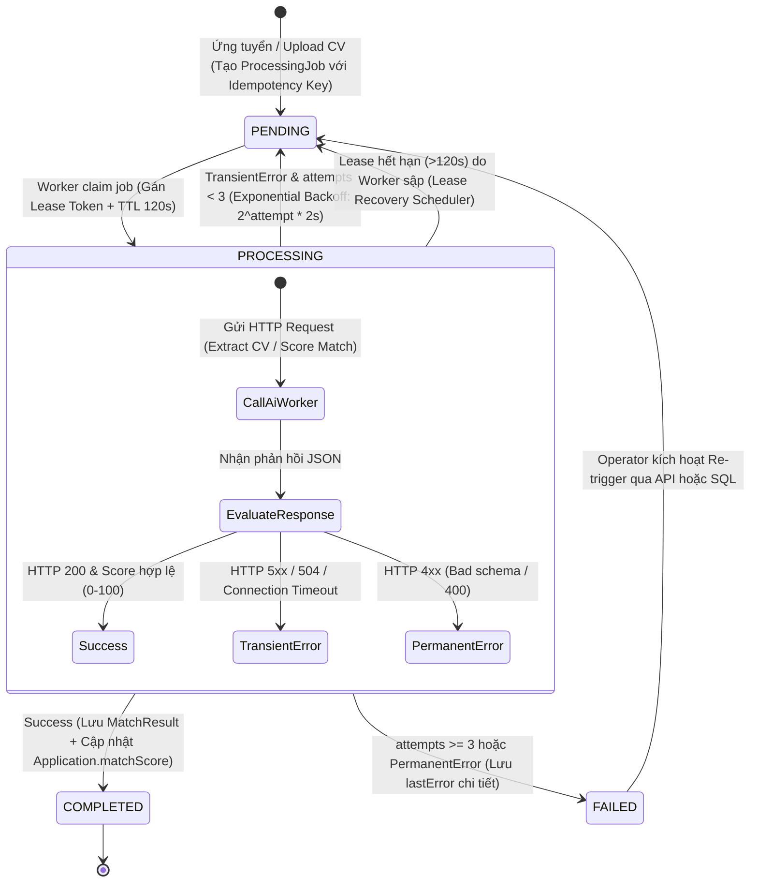

# SỔ TAY VẬN HÀNH & QUY TRÌNH PHỤC HỒI SỰ CỐ PIPELINE (RUNBOOK)
**MatchaJob Smart Recruitment Platform — System Reliability & Operations**  
**Tài liệu:** `docs/qa/pipeline-regression/pipeline-recovery-checklist.md`  
**Phiên bản:** 1.0.0 (Release Candidate)  
**Phạm vi:** CV Processing, AI Worker Integration, Application Matching & Ranking Pipeline

---

## 1. SƠ ĐỒ CHU TRÌNH TRẠNG THÁI VẬN HÀNH (STATE MACHINE DIAGRAM)

Quy trình xử lý bất đồng bộ giữa Backend và AI Worker tuân theo sơ đồ chuyển đổi trạng thái nghiêm ngặt dưới đây:



---

## 2. BẢNG NGUYÊN NHÂN SỰ CỐ THƯỜNG GẶP (FAILURE MATRIX)

| Triệu chứng | Mã lỗi / Biểu hiện | Nguyên nhân gốc rễ | Hậu quả trên hệ thống | Biện pháp xử lý tức thời |
| :--- | :--- | :--- | :--- | :--- |
| **AI Worker Timeout** | `ResourceAccessException` / `HTTP 504 Gateway Timeout` | AI Worker quá tải hoặc mô hình LLM suy luận quá 30 giây | ProcessingJob chuyển sang `FAILED` hoặc chờ retry; `Application.matchScore` tạm thời là `NULL` | Tự động retry sau backoff; kiểm tra tài nguyên container `ai-worker` |
| **Mất kết nối AI Worker** | `ConnectException` / `Connection refused` | Container `ai-worker` bị stop hoặc lỗi OOM kill | Job bị hoãn; không làm crash request nộp đơn của ứng viên | Khởi động lại container `ai-worker`; chạy lệnh hồi phục lease |
| **Job bị kẹt ở `PROCESSING`** | `status = 'PROCESSING'` nhưng `lease_expires_at < NOW()` | Worker bị dừng đột ngột giữa lúc đang xử lý HTTP | Job không hoàn thành, ứng viên không có điểm trên Dashboard | Kích hoạt `recoverExpiredLeases()` để đưa job về lại `PENDING` |
| **Nộp trùng lặp đồng thời** | `DataIntegrityViolationException: uq_application` | Ứng viên click đúp hoặc mạng lag gửi 2 request cùng lúc | Hệ thống bắt lỗi và trả về HTTP `409 Conflict` (không phát sinh bản ghi trùng) | Không cần can thiệp; client nhận thông báo "Bạn đã nộp đơn vào vị trí này" |
| **Callback / Retry trùng lặp** | `DataIntegrityViolationException: uq_match_application` | Client hoặc worker gửi request tính toán lại cho cùng application | Hệ thống kiểm tra idempotency và trả về kết quả `MatchResult` đã có | Đảm bảo tính toán idempotent; an toàn không sinh dữ liệu rác |

---

## 3. QUY TRÌNH XỬ LÝ SỰ CỐ TỪNG BƯỚC (STEP-BY-STEP TROUBLESHOOTING RUNBOOK)

### Quy trình 1: Khắc phục sự cố khi AI Worker bị sập hoặc mất kết nối
1. **Kiểm tra trạng thái container AI Worker:**
   ```bash
   docker compose ps ai-worker
   docker compose logs --tail=100 ai-worker
   ```
2. **Kiểm tra endpoint sức khỏe (Health Check):**
   ```bash
   curl -I http://localhost:8001/health
   # Kỳ vọng: HTTP/1.1 200 OK {"status":"ok","service":"ai-worker",...}
   ```
3. **Khởi động lại nếu container gặp sự cố:**
   ```bash
   docker compose restart ai-worker
   ```
4. **Kiểm tra các job bị gián đoạn:**
   ```sql
   SELECT id, job_type, entity_id, status, attempt_count, last_error
   FROM processing_jobs
   WHERE status = 'FAILED' AND updated_at > NOW() - INTERVAL '1 hour';
   ```

---

### Quy trình 2: Xử lý Processing Job bị treo quá hạn Lease (> 120 giây)
Khi worker bị kill giữa chừng, lease token không được giải phóng. Hệ thống có cơ chế tự động thu hồi nhưng quản trị viên có thể kích hoạt tức thời:

1. **Truy vấn danh sách job bị treo lease:**
   ```sql
   SELECT id, job_type, entity_id, lease_token, lease_expires_at
   FROM processing_jobs
   WHERE status = 'PROCESSING' AND lease_expires_at < NOW();
   ```
2. **Thu hồi lease thủ công bằng SQL (hoặc gọi Scheduled Service):**
   ```sql
   UPDATE processing_jobs
   SET status = 'PENDING',
       lease_token = NULL,
       lease_expires_at = NULL,
       retry_after = NOW(),
       updated_at = NOW()
   WHERE status = 'PROCESSING' AND lease_expires_at < NOW();
   ```
3. **Xác nhận số lượng job đã được khôi phục về hàng đợi `PENDING`.**

---

### Quy trình 3: Tái kích hoạt hàng loạt (Re-trigger) các Job thất bại
Sau khi sự cố AI Worker hoặc mạng được khắc phục, thực hiện tái xử lý các đơn ứng tuyển bị đánh dấu `FAILED`:

1. **Khôi phục trạng thái hàng loạt cho các đơn bị lỗi trong 24 giờ qua:**
   ```sql
   UPDATE processing_jobs
   SET status = 'PENDING',
       attempt_count = 0,
       lease_token = NULL,
       lease_expires_at = NULL,
       retry_after = NOW(),
       updated_at = NOW()
   WHERE status = 'FAILED'
     AND updated_at > NOW() - INTERVAL '24 hours';
   ```
2. **Theo dõi tiến trình xử lý:**
   ```sql
   SELECT status, COUNT(*) 
   FROM processing_jobs 
   GROUP BY status;
   ```

---

### Quy trình 4: Kiểm tra tính toàn vẹn dữ liệu giữa Applications và Match Results
Đảm bảo mọi đơn ứng tuyển hợp lệ đều có dữ liệu đối chiếu chính xác, không có bản ghi mồ côi:

1. **Phát hiện đơn ứng tuyển chưa có kết quả matching:**
   ```sql
   SELECT a.id AS application_id, a.candidate_id, a.job_id, a.applied_at, pj.status AS processing_status, pj.last_error
   FROM applications a
   LEFT JOIN match_results mr ON mr.application_id = a.id
   LEFT JOIN processing_jobs pj ON pj.entity_id = a.id AND pj.job_type = 'APPLICATION_MATCHING'
   WHERE mr.id IS NULL AND a.stage != 'rejected';
   ```
2. **Đồng bộ lại trường `match_score` trên bảng `applications` nếu bị lệch:**
   ```sql
   UPDATE applications a
   SET match_score = mr.overall_score,
       updated_at = NOW()
   FROM match_results mr
   WHERE mr.application_id = a.id
     AND (a.match_score IS NULL OR a.match_score != mr.overall_score);
   ```

---

## 4. BỘ CÂU LỆNH VẬN HÀNH NHANH (OPERATIONAL CLI CHEAT SHEET)

### 4.1. Kiểm tra sức khỏe hệ sinh thái dịch vụ
```bash
# Health check Backend
curl -s http://localhost:8081/api/actuator/health | jq .

# Health check AI Worker
curl -s http://localhost:8001/health | jq .

# Xem log các job đang xử lý gần nhất trên Backend
docker compose logs --tail=50 backend | grep -E "(ProcessingJob|MatchingService|Application)"
```

### 4.2. Kích hoạt tính điểm trực tiếp qua API (Manual Match Trigger)
```bash
# Yêu cầu JWT token của Employer sở hữu Job hoặc Admin
curl -X POST "http://localhost:8081/api/v1/applications/{applicationId}/match" \
     -H "Authorization: Bearer <EMPLOYER_JWT_TOKEN>" \
     -H "Content-Type: application/json"
```

### 4.3. Kiểm tra kết quả xếp hạng ứng viên của một tin tuyển dụng
```bash
curl -X GET "http://localhost:8081/api/v1/jobs/{jobId}/applications/ranking" \
     -H "Authorization: Bearer <EMPLOYER_JWT_TOKEN>" | jq .
```

---

## 5. DANH MỤC KIỂM TRA TRƯỚC KHI DEMO HỘI ĐỒNG (PRE-DEMO CHECKLIST)

- [x] Cơ sở dữ liệu PostgreSQL đã chạy migration đầy đủ đến Flyway `V7`.
- [x] Script dữ liệu seed tái lập `scripts/seed-pipeline-regression.sql` đã sẵn sàng để reset/seed khi cần.
- [x] Backend kết nối thành công với AI Worker qua mạng nội bộ Docker (`http://ai-worker:8000`).
- [x] Toàn bộ 104 integration & regression tests đạt kết quả **100% PASS**.
- [x] Bảng xếp hạng ứng viên thể hiện rõ ràng thứ tự điểm cao đứng đầu, hòa điểm ưu tiên nộp trước, hồ sơ chưa chấm điểm nằm ở cuối.
- [x] Giao diện không bị crash khi AI Worker phản hồi chậm hoặc tạm thời mất kết nối (giao diện hiển thị trạng thái chờ tải hoặc nút thử lại).
